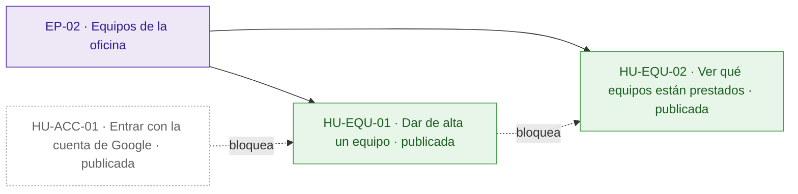
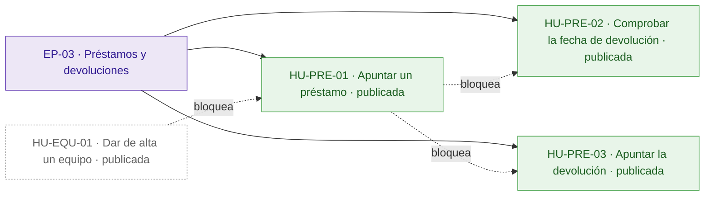
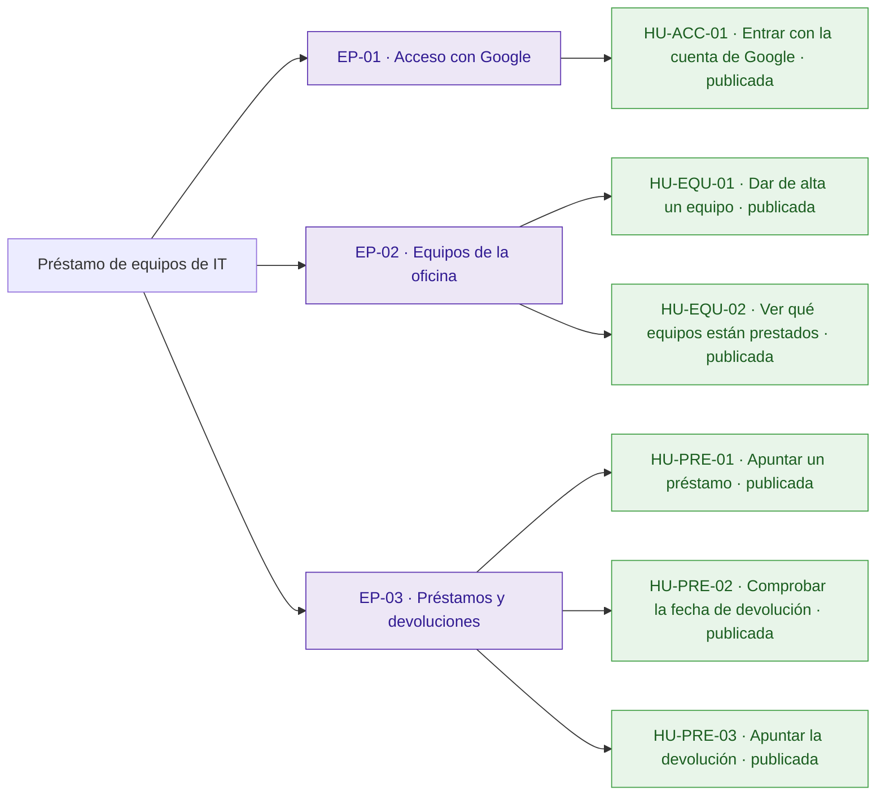
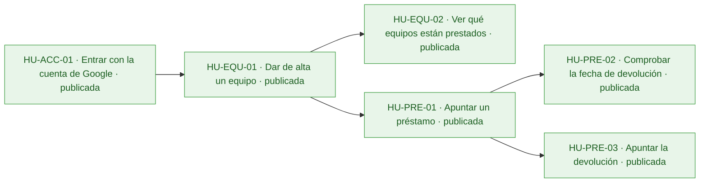
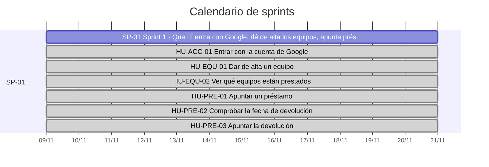
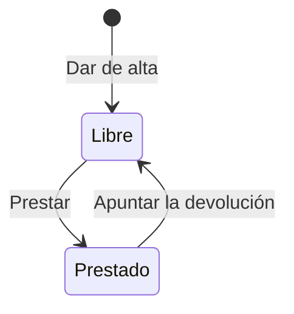

# Préstamo de equipos de IT

Hoy IT apunta los préstamos de equipos en una hoja de cálculo que nadie mantiene al día: no sabe qué equipos están prestados ni a quién, y cada pocos meses se pierde alguno o alguien se queda sin portátil porque se creía que estaba libre.

La aplicación da a IT, que entra con su cuenta de Google de la empresa, una lista de equipos donde dar de alta cada uno, apuntar sus préstamos y devoluciones y ver en todo momento qué está prestado, a quién y hasta cuándo. El inventario de IT se conecta a ella con una cuenta de servicio, así que la API tiene que ser exactamente la del anexo. Quedan fuera las peticiones de los empleados y los avisos de préstamos vencidos. El proyecto se da por bueno si durante el primer mes todos los préstamos se apuntan en la aplicación y no se pierde ningún equipo.

## Visión y alcance

Que IT apunte a quién ha prestado cada equipo de la oficina y cuándo lo devuelve, y vea en todo momento qué equipos están prestados, a quién y hasta cuándo.

**Dentro del alcance**

- Dar de alta un equipo con su nombre, por ejemplo «Portátil 07» o «Proyector sala 2» (peticion.md).
- Rechazar el alta de un equipo sin nombre o con un nombre que ya existe; dos nombres son el mismo si solo se diferencian en mayúsculas o en espacios al principio o al final (peticion.md).
- Apuntar el préstamo de un equipo con la persona y la fecha en que lo tiene que devolver (peticion.md).
- Rechazar un préstamo sin persona o sin fecha, con una fecha que no existe, de un equipo que no existe o de un equipo ya prestado; la fecha va como \`AAAA-MM-DD\` y se acepta una fecha pasada, porque IT a veces apunta los préstamos con retraso (peticion.md).
- Apuntar la devolución de un equipo cuando lo devuelven; se rechaza si el equipo no existe o no está prestado (peticion.md).
- Ver en todo momento todos los equipos, si están prestados y, si lo están, a quién y hasta cuándo (peticion.md).

**Fuera del alcance**

- Que los empleados pidan equipos desde la aplicación (peticion.md).
- Avisos de préstamos vencidos (peticion.md).
- Por ahora, limitar el acceso a las cuentas de IT (peticion.md).

## Resumen en cifras

| Dato | Valor |
| --- | --- |
| Épicas | 3 |
| Historias | 6 |
| Historias por estado | borrador 0, aprobada 0, descartada 0, publicada 6 |
| Tareas | 20 |
| Sprints | 1 |
| Personas en el equipo | 1 |
| Modalidad de desarrollo | manual, sin IA |
| Horas estimadas | 24 h |
| Horas efectivas (según la modalidad de desarrollo) | 24 h |
| Historias sin estimar | 0 |
| Historias descartadas (fuera de las horas) | 0 |
| Supuestos | 13 |
| Preguntas abiertas | 5 |
| Requisitos | 8 |
| Requisitos sin historia | 0 |

## Índice

- [Visión y alcance](#visión-y-alcance)
- [Resumen en cifras](#resumen-en-cifras)
- [Épicas e historias](#épicas-e-historias)
  - [EP-01 · Acceso con Google](#ep-01--acceso-con-google)
  - [EP-02 · Equipos de la oficina](#ep-02--equipos-de-la-oficina)
  - [EP-03 · Préstamos y devoluciones](#ep-03--préstamos-y-devoluciones)
- [Tareas](#tareas)
- [Sprints](#sprints)
- [Equipo](#equipo)
- [Dependencias](#dependencias)
- [Requisitos y trazabilidad](#requisitos-y-trazabilidad)
- [Preparación y definición de hecho](#preparación-y-definición-de-hecho)
- [Diagramas](#diagramas)
- [Supuestos](#supuestos)
- [Preguntas abiertas](#preguntas-abiertas)
- [Decisiones](#decisiones)

## Épicas e historias

### EP-01 · Acceso con Google

Exige iniciar sesión con Google en todas las rutas de la aplicación, tanto a los técnicos de IT con su cuenta de la empresa como al inventario de IT con su cuenta de servicio. Por ahora no limita el acceso a las cuentas de IT.

#### Épica EP-01: Acceso con Google

#### HU-ACC-01 · Entrar con la cuenta de Google

Como técnico de IT, quiero entrar en la aplicación con mi cuenta de Google de la empresa, para que nadie sin sesión iniciada pueda ver ni cambiar los préstamos.

**Contexto.** Cubre RQ.007 (peticion.md): todas las rutas necesitan haber iniciado sesión y vale el token de identidad de Google, con el correo verificado, emitido para el cliente OAuth de la aplicación, de una persona o de una cuenta de servicio.

- **Prioridad:** Highest
- **Tamaño:** L
- **Horas:** 8 h estimadas · 8 h efectivas
- **Estado:** publicada
- **Sprint:** SP-01 Sprint 1
- **Responsable:** José Luis Calvo
- **Tipo:** historia
- **Puntos de historia:** 5
- **Preparación:** parcialmente lista (pendiente: DoR-08: dependencias externas sin plan confirmado: Cliente OAuth de la aplicación en Google; Cuenta de servicio de Google del inventario de IT · supuestos sin confirmar: DoR-04, DoR-05, DoR-06, DoR-07, DoR-09)
- **Requisitos:** RQ.007, RQ.008
- **Dependencias externas:** Cliente OAuth de la aplicación en Google; Cuenta de servicio de Google del inventario de IT

**Criterios de aceptación**

*Escenarios positivos*

1. **Dado** un técnico de IT con un token de identidad de Google de «tecnico@empresa.example», con el correo verificado y emitido para el cliente OAuth de la aplicación, **cuando** pide GET /api/equipos, **entonces** recibe 200 con la lista de equipos.
2. **Dado** el inventario de IT con un token de identidad de Google de su cuenta de servicio, con el correo verificado y emitido para el cliente OAuth de la aplicación, **cuando** pide GET /api/equipos, **entonces** recibe 200 con la lista de equipos.

*Escenarios negativos*

1. **Dado** una petición sin token, **cuando** pide POST /api/equipos con {"nombre": "Portátil 07"}, **entonces** recibe 401 con {"error": "Inicia sesión con Google."} y no se crea ningún equipo.
2. **Dado** un token de identidad de Google de «tecnico@empresa.example» emitido para otro cliente OAuth, **cuando** pide GET /api/equipos, **entonces** recibe 401 con {"error": "Inicia sesión con Google."}.
3. **Dado** un token de identidad de Google emitido para el cliente OAuth de la aplicación, de una cuenta con el correo sin verificar, **cuando** pide GET /api/equipos, **entonces** recibe 401 con {"error": "Inicia sesión con Google."}.

**Notas.** Por ahora no se limita el acceso a las cuentas de IT; cuándo y cómo limitarlo sigue como pregunta abierta. La pantalla de inicio de sesión depende del supuesto de que IT usa una interfaz web.

**Definición de hecho**

- Criterios de aceptación probados.
- Respuestas y mensaje de error idénticos a los del anexo de la API.
- Textos revisados en español de España.

**Tareas**

- TA-001 · Validación del token de identidad de Google en todas las rutas · backend · José Luis Calvo
- TA-002 · Inicio de sesión con Google en la interfaz de IT · frontend · José Luis Calvo
- TA-003 · Pruebas con token de persona, de cuenta de servicio, de otro cliente, sin verificar y sin token · QA · José Luis Calvo

### EP-02 · Equipos de la oficina

Permite a IT dar de alta los equipos de la oficina, como «Portátil 07» o «Proyector sala 2», y ver en todo momento cuáles están prestados, a quién y hasta cuándo. Los préstamos y las devoluciones van en la épica EP-03 Préstamos y devoluciones.

#### Épica EP-02: Equipos de la oficina

#### HU-EQU-01 · Dar de alta un equipo

Como técnico de IT, quiero dar de alta un equipo de la oficina con su nombre, para que cada portátil o proyector figure en la lista antes de prestarlo.

**Contexto.** Cubre RQ.001 y RQ.002 (peticion.md): IT da de alta los equipos, y dos nombres son el mismo si solo se diferencian en mayúsculas o en espacios al principio o al final.

- **Prioridad:** Highest
- **Tamaño:** M
- **Horas:** 4 h estimadas · 4 h efectivas
- **Estado:** publicada
- **Sprint:** SP-01 Sprint 1
- **Responsable:** José Luis Calvo
- **Tipo:** historia
- **Puntos de historia:** 3
- **Preparación:** parcialmente lista (pendiente: DoR-08: depende de HU-ACC-01, sin resolver ni planificada en un sprint anterior · supuestos sin confirmar: DoR-04, DoR-05, DoR-06, DoR-07, DoR-09)
- **Requisitos:** RQ.001, RQ.002, RQ.008
- **Depende de:**
  - HU-ACC-01 · Entrar con la cuenta de Google: Todas las rutas exigen haber iniciado sesión con Google.

**Criterios de aceptación**

*Escenarios positivos*

1. **Dado** un técnico de IT con sesión iniciada y ningún equipo llamado «Portátil 07», **cuando** envía POST /api/equipos con {"nombre": "Portátil 07"}, **entonces** recibe 201 con el id nuevo, "nombre": "Portátil 07" y "prestado": false, y «Portátil 07» aparece en GET /api/equipos.

*Escenarios negativos*

1. **Dado** un técnico de IT con sesión iniciada, **cuando** envía POST /api/equipos con {"nombre": ""}, **entonces** recibe 400 con {"error": "Falta el nombre del equipo"} y no se crea ningún equipo.
2. **Dado** un técnico de IT con sesión iniciada, **cuando** envía POST /api/equipos con {}, **entonces** recibe 400 con {"error": "Falta el nombre del equipo"} y no se crea ningún equipo.
3. **Dado** un técnico de IT con sesión iniciada y el equipo «Portátil 07» ya dado de alta, **cuando** envía POST /api/equipos con {"nombre": " portátil 07 "}, **entonces** recibe 409 con {"error": "Ya hay un equipo con ese nombre"} y sigue habiendo un solo «Portátil 07».

**Notas.** Editar, renombrar o dar de baja equipos no está en el alcance y sigue como pregunta abierta.

**Definición de hecho**

- Criterios de aceptación probados.
- Respuestas y mensajes de error idénticos a los del anexo de la API.
- Textos revisados en español de España.

**Tareas**

- TA-004 · Modelo de equipos con nombre único sin distinguir mayúsculas ni espacios al principio o al final · datos · José Luis Calvo
- TA-005 · Endpoint POST /api/equipos con sus errores · backend · José Luis Calvo
- TA-006 · Formulario de alta de equipos · frontend · José Luis Calvo
- TA-007 · Pruebas del alta, del nombre vacío y del nombre repetido · QA · José Luis Calvo

#### HU-EQU-02 · Ver qué equipos están prestados

Como técnico de IT, quiero ver todos los equipos y, de los prestados, a quién y hasta cuándo, para saber si un portátil está libre antes de comprometerlo con alguien.

**Contexto.** Cubre RQ.006 (peticion.md): IT ve en todo momento qué equipos están prestados, a quién y hasta cuándo. Hoy no lo sabe y alguien se queda sin portátil porque se creía que estaba libre.

- **Prioridad:** Highest
- **Tamaño:** M
- **Horas:** 4 h estimadas · 4 h efectivas
- **Estado:** publicada
- **Sprint:** SP-01 Sprint 1
- **Responsable:** José Luis Calvo
- **Tipo:** historia
- **Puntos de historia:** 3
- **Preparación:** parcialmente lista (pendiente: DoR-08: depende de HU-EQU-01, sin resolver ni planificada en un sprint anterior · supuestos sin confirmar: DoR-04, DoR-05, DoR-06, DoR-07, DoR-09)
- **Requisitos:** RQ.006, RQ.008
- **Depende de:**
  - HU-EQU-01 · Dar de alta un equipo: La lista muestra los equipos dados de alta.

**Criterios de aceptación**

*Escenarios positivos*

1. **Dado** «Portátil 07» prestado a «Ana Pérez» hasta el 2026-11-20 y «Proyector sala 2» sin prestar, **cuando** un técnico de IT con sesión iniciada pide GET /api/equipos, **entonces** recibe 200 con «Portátil 07» con "prestado": true, "persona": "Ana Pérez" y "devolucion": "2026-11-20", y «Proyector sala 2» con "prestado": false y sin persona ni devolucion.
2. **Dado** ningún equipo dado de alta, **cuando** un técnico de IT con sesión iniciada pide GET /api/equipos, **entonces** recibe 200 con la lista vacía \[\].

*Escenarios negativos*

1. **Dado** «Portátil 07» prestado a «Ana Pérez» y una petición sin token, **cuando** pide GET /api/equipos, **entonces** recibe 401 con {"error": "Inicia sesión con Google."} y no ve ningún equipo ni a quién está prestado.

**Definición de hecho**

- Criterios de aceptación probados.
- Respuestas idénticas a las del anexo de la API.
- Textos revisados en español de España.

**Tareas**

- TA-008 · Endpoint GET /api/equipos con persona y devolucion de los prestados · backend · José Luis Calvo
- TA-009 · Lista de equipos con su estado de préstamo · frontend · José Luis Calvo
- TA-010 · Pruebas de la lista con equipos prestados, libres y vacía · QA · José Luis Calvo

### EP-03 · Préstamos y devoluciones

Permite a IT apuntar cada préstamo con la persona y la fecha de devolución, y apuntar la devolución cuando le devuelven el equipo. Quedan fuera las peticiones de los empleados desde la aplicación y los avisos de préstamos vencidos.

#### Épica EP-03: Préstamos y devoluciones

#### HU-PRE-01 · Apuntar un préstamo

Como técnico de IT, quiero apuntar el préstamo de un equipo con la persona y la fecha en que lo tiene que devolver, para saber en todo momento quién tiene cada equipo y no perder ninguno.

**Contexto.** Cubre RQ.003 y parte de RQ.004 (peticion.md): IT apunta cada préstamo con la persona y la fecha en que lo tiene que devolver. La validación de la fecha va en HU-PRE-02.

- **Prioridad:** Highest
- **Tamaño:** M
- **Horas:** 4 h estimadas · 4 h efectivas
- **Estado:** publicada
- **Sprint:** SP-01 Sprint 1
- **Responsable:** José Luis Calvo
- **Tipo:** historia
- **Puntos de historia:** 3
- **Preparación:** parcialmente lista (pendiente: DoR-08: depende de HU-EQU-01, sin resolver ni planificada en un sprint anterior · supuestos sin confirmar: DoR-04, DoR-05, DoR-06, DoR-07, DoR-09)
- **Requisitos:** RQ.003, RQ.004, RQ.008
- **Depende de:**
  - HU-EQU-01 · Dar de alta un equipo: Solo se presta un equipo dado de alta.

**Criterios de aceptación**

*Escenarios positivos*

1. **Dado** un técnico de IT con sesión iniciada y «Portátil 07» sin prestar, **cuando** envía POST /api/equipos/{id de Portátil 07}/prestamo con {"persona": "Ana Pérez", "devolucion": "2026-11-20"}, **entonces** recibe 201 con el id, "nombre": "Portátil 07", "prestado": true, "persona": "Ana Pérez" y "devolucion": "2026-11-20".

*Escenarios negativos*

1. **Dado** un técnico de IT con sesión iniciada y «Portátil 07» sin prestar, **cuando** envía POST /api/equipos/{id de Portátil 07}/prestamo con {"devolucion": "2026-11-20"}, **entonces** recibe 400 con {"error": "Faltan la persona o la fecha de devolución"} y «Portátil 07» sigue sin prestar.
2. **Dado** un técnico de IT con sesión iniciada y «Portátil 07» sin prestar, **cuando** envía POST /api/equipos/{id de Portátil 07}/prestamo con {"persona": "Ana Pérez"}, **entonces** recibe 400 con {"error": "Faltan la persona o la fecha de devolución"} y «Portátil 07» sigue sin prestar.
3. **Dado** un técnico de IT con sesión iniciada y ningún equipo con el id «no-existe», **cuando** envía POST /api/equipos/no-existe/prestamo con {"persona": "Ana Pérez", "devolucion": "2026-11-20"}, **entonces** recibe 404 con {"error": "No existe el equipo"}.
4. **Dado** un técnico de IT con sesión iniciada y «Portátil 07» prestado a «Ana Pérez» hasta el 2026-11-20, **cuando** envía POST /api/equipos/{id de Portátil 07}/prestamo con {"persona": "Luis Gómez", "devolucion": "2026-11-27"}, **entonces** recibe 409 con {"error": "El equipo ya está prestado"} y «Portátil 07» sigue prestado a «Ana Pérez» hasta el 2026-11-20.

**Notas.** IT dejará de usar la aplicación si apuntar un préstamo cuesta más de un minuto (riesgo de peticion.md). Dónde se mide ese minuto sigue como pregunta abierta.

**Definición de hecho**

- Criterios de aceptación probados.
- Respuestas y mensajes de error idénticos a los del anexo de la API.
- Textos revisados en español de España.

**Tareas**

- TA-011 · Datos del préstamo en curso de cada equipo · datos · José Luis Calvo
- TA-012 · Endpoint POST /api/equipos/{id}/prestamo con sus errores · backend · José Luis Calvo
- TA-013 · Formulario de préstamo con persona y fecha de devolución · frontend · José Luis Calvo
- TA-014 · Pruebas del préstamo, de la persona o la fecha que faltan, del equipo inexistente y del ya prestado · QA · José Luis Calvo

#### HU-PRE-02 · Comprobar la fecha de devolución

Como técnico de IT, quiero apuntar un préstamo con una fecha de devolución pasada y corregir una fecha que no existe, para no dejar un préstamo con una fecha imposible y poder apuntar con retraso los que se olvidaron.

**Contexto.** Cubre la parte de RQ.004 sobre la fecha (peticion.md): va como texto AAAA-MM-DD, se devuelve igual, tiene que existir («2026-02-30» no vale) y se acepta una fecha pasada, porque IT a veces apunta los préstamos con retraso.

- **Prioridad:** Highest
- **Tamaño:** S
- **Horas:** 2 h estimadas · 2 h efectivas
- **Estado:** publicada
- **Sprint:** SP-01 Sprint 1
- **Responsable:** José Luis Calvo
- **Tipo:** historia
- **Puntos de historia:** 2
- **Preparación:** parcialmente lista (pendiente: DoR-08: depende de HU-PRE-01, sin resolver ni planificada en un sprint anterior · supuestos sin confirmar: DoR-04, DoR-05, DoR-06, DoR-07, DoR-09)
- **Requisitos:** RQ.004, RQ.008
- **Depende de:**
  - HU-PRE-01 · Apuntar un préstamo: La fecha se comprueba al apuntar un préstamo.

**Criterios de aceptación**

*Escenarios positivos*

1. **Dado** un técnico de IT con sesión iniciada el 2 de noviembre de 2026 y «Portátil 07» sin prestar, **cuando** envía POST /api/equipos/{id de Portátil 07}/prestamo con {"persona": "Ana Pérez", "devolucion": "2026-10-30"}, **entonces** recibe 201 con "prestado": true, "persona": "Ana Pérez" y "devolucion": "2026-10-30".

*Escenarios negativos*

1. **Dado** un técnico de IT con sesión iniciada y «Portátil 07» sin prestar, **cuando** envía POST /api/equipos/{id de Portátil 07}/prestamo con {"persona": "Ana Pérez", "devolucion": "2026-02-30"}, **entonces** recibe 400 con {"error": "La fecha de devolución no es válida"} y «Portátil 07» sigue sin prestar.

**Notas.** Qué respuesta recibe una fecha en otro formato, como «20/11/2026», sigue como pregunta abierta.

**Definición de hecho**

- Criterios de aceptación probados.
- Respuestas y mensajes de error idénticos a los del anexo de la API.
- Textos revisados en español de España.

**Tareas**

- TA-015 · Comprobación de que la fecha AAAA-MM-DD existe · backend · José Luis Calvo
- TA-016 · Mensaje de fecha no válida en el formulario de préstamo · frontend · José Luis Calvo
- TA-017 · Pruebas de fechas pasadas, inexistentes y de su devolución sin cambios · QA · José Luis Calvo

#### HU-PRE-03 · Apuntar la devolución

Como técnico de IT, quiero apuntar la devolución de un equipo cuando me lo devuelven, para que el equipo vuelva a figurar como libre y se pueda prestar a otra persona.

**Contexto.** Cubre RQ.005 (peticion.md): IT apunta la devolución cuando le devuelven el equipo.

- **Prioridad:** Highest
- **Tamaño:** S
- **Horas:** 2 h estimadas · 2 h efectivas
- **Estado:** publicada
- **Sprint:** SP-01 Sprint 1
- **Responsable:** José Luis Calvo
- **Tipo:** historia
- **Puntos de historia:** 2
- **Preparación:** parcialmente lista (pendiente: DoR-08: depende de HU-PRE-01, sin resolver ni planificada en un sprint anterior · supuestos sin confirmar: DoR-04, DoR-05, DoR-06, DoR-07, DoR-09)
- **Requisitos:** RQ.005, RQ.008
- **Depende de:**
  - HU-PRE-01 · Apuntar un préstamo: Solo se devuelve un equipo prestado.

**Criterios de aceptación**

*Escenarios positivos*

1. **Dado** un técnico de IT con sesión iniciada y «Portátil 07» prestado a «Ana Pérez» hasta el 2026-11-20, **cuando** envía POST /api/equipos/{id de Portátil 07}/devolucion, **entonces** recibe 200 con el equipo «Portátil 07» y "prestado": false, y en GET /api/equipos aparece sin persona ni devolucion.

*Escenarios negativos*

1. **Dado** un técnico de IT con sesión iniciada y «Proyector sala 2» sin prestar, **cuando** envía POST /api/equipos/{id de Proyector sala 2}/devolucion, **entonces** recibe 409 con {"error": "El equipo no está prestado"}.
2. **Dado** un técnico de IT con sesión iniciada y ningún equipo con el id «no-existe», **cuando** envía POST /api/equipos/no-existe/devolucion, **entonces** recibe 404 con {"error": "No existe el equipo"}.

**Notas.** Si se guarda el historial de préstamos sigue como pregunta abierta; los criterios no dependen de ello.

**Definición de hecho**

- Criterios de aceptación probados.
- Respuestas y mensajes de error idénticos a los del anexo de la API.
- Textos revisados en español de España.

**Tareas**

- TA-018 · Endpoint POST /api/equipos/{id}/devolucion con sus errores · backend · José Luis Calvo
- TA-019 · Acción de apuntar la devolución en la lista de equipos · frontend · José Luis Calvo
- TA-020 · Pruebas de la devolución, del equipo sin prestar y del inexistente · QA · José Luis Calvo

## Tareas

| ID | Título | Historia | Disciplina | Descripción | Responsable | Horas estimadas | Horas efectivas |
| --- | --- | --- | --- | --- | --- | --- | --- |
| TA-001 | Validación del token de identidad de Google en todas las rutas | HU-ACC-01 · Entrar con la cuenta de Google | backend |   | José Luis Calvo |   |   |
| TA-002 | Inicio de sesión con Google en la interfaz de IT | HU-ACC-01 · Entrar con la cuenta de Google | frontend |   | José Luis Calvo |   |   |
| TA-003 | Pruebas con token de persona, de cuenta de servicio, de otro cliente, sin verificar y sin token | HU-ACC-01 · Entrar con la cuenta de Google | QA |   | José Luis Calvo |   |   |
| TA-004 | Modelo de equipos con nombre único sin distinguir mayúsculas ni espacios al principio o al final | HU-EQU-01 · Dar de alta un equipo | datos |   | José Luis Calvo |   |   |
| TA-005 | Endpoint POST /api/equipos con sus errores | HU-EQU-01 · Dar de alta un equipo | backend |   | José Luis Calvo |   |   |
| TA-006 | Formulario de alta de equipos | HU-EQU-01 · Dar de alta un equipo | frontend |   | José Luis Calvo |   |   |
| TA-007 | Pruebas del alta, del nombre vacío y del nombre repetido | HU-EQU-01 · Dar de alta un equipo | QA |   | José Luis Calvo |   |   |
| TA-008 | Endpoint GET /api/equipos con persona y devolucion de los prestados | HU-EQU-02 · Ver qué equipos están prestados | backend |   | José Luis Calvo |   |   |
| TA-009 | Lista de equipos con su estado de préstamo | HU-EQU-02 · Ver qué equipos están prestados | frontend |   | José Luis Calvo |   |   |
| TA-010 | Pruebas de la lista con equipos prestados, libres y vacía | HU-EQU-02 · Ver qué equipos están prestados | QA |   | José Luis Calvo |   |   |
| TA-011 | Datos del préstamo en curso de cada equipo | HU-PRE-01 · Apuntar un préstamo | datos |   | José Luis Calvo |   |   |
| TA-012 | Endpoint POST /api/equipos/{id}/prestamo con sus errores | HU-PRE-01 · Apuntar un préstamo | backend |   | José Luis Calvo |   |   |
| TA-013 | Formulario de préstamo con persona y fecha de devolución | HU-PRE-01 · Apuntar un préstamo | frontend |   | José Luis Calvo |   |   |
| TA-014 | Pruebas del préstamo, de la persona o la fecha que faltan, del equipo inexistente y del ya prestado | HU-PRE-01 · Apuntar un préstamo | QA |   | José Luis Calvo |   |   |
| TA-015 | Comprobación de que la fecha AAAA-MM-DD existe | HU-PRE-02 · Comprobar la fecha de devolución | backend |   | José Luis Calvo |   |   |
| TA-016 | Mensaje de fecha no válida en el formulario de préstamo | HU-PRE-02 · Comprobar la fecha de devolución | frontend |   | José Luis Calvo |   |   |
| TA-017 | Pruebas de fechas pasadas, inexistentes y de su devolución sin cambios | HU-PRE-02 · Comprobar la fecha de devolución | QA |   | José Luis Calvo |   |   |
| TA-018 | Endpoint POST /api/equipos/{id}/devolucion con sus errores | HU-PRE-03 · Apuntar la devolución | backend |   | José Luis Calvo |   |   |
| TA-019 | Acción de apuntar la devolución en la lista de equipos | HU-PRE-03 · Apuntar la devolución | frontend |   | José Luis Calvo |   |   |
| TA-020 | Pruebas de la devolución, del equipo sin prestar y del inexistente | HU-PRE-03 · Apuntar la devolución | QA |   | José Luis Calvo |   |   |

## Sprints

| Sprint | Fechas | Objetivo | Historias | Capacidad (h) | Carga (h efectivas) |
| --- | --- | --- | --- | --- | --- |
| SP-01 Sprint 1 | del 09/11/2026 al 20/11/2026 | Que IT entre con Google, dé de alta los equipos, apunte préstamos y devoluciones y vea qué está prestado, a quién y hasta cuándo. | 6 | 56 h | 24 h · 43 % |

Historias sin sprint: 0.

## Equipo

| Nombre | Rol | Dedicación | Usa un agente de IA |
| --- | --- | --- | --- |
| José Luis Calvo | Desarrollo | 100 % | sí |

*Por privacidad, este documento no incluye correos electrónicos ni usuarios de GitHub o Trello.*

## Dependencias

| Historia | Bloqueada por | Motivo |
| --- | --- | --- |
| HU-EQU-01 · Dar de alta un equipo | HU-ACC-01 · Entrar con la cuenta de Google | Todas las rutas exigen haber iniciado sesión con Google. |
| HU-EQU-02 · Ver qué equipos están prestados | HU-EQU-01 · Dar de alta un equipo | La lista muestra los equipos dados de alta. |
| HU-PRE-01 · Apuntar un préstamo | HU-EQU-01 · Dar de alta un equipo | Solo se presta un equipo dado de alta. |
| HU-PRE-02 · Comprobar la fecha de devolución | HU-PRE-01 · Apuntar un préstamo | La fecha se comprueba al apuntar un préstamo. |
| HU-PRE-03 · Apuntar la devolución | HU-PRE-01 · Apuntar un préstamo | Solo se devuelve un equipo prestado. |

## Requisitos y trazabilidad

| Requisito | Título | Tipo | Origen | Historias | Cobertura |
| --- | --- | --- | --- | --- | --- |
| RQ.001 | Dar de alta un equipo con su nombre | Funcional | peticion.md | HU-EQU-01 | cubierto |
| RQ.002 | Rechazar el alta de un equipo sin nombre o con un nombre que ya existe, sin distinguir mayúsculas ni espacios al principio o al final | Funcional | peticion.md | HU-EQU-01 | cubierto |
| RQ.003 | Apuntar el préstamo de un equipo con la persona y la fecha en que lo tiene que devolver | Funcional | peticion.md | HU-PRE-01 | cubierto |
| RQ.004 | Rechazar un préstamo sin persona o sin fecha, con una fecha que no existe, de un equipo que no existe o ya prestado; se acepta una fecha pasada | Funcional | peticion.md | HU-PRE-01, HU-PRE-02 | cubierto |
| RQ.005 | Apuntar la devolución de un equipo; se rechaza si no existe o no está prestado | Funcional | peticion.md | HU-PRE-03 | cubierto |
| RQ.006 | Ver todos los equipos, si están prestados y, si lo están, a quién y hasta cuándo | Funcional | peticion.md | HU-EQU-02 | cubierto |
| RQ.007 | Todas las rutas exigen un token de identidad de Google válido, con el correo verificado y emitido para el cliente OAuth de la aplicación, de persona o de cuenta de servicio; sin él, 401 «Inicia sesión con Google.» | No funcional: seguridad | peticion.md | HU-ACC-01 | cubierto |
| RQ.008 | La API es exactamente la del anexo y sus errores son un objeto JSON {"error": "\<mensaje\>"} con el mensaje exacto | No funcional: interoperabilidad | peticion.md | HU-ACC-01, HU-EQU-01, HU-EQU-02, HU-PRE-01, HU-PRE-02, HU-PRE-03 | cubierto |

Requisitos sin ninguna historia: 0 de 8.

## Preparación y definición de hecho

**Definición de preparado (DoR)**

- Historia con título, descripción y valor de negocio claros.
- Trazabilidad a uno o varios RQ registrada.
- Criterios de aceptación verificables definidos.
- Reglas funcionales necesarias cerradas.
- Diseño/prototipo o referencia UI disponible cuando aplique.
- Fuentes/campos de datos identificados cuando aplique.
- Datos de prueba suficientes o estrategia de mock definida.
- Dependencias externas resueltas o plan temporal explícito.
- Permisos/roles definidos si afectan a la historia.
- La historia puede completarse razonablemente dentro de un sprint.
- No hay decisiones de negocio abiertas que impidan implementar o probar.

**Definición de hecho del proyecto (DoD)**

- Todos los criterios de aceptación implementados.
- Código revisado y mergeado conforme al flujo acordado.
- Tests unitarios y de integración asociados en verde.
- Pruebas funcionales ejecutadas correctamente.
- Comportamiento validado con los datos disponibles.
- Permisos/RLS verificados cuando corresponda.
- Rendimiento contrastado cuando el RQ lo requiera.
- Sin defectos críticos o bloqueantes asociados.
- Desplegada en el entorno previsto para el sprint.
- Trazabilidad HU → RQ → prueba/evidencia actualizada.

**Historias que no están listas del todo**

| ID | Historia | Preparación | Pendiente |
| --- | --- | --- | --- |
| HU-ACC-01 | Entrar con la cuenta de Google | parcialmente lista | DoR-08: dependencias externas sin plan confirmado: Cliente OAuth de la aplicación en Google; Cuenta de servicio de Google del inventario de IT · supuestos sin confirmar: DoR-04, DoR-05, DoR-06, DoR-07, DoR-09 |
| HU-EQU-01 | Dar de alta un equipo | parcialmente lista | DoR-08: depende de HU-ACC-01, sin resolver ni planificada en un sprint anterior · supuestos sin confirmar: DoR-04, DoR-05, DoR-06, DoR-07, DoR-09 |
| HU-EQU-02 | Ver qué equipos están prestados | parcialmente lista | DoR-08: depende de HU-EQU-01, sin resolver ni planificada en un sprint anterior · supuestos sin confirmar: DoR-04, DoR-05, DoR-06, DoR-07, DoR-09 |
| HU-PRE-01 | Apuntar un préstamo | parcialmente lista | DoR-08: depende de HU-EQU-01, sin resolver ni planificada en un sprint anterior · supuestos sin confirmar: DoR-04, DoR-05, DoR-06, DoR-07, DoR-09 |
| HU-PRE-02 | Comprobar la fecha de devolución | parcialmente lista | DoR-08: depende de HU-PRE-01, sin resolver ni planificada en un sprint anterior · supuestos sin confirmar: DoR-04, DoR-05, DoR-06, DoR-07, DoR-09 |
| HU-PRE-03 | Apuntar la devolución | parcialmente lista | DoR-08: depende de HU-PRE-01, sin resolver ni planificada en un sprint anterior · supuestos sin confirmar: DoR-04, DoR-05, DoR-06, DoR-07, DoR-09 |

## Diagramas

### Mapa de la iniciativa

### Dependencias entre historias

### Calendario de sprints

### Estados de un equipo

## Supuestos

- \[SUPUESTO\] Además de la API, IT usa una interfaz web sencilla para dar de alta, prestar, devolver y ver los equipos — la petición habla de una «aplicación» en la que IT «entra», pero solo define la API.
- \[SUPUESTO\] «Equipo» es un objeto físico de la oficina, no un grupo de personas — por los ejemplos «Portátil 07» y «Proyector sala 2».
- \[SUPUESTO\] La persona del préstamo se guarda como texto libre, sin directorio de empleados — el ejemplo es «Ana Pérez» y no se menciona ningún directorio.
- \[SUPUESTO\] Basta con guardar el préstamo en curso de cada equipo, sin historial — la API solo expone el estado actual.
- \[SUPUESTO\] Se usa la plantilla DIVERGER de convenciones del backlog — el proyecto no tenía convenciones guardadas y se aplicó la plantilla sin preguntar.
- \[SUPUESTO\] ¿Hace falta una interfaz web para IT o basta con la API?: hace falta una interfaz web, además de la API (web/App.tsx: la aplicación ya tiene una interfaz web con el botón de inicio de sesión de Google).
- \[SUPUESTO\] ¿Cuándo y cómo se limitará el acceso a las cuentas de IT?: por ahora no se limita; vale cualquier cuenta de Google con el correo verificado y un token emitido para el cliente OAuth de la aplicación (lib/auth.ts: comprueba la audiencia y el correo verificado, sin filtrar por dominio; intent.md: «Por ahora no hace falta limitar el acceso a las cuentas de IT»).
- \[SUPUESTO\] ¿Se guarda el historial de préstamos de cada equipo?: no; se guarda solo el préstamo en curso de cada equipo (supuesto razonable: la API fijada solo expone el estado actual y el historial ampliaría el alcance).
- \[SUPUESTO\] ¿El minuto para apuntar un préstamo se mide en la interfaz de IT, en la API o en ambas?: en la interfaz web de IT, desde que abre el formulario de préstamo hasta que queda guardado (supuesto razonable: el riesgo es que IT deje de usarla, y IT la usa desde la interfaz).
- \[SUPUESTO\] ¿Qué respuesta recibe una fecha de devolución en otro formato, como «20/11/2026»?: 400 «La fecha de devolución no es válida» (intent.md: «La fecha de devolución va como texto AAAA-MM-DD» y 400 «La fecha de devolución no es válida» si no es una fecha real).
- \[SUPUESTO\] ¿Un nombre de equipo formado solo por espacios cuenta como nombre vacío?: sí; recibe 400 «Falta el nombre del equipo» (supuesto razonable: los espacios al principio y al final no cuentan al comparar nombres, así que un nombre solo de espacios queda vacío).
- \[SUPUESTO\] Sprints de 10 días laborables, empezando el lunes 9 de noviembre de 2026, con 8 horas al día y un factor de foco de 0,7: el equipo no ha dado los suyos.
- \[SUPUESTO\] Modalidad de desarrollo: solo trabajo manual; el equipo no ha dicho si usará IA.

## Preguntas abiertas

- \[media\] ¿Se pueden editar, renombrar o dar de baja equipos? La API no lo contempla.
- \[media\] ¿Hay que importar los datos de la hoja de cálculo actual antes del primer mes?
- \[media\] ¿Cómo se comprobará que se apuntan «todos los préstamos» y que «no se pierde ningún equipo» durante el primer mes?
- \[baja\] ¿Hay plazo, plataforma o alojamiento previstos?
- \[media\] ¿Se añaden las tareas habilitadoras transversales de la plantilla (Sprint 0, rendimiento, pruebas de penetración, UAT y despliegue)?

## Decisiones

- **2026-11-02 18:56** · Se crea la iniciativa «Préstamo de equipos de IT» a partir de .diverger/inbox/peticion.md y se da por bueno su alcance sin preguntar (modo yolo). *(supuesto)*
- **2026-11-02 18:56** · Se usa la plantilla DIVERGER de convenciones: IDs por área, Story y Enabler, Datos/Backend/Frontend/QA, puntos y horas, prioridad Jira, RQ.001, DoR y DoD de la plantilla, Sprint 0 propuesto. *(supuesto)*
- **2026-11-02 18:56** · Además de la API, IT usa una interfaz web sencilla para dar de alta, prestar, devolver y ver los equipos. *(supuesto)*
- **2026-11-02 18:56** · La persona del préstamo se guarda como texto libre y solo se guarda el préstamo en curso de cada equipo, sin historial. *(supuesto)*
- **2026-11-02 18:56** · Limitar el acceso a las cuentas de IT no se trata como decisión abierta: la petición lo deja fuera «por ahora»; queda como pregunta abierta de impacto alto. *(supuesto)*
- **2026-11-02 18:59** · Se escribe el backlog con 3 épicas, 6 historias en borrador y 20 tareas a partir de intent.md, sin preguntar (modo yolo). *(supuesto)*
- **2026-11-02 18:59** · Los tamaños y puntos de las historias son una propuesta de Diverger para que el equipo los ajuste. *(supuesto)*
- **2026-11-02 18:59** · Las 6 historias quedan como imprescindibles: el objetivo (apuntar todos los préstamos y ver qué está prestado) y la API fijada por el inventario dependen de todas ellas. *(supuesto)*
- **2026-11-02 18:59** · No se añaden las tareas habilitadoras transversales de la plantilla (Sprint 0, rendimiento, pruebas de penetración, UAT y despliegue) porque ningún requisito las pide; queda como pregunta abierta. *(supuesto)*
- **2026-11-02 19:00** · \[SUPUESTO\] DoR DoR-04 «Reglas funcionales necesarias cerradas.»: se supone cumplido — HU-ACC-01, HU-EQU-01, HU-EQU-02, HU-PRE-01, HU-PRE-02, HU-PRE-03. Reglas y mensajes fijados en el anexo de la API de peticion.md. *(supuesto)*
- **2026-11-02 19:00** · \[SUPUESTO\] DoR DoR-05 «Diseño/prototipo o referencia UI disponible cuando aplique.»: se supone cumplido — HU-ACC-01, HU-EQU-01, HU-EQU-02, HU-PRE-01, HU-PRE-02, HU-PRE-03. La interfaz web es un supuesto; la referencia es la API del anexo. *(supuesto)*
- **2026-11-02 19:00** · \[SUPUESTO\] DoR DoR-06 «Fuentes/campos de datos identificados cuando aplique.»: se supone cumplido — HU-ACC-01, HU-EQU-01, HU-EQU-02, HU-PRE-01, HU-PRE-02, HU-PRE-03. Campos id, nombre, prestado, persona y devolucion del anexo. *(supuesto)*
- **2026-11-02 19:00** · \[SUPUESTO\] DoR DoR-07 «Datos de prueba suficientes o estrategia de mock definida.»: se supone cumplido — HU-ACC-01, HU-EQU-01, HU-EQU-02, HU-PRE-01, HU-PRE-02, HU-PRE-03. Datos de prueba de los criterios: «Portátil 07», «Proyector sala 2», «Ana Pérez». *(supuesto)*
- **2026-11-02 19:00** · \[SUPUESTO\] DoR DoR-09 «Permisos/roles definidos si afectan a la historia.»: se supone cumplido — HU-ACC-01, HU-EQU-01, HU-EQU-02, HU-PRE-01, HU-PRE-02, HU-PRE-03. Cualquier cuenta de Google válida tiene los mismos permisos; por ahora no se limita a IT. *(supuesto)*
- **2026-11-02 20:43** · \[SUPUESTO\] ¿Hace falta una interfaz web para IT o basta con la API?: hace falta una interfaz web, además de la API (web/App.tsx: la aplicación ya tiene una interfaz web con el botón de inicio de sesión de Google). *(supuesto)*
- **2026-11-02 20:43** · \[SUPUESTO\] ¿Cuándo y cómo se limitará el acceso a las cuentas de IT?: por ahora no se limita; vale cualquier cuenta de Google con el correo verificado y un token emitido para el cliente OAuth de la aplicación (lib/auth.ts: comprueba la audiencia y el correo verificado, sin filtrar por dominio). *(supuesto)*
- **2026-11-02 20:43** · \[SUPUESTO\] ¿Se guarda el historial de préstamos de cada equipo?: no; solo el préstamo en curso (supuesto razonable: la API fijada solo expone el estado actual y el historial ampliaría el alcance). *(supuesto)*
- **2026-11-02 20:43** · \[SUPUESTO\] ¿El minuto para apuntar un préstamo se mide en la interfaz de IT, en la API o en ambas?: en la interfaz web de IT, desde que abre el formulario hasta que el préstamo queda guardado (supuesto razonable: IT la usa desde la interfaz). *(supuesto)*
- **2026-11-02 20:43** · \[SUPUESTO\] ¿Qué respuesta recibe una fecha de devolución en otro formato, como «20/11/2026»?: 400 «La fecha de devolución no es válida» (intent.md: la fecha va como texto AAAA-MM-DD y una fecha no real da ese error). *(supuesto)*
- **2026-11-02 20:43** · \[SUPUESTO\] ¿Un nombre de equipo formado solo por espacios cuenta como nombre vacío?: sí, 400 «Falta el nombre del equipo» (supuesto razonable: los espacios al principio y al final no cuentan al comparar nombres). *(supuesto)*
- **2026-11-02 20:43** · \[SUPUESTO\] HU-ACC-01, HU-EQU-01, HU-EQU-02, HU-PRE-01, HU-PRE-02 y HU-PRE-03 aprobadas sin revisión del usuario: son válidas, sin problemas de calidad, y las preguntas abiertas que las citaban quedaron resueltas como supuestos tras confirmar los requisitos. *(supuesto)*
- **2026-11-02 20:44** · \[SUPUESTO\] HU-ACC-01 entra en un sprint sin estar lista: Resuelto en el repositorio: infra/staging.tfvars: google\_client\_id con el ID del cliente OAuth de la aplicación. Supuesto razonable para la cuenta de servicio del inventario: el servidor acepta cualquier token de Google emitido para ese cliente, así que la historia se puede construir y probar sin ella. *(supuesto)*
- **2026-11-02 20:44** · \[SUPUESTO\] HU-EQU-01 entra en un sprint sin estar lista: Supuesto razonable: su bloqueadora HU-ACC-01 se planifica antes, en el mismo sprint o en uno anterior. *(supuesto)*
- **2026-11-02 20:44** · \[SUPUESTO\] HU-EQU-02 entra en un sprint sin estar lista: Supuesto razonable: su bloqueadora HU-EQU-01 se planifica antes, en el mismo sprint o en uno anterior. *(supuesto)*
- **2026-11-02 20:44** · \[SUPUESTO\] HU-PRE-01 entra en un sprint sin estar lista: Supuesto razonable: su bloqueadora HU-EQU-01 se planifica antes, en el mismo sprint o en uno anterior. *(supuesto)*
- **2026-11-02 20:44** · \[SUPUESTO\] HU-PRE-02 entra en un sprint sin estar lista: Supuesto razonable: su bloqueadora HU-PRE-01 se planifica antes, en el mismo sprint o en uno anterior. *(supuesto)*
- **2026-11-02 20:44** · \[SUPUESTO\] HU-PRE-03 entra en un sprint sin estar lista: Supuesto razonable: su bloqueadora HU-PRE-01 se planifica antes, en el mismo sprint o en uno anterior. *(supuesto)*
- **2026-11-02 20:45** · Equipo cargado de .diverger/inbox/equipo.csv: José Luis Calvo (P-01), Desarrollo, dedicación completa, usa agente de IA. *(decisión del usuario)*
- **2026-11-02 20:45** · \[SUPUESTO\] Sprints de 10 días laborables, empezando el lunes 9 de noviembre de 2026, 8 horas al día y factor de foco 0,7: el equipo no ha dado los suyos. *(supuesto)*
- **2026-11-02 20:45** · \[SUPUESTO\] Modalidad de desarrollo: solo trabajo manual; el equipo no ha dicho si usará IA. *(supuesto)*
- **2026-11-02 20:45** · \[SUPUESTO\] Plan guardado: 1 sprint, SP-01 del 9 al 20 de noviembre de 2026 (56 h de capacidad), con las 6 historias aprobadas (24 h) asignadas a P-01. No se añaden dependencias nuevas; la de confianza media HU-EQU-02 bloqueada por HU-PRE-01 queda como sugerencia. *(supuesto)*

---

*Documento generado por Diverger, de DIVERGER, a partir de backlog.json. Se reescribe en cada exportación: los cambios se hacen en el backlog, no aquí.*
