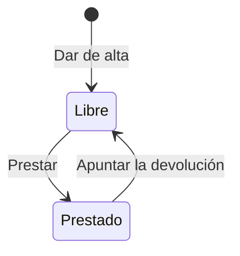

# Préstamo de equipos de IT

## Fuentes

- .diverger/inbox/peticion.md: petición del nivel 0. Aporta el problema, los usuarios, el alcance, el criterio de éxito, los riesgos y el anexo con la API que el inventario de IT necesita exactamente.

## Objetivo

Hoy los préstamos se apuntan en una hoja de cálculo que nadie mantiene al día: no se sabe qué equipos están prestados ni a quién, y cada pocos meses se pierde alguno o alguien se queda sin portátil porque se creía que estaba libre (peticion.md).

Que IT tenga una lista de los equipos de la oficina donde apuntar a quién ha prestado cada uno y cuándo lo devuelve, y vea en todo momento qué equipos están prestados, a quién y hasta cuándo (peticion.md).

Métricas de éxito:

- Durante el primer mes, todos los préstamos se apuntan en la aplicación (peticion.md).
- Durante el primer mes, no se pierde ningún equipo (peticion.md).
- Apuntar un préstamo no cuesta más de un minuto; si cuesta más, IT dejará de usarla (peticion.md).

## Usuarios

- Equipo de IT: es el único que usa la aplicación; entra con su cuenta de Google de la empresa, da de alta los equipos, apunta préstamos y devoluciones y consulta qué está prestado (peticion.md).
- Inventario de IT: sistema que se conecta a la API de la aplicación con una cuenta de servicio de Google (peticion.md).

## Alcance

- Dar de alta un equipo con su nombre, por ejemplo «Portátil 07» o «Proyector sala 2» (peticion.md).
- Rechazar el alta de un equipo sin nombre o con un nombre que ya existe; dos nombres son el mismo si solo se diferencian en mayúsculas o en espacios al principio o al final (peticion.md).
- Apuntar el préstamo de un equipo con la persona y la fecha en que lo tiene que devolver (peticion.md).
- Rechazar un préstamo sin persona o sin fecha, con una fecha que no existe, de un equipo que no existe o de un equipo ya prestado; la fecha va como `AAAA-MM-DD` y se acepta una fecha pasada, porque IT a veces apunta los préstamos con retraso (peticion.md).
- Apuntar la devolución de un equipo cuando lo devuelven; se rechaza si el equipo no existe o no está prestado (peticion.md).
- Ver en todo momento todos los equipos, si están prestados y, si lo están, a quién y hasta cuándo (peticion.md).

## Fuera de alcance

- Que los empleados pidan equipos desde la aplicación (peticion.md).
- Avisos de préstamos vencidos (peticion.md).
- Por ahora, limitar el acceso a las cuentas de IT (peticion.md).

## Restricciones

- La API tiene que ser exactamente la del anexo, porque el inventario de IT se va a conectar a ella (peticion.md).
- Todas las rutas necesitan haber iniciado sesión: sin un token válido responden 401 con «Inicia sesión con Google.» (peticion.md).
- Vale el token de identidad de Google, con el correo verificado, emitido para el cliente OAuth de la aplicación, tanto de una persona como de una cuenta de servicio (peticion.md).
- Los errores son un objeto JSON `{"error": "<mensaje>"}` con el mensaje exacto que se indica (peticion.md).
- Integración: el inventario de IT entra con una cuenta de servicio (peticion.md).

## API fijada por el cliente

El inventario de IT se va a conectar a la aplicación, así que la API tiene que ser exactamente esta. Todas las rutas necesitan haber iniciado sesión: sin un token válido responden 401 con «Inicia sesión con Google.». Vale el token de identidad de Google, con el correo verificado, emitido para el cliente OAuth de la aplicación, tanto de una persona como de una cuenta de servicio: el inventario entra con una cuenta de servicio. Por ahora no hace falta limitar el acceso a las cuentas de IT. Los errores son un objeto JSON `{"error": "<mensaje>"}` con el mensaje exacto que se indica.

| Operación | Petición | Respuesta correcta | Errores |
|---|---|---|---|
| Dar de alta un equipo | `POST /api/equipos` con `{"nombre": "Portátil 07"}` | 201 con `{"id": "…", "nombre": "Portátil 07", "prestado": false}` | 400 «Falta el nombre del equipo» si el nombre falta o está vacío. 409 «Ya hay un equipo con ese nombre» |
| Ver los equipos | `GET /api/equipos` | 200 con la lista de equipos, cada uno con `id`, `nombre` y `prestado`; si está prestado, también `persona` y `devolucion` | — |
| Prestar un equipo | `POST /api/equipos/{id}/prestamo` con `{"persona": "Ana Pérez", "devolucion": "2026-11-20"}` | 201 con el equipo: `id`, `nombre`, `prestado: true`, `persona` y `devolucion` | 400 «Faltan la persona o la fecha de devolución». 400 «La fecha de devolución no es válida» si no es una fecha real. 404 «No existe el equipo». 409 «El equipo ya está prestado» |
| Apuntar la devolución | `POST /api/equipos/{id}/devolucion` | 200 con el equipo y `prestado: false` | 404 «No existe el equipo». 409 «El equipo no está prestado» |

La fecha de devolución va como texto `AAAA-MM-DD` y se devuelve igual. Tiene que ser una fecha que exista («2026-02-30» no vale); una fecha pasada se acepta, porque IT a veces apunta los préstamos con retraso.

Dos nombres de equipo son el mismo si solo se diferencian en mayúsculas o en espacios al principio o al final: « portátil 07 » repite «Portátil 07».

(peticion.md, «Anexo: API para el inventario de IT»)

## Riesgos

- Que IT deje de usar la aplicación si apuntar un préstamo cuesta más de un minuto (peticion.md).
- Que el inventario de IT deje de funcionar si la API cambia (peticion.md).

## Supuestos

- [SUPUESTO] Además de la API, IT usa una interfaz web sencilla para dar de alta, prestar, devolver y ver los equipos — la petición habla de una «aplicación» en la que IT «entra», pero solo define la API.
- [SUPUESTO] «Equipo» es un objeto físico de la oficina, no un grupo de personas — por los ejemplos «Portátil 07» y «Proyector sala 2».
- [SUPUESTO] La persona del préstamo se guarda como texto libre, sin directorio de empleados — el ejemplo es «Ana Pérez» y no se menciona ningún directorio.
- [SUPUESTO] Basta con guardar el préstamo en curso de cada equipo, sin historial — la API solo expone el estado actual.
- [SUPUESTO] Se usa la plantilla DIVERGER de convenciones del backlog — el proyecto no tenía convenciones guardadas y se aplicó la plantilla sin preguntar.

## Preguntas abiertas

1. [alta] ¿Hace falta una interfaz web para IT o basta con la API? La petición habla de una «aplicación» en la que IT «entra», pero solo describe la API.
2. [alta] «Solo la usa el equipo de IT, que entra con su cuenta de Google de la empresa» frente a «Por ahora no hace falta limitar el acceso a las cuentas de IT»: hoy cualquier cuenta de Google con token válido entraría. ¿Cuándo y cómo se limitará el acceso (dominio de la empresa, lista de cuentas)?
3. [alta] ¿Se guarda el historial de préstamos de cada equipo? Afecta al modelo de datos y a cómo comprobar que no se pierde ningún equipo.
4. [media] ¿Se pueden editar, renombrar o dar de baja equipos? La API no lo contempla.
5. [media] ¿Hay que importar los datos de la hoja de cálculo actual antes del primer mes?
6. [media] ¿Cómo se comprobará que se apuntan «todos los préstamos» y que «no se pierde ningún equipo» durante el primer mes?
7. [media] ¿El minuto para apuntar un préstamo se mide en la interfaz de IT, en la API o en ambas?
8. [baja] ¿Hay plazo, plataforma o alojamiento previstos?

## Claridad

| Categoría | Claridad |
|---|---|
| Usuarios | 75 % |
| Problema | 75 % |
| Objetivo y métricas | 50 % |
| Alcance | 75 % |
| Fuera de alcance | 75 % |
| Restricciones | 50 % |
| Dependencias e integraciones | 75 % |
| Riesgos | 50 % |
| Global | 66 % |

## Diagramas

### Estados de un equipo

