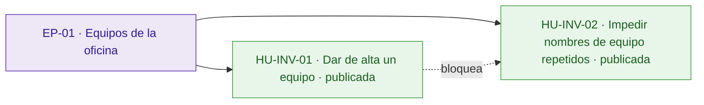
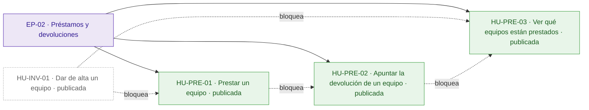
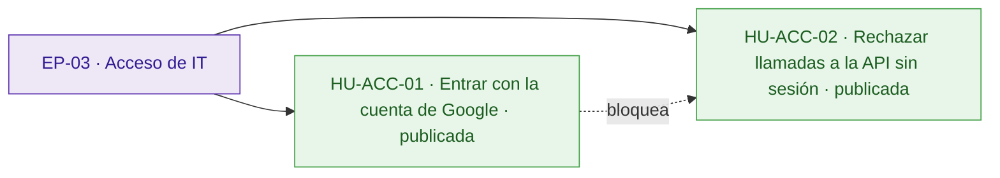
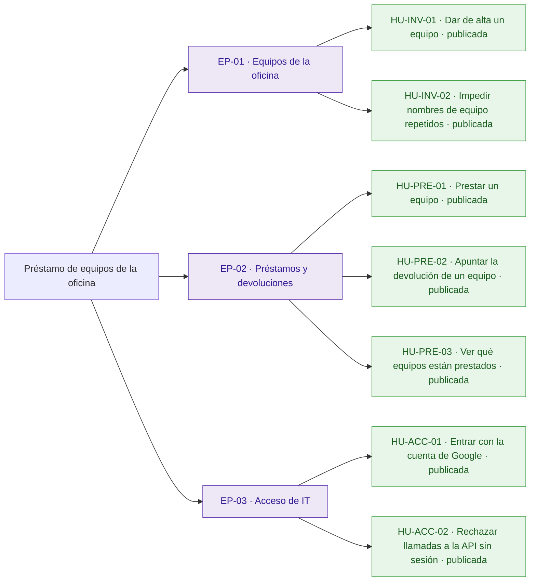
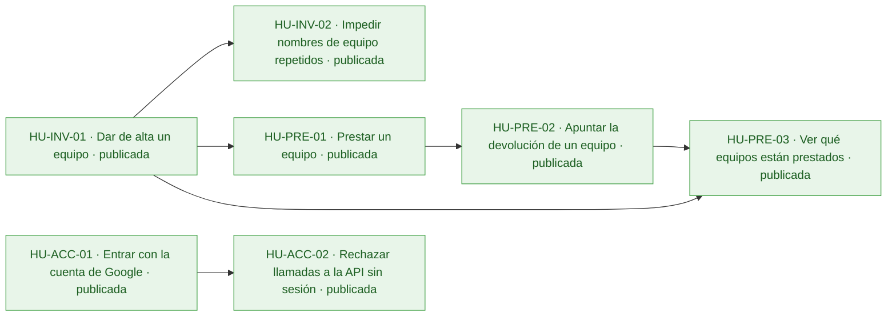
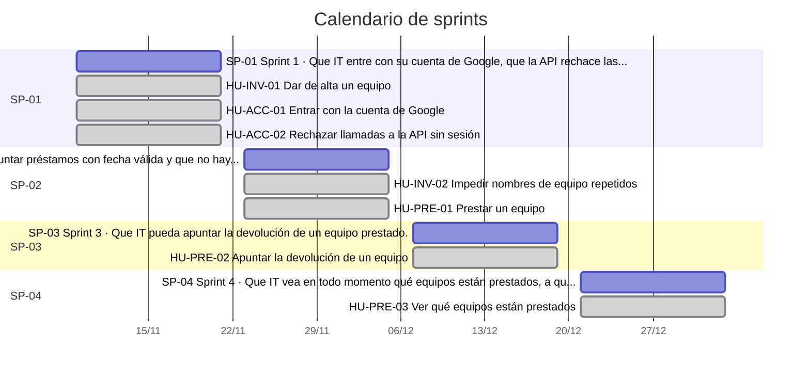
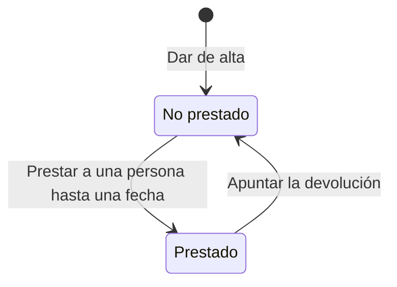
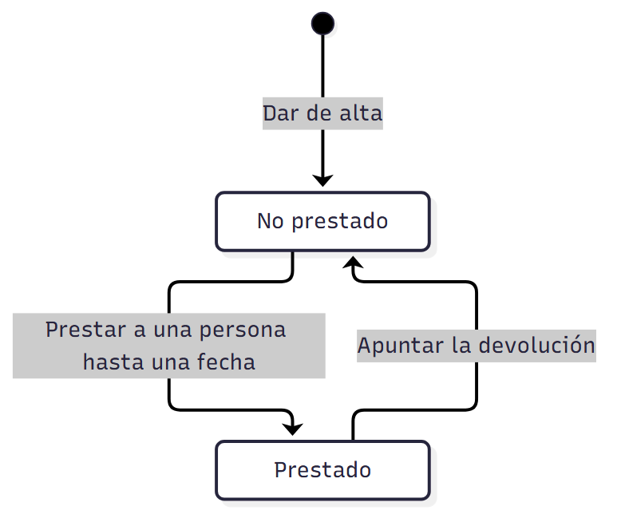

# Préstamo de equipos de la oficina

Hoy IT apunta los préstamos de equipos en una hoja de cálculo que nadie mantiene al día: no se sabe qué equipos están prestados ni a quién, y cada pocos meses se pierde alguno o alguien se queda sin portátil porque se creía libre.

La aplicación permite al equipo de IT, que entra con su cuenta de Google de la empresa, dar de alta los equipos, apuntar cada préstamo con la persona y la fecha de devolución, apuntar la devolución y ver en todo momento qué está prestado, a quién y hasta cuándo. El inventario de IT se conecta a ella, así que la API del anexo debe respetarse exactamente. Quedan fuera las peticiones de los empleados y los avisos de préstamos vencidos.

## Visión y alcance

Una lista de los equipos de la oficina donde IT apunte a quién ha prestado cada uno y cuándo lo devuelve, para que no se pierda ninguno.

**Dentro del alcance**

- Dar de alta un equipo con su nombre, por ejemplo «Portátil 07» o «Proyector sala 2» (peticion.md).
- No permitir dos equipos con el mismo nombre (peticion.md, anexo).
- Comparar los nombres sin distinguir mayúsculas y quitando los espacios del principio y del final: «portátil 07 » repite «Portátil 07» (usuario).
- Rechazar una fecha de devolución que no sea real o no siga el formato AAAA-MM-DD con 400 {"error": "La fecha de devolución no es válida"}; una fecha pasada se acepta, porque IT puede apuntar préstamos con retraso (usuario).
- Apuntar el préstamo de un equipo con la persona y la fecha en que lo tiene que devolver (peticion.md).
- Apuntar la devolución cuando le devuelven el equipo a IT (peticion.md).
- Ver en todo momento qué equipos están prestados, a quién y hasta cuándo (peticion.md).

**Fuera del alcance**

- Peticiones de los empleados desde la aplicación (peticion.md).
- Avisos de préstamos vencidos (peticion.md).
- Limitar el acceso solo a las cuentas de IT, en esta versión (usuario).

## Resumen en cifras

| Dato | Valor |
| --- | --- |
| Épicas | 3 |
| Historias | 7 |
| Historias por estado | borrador 0, aprobada 0, descartada 0, publicada 7 |
| Tareas | 22 |
| Sprints | 4 |
| Personas en el equipo | 1 |
| Modalidad de desarrollo | manual, sin IA |
| Horas estimadas | 30 h |
| Horas efectivas (según la modalidad de desarrollo) | 30 h |
| Historias sin estimar | 0 |
| Historias descartadas (fuera de las horas) | 0 |
| Supuestos | 5 |
| Preguntas abiertas | 6 |
| Requisitos | 13 |
| Requisitos sin historia | 0 |

## Índice

- [Visión y alcance](#visión-y-alcance)
- [Resumen en cifras](#resumen-en-cifras)
- [Épicas e historias](#épicas-e-historias)
  - [EP-01 · Equipos de la oficina](#ep-01--equipos-de-la-oficina)
  - [EP-02 · Préstamos y devoluciones](#ep-02--préstamos-y-devoluciones)
  - [EP-03 · Acceso de IT](#ep-03--acceso-de-it)
- [Tareas](#tareas)
- [Sprints](#sprints)
- [Equipo](#equipo)
- [Dependencias](#dependencias)
- [Requisitos y trazabilidad](#requisitos-y-trazabilidad)
- [Preparación y definición de hecho](#preparación-y-definición-de-hecho)
- [Diagramas](#diagramas)
- [Supuestos](#supuestos)
- [Preguntas abiertas](#preguntas-abiertas)
- [Decisiones](#decisiones)

## Épicas e historias

### EP-01 · Equipos de la oficina

Permite al equipo de IT dar de alta los equipos de la oficina con un nombre único, como «Portátil 07» o «Proyector sala 2». Es la base sobre la que se apuntan los préstamos. No incluye peticiones de los empleados.

#### Épica EP-01: Equipos de la oficina

#### HU-INV-01 · Dar de alta un equipo

Como técnico de IT, quiero dar de alta un equipo con su nombre, para tener en la aplicación todos los equipos que se pueden prestar en lugar de una hoja de cálculo desactualizada.

**Contexto.** Cubre RQ.001 (peticion.md): IT da de alta los equipos, por ejemplo «Portátil 07» o «Proyector sala 2». La operación y sus mensajes de error son los del anexo de la API (RQ.007).

- **Prioridad:** Highest
- **Tamaño:** M
- **Horas:** 4 h estimadas · 4 h efectivas
- **Estado:** publicada
- **Sprint:** SP-01 Sprint 1
- **Responsable:** José Luis Calvo
- **Tipo:** historia
- **Puntos de historia:** 3
- **Preparación:** lista (pendiente: supuestos sin confirmar: DoR-04, DoR-05, DoR-06, DoR-07, DoR-09)
- **Requisitos:** RQ.001, RQ.007

**Criterios de aceptación**

*Escenarios positivos*

1. **Dado** un técnico de IT con sesión iniciada y ningún equipo llamado «Portátil 07», **cuando** envía POST /api/equipos con {"nombre": "Portátil 07"}, **entonces** la aplicación responde 201 con {"id": "…", "nombre": "Portátil 07", "prestado": false}.

*Escenarios negativos*

1. **Dado** un técnico de IT con sesión iniciada, **cuando** envía POST /api/equipos con {"nombre": ""}, **entonces** la aplicación responde 400 con {"error": "Falta el nombre del equipo"} y no se crea ningún equipo.
2. **Dado** un técnico de IT con sesión iniciada, **cuando** envía POST /api/equipos con {}, **entonces** la aplicación responde 400 con {"error": "Falta el nombre del equipo"} y no se crea ningún equipo.

**Notas.** La respuesta y los mensajes deben coincidir exactamente con el anexo, porque el inventario de IT se conecta a la aplicación.

**Definición de hecho**

- Criterios de aceptación probados contra la API.
- Respuesta y mensajes idénticos a los del anexo.
- Textos revisados en español de España.

**Tareas**

- TA-001 · Modelo de equipo con id, nombre y estado de préstamo · datos · José Luis Calvo
- TA-002 · Endpoint POST /api/equipos con validación del nombre · backend · José Luis Calvo
- TA-003 · Formulario de alta de equipos · frontend · José Luis Calvo
- TA-004 · Pruebas de los criterios del alta contra la API · QA · José Luis Calvo

#### HU-INV-02 · Impedir nombres de equipo repetidos

Como técnico de IT, quiero dar de alta un equipo solo si ningún otro tiene su nombre, para no confundir dos equipos al apuntar a quién se ha prestado cada uno.

**Contexto.** Cubre RQ.002 (peticion.md, anexo): no puede haber dos equipos con el mismo nombre, con el error 409 del anexo (RQ.007). El usuario decidió que los nombres se comparan sin distinguir mayúsculas y quitando los espacios del principio y del final (RQ.011).

- **Prioridad:** Highest
- **Tamaño:** S
- **Horas:** 2 h estimadas · 2 h efectivas
- **Estado:** publicada
- **Sprint:** SP-02 Sprint 2
- **Responsable:** José Luis Calvo
- **Tipo:** historia
- **Puntos de historia:** 2
- **Preparación:** lista (pendiente: supuestos sin confirmar: DoR-04, DoR-05, DoR-06, DoR-07, DoR-09)
- **Requisitos:** RQ.002, RQ.007, RQ.011
- **Depende de:**
  - HU-INV-01 · Dar de alta un equipo: Comprobar un nombre repetido exige poder dar de alta equipos.

**Criterios de aceptación**

*Escenarios positivos*

1. **Dado** un técnico de IT con sesión iniciada, el equipo «Portátil 07» ya dado de alta y ningún equipo llamado «Proyector sala 2», **cuando** envía POST /api/equipos con {"nombre": "Proyector sala 2"}, **entonces** la aplicación responde 201 con {"id": "…", "nombre": "Proyector sala 2", "prestado": false} y la lista de equipos tiene «Portátil 07» y «Proyector sala 2».

*Escenarios negativos*

1. **Dado** un técnico de IT con sesión iniciada y el equipo «Portátil 07» ya dado de alta, **cuando** envía POST /api/equipos con {"nombre": "Portátil 07"}, **entonces** la aplicación responde 409 con {"error": "Ya hay un equipo con ese nombre"} y la lista de equipos sigue teniendo un único «Portátil 07».
2. **Dado** un técnico de IT con sesión iniciada y el equipo «Portátil 07» ya dado de alta, **cuando** envía POST /api/equipos con {"nombre": "portátil 07 "}, **entonces** la aplicación responde 409 con {"error": "Ya hay un equipo con ese nombre"} y la lista de equipos sigue teniendo un único «Portátil 07».

**Definición de hecho**

- Criterios de aceptación probados contra la API.
- Mensaje de error idéntico al del anexo.

**Tareas**

- TA-005 · Restricción de nombre único en los equipos · datos · José Luis Calvo
- TA-006 · Respuesta 409 ante un nombre repetido · backend · José Luis Calvo
- TA-007 · Pruebas del nombre repetido · QA · José Luis Calvo

### EP-02 · Préstamos y devoluciones

Permite al equipo de IT apuntar a quién presta cada equipo y hasta cuándo, apuntar la devolución y ver en todo momento qué está prestado. El inventario de IT usa las mismas operaciones a través de la API del anexo. No incluye avisos de préstamos vencidos.

#### Épica EP-02: Préstamos y devoluciones

#### HU-PRE-01 · Prestar un equipo

Como técnico de IT, quiero apuntar el préstamo de un equipo con la persona y la fecha en que lo tiene que devolver, para saber en todo momento quién tiene cada equipo y hasta cuándo, sin consultar una hoja de cálculo.

**Contexto.** Cubre RQ.003 (peticion.md): IT apunta cada préstamo con la persona y la fecha en que lo tiene que devolver. La fecha va como texto AAAA-MM-DD y se devuelve igual (RQ.009), y la operación es la del anexo (RQ.007).

- **Prioridad:** Highest
- **Tamaño:** M
- **Horas:** 4 h estimadas · 4 h efectivas
- **Estado:** publicada
- **Sprint:** SP-02 Sprint 2
- **Responsable:** José Luis Calvo
- **Tipo:** historia
- **Puntos de historia:** 3
- **Preparación:** lista (pendiente: supuestos sin confirmar: DoR-04, DoR-05, DoR-06, DoR-07, DoR-09)
- **Requisitos:** RQ.003, RQ.007, RQ.009, RQ.010
- **Depende de:**
  - HU-INV-01 · Dar de alta un equipo: Solo se puede prestar un equipo dado de alta.

**Criterios de aceptación**

*Escenarios positivos*

1. **Dado** un técnico de IT con sesión iniciada y el equipo «Portátil 07» no prestado, **cuando** envía POST /api/equipos/{id}/prestamo de «Portátil 07» con {"persona": "Ana Pérez", "devolucion": "2026-11-20"}, **entonces** la aplicación responde 201 con el equipo: su id, "nombre": "Portátil 07", "prestado": true, "persona": "Ana Pérez" y "devolucion": "2026-11-20".
2. **Dado** un técnico de IT con sesión iniciada, el equipo «Portátil 07» no prestado y hoy 2 de noviembre de 2026, **cuando** envía POST /api/equipos/{id}/prestamo de «Portátil 07» con {"persona": "Ana Pérez", "devolucion": "2026-10-15"}, **entonces** la aplicación responde 201 con "prestado": true, "persona": "Ana Pérez" y "devolucion": "2026-10-15".

*Escenarios negativos*

1. **Dado** un técnico de IT con sesión iniciada y el equipo «Portátil 07» no prestado, **cuando** envía POST /api/equipos/{id}/prestamo de «Portátil 07» con {"persona": "Ana Pérez"}, **entonces** la aplicación responde 400 con {"error": "Faltan la persona o la fecha de devolución"} y «Portátil 07» sigue no prestado.
2. **Dado** un técnico de IT con sesión iniciada y el equipo «Portátil 07» prestado a Ana Pérez hasta el 2026-11-20, **cuando** envía POST /api/equipos/{id}/prestamo de «Portátil 07» con {"persona": "Luis Gómez", "devolucion": "2026-11-25"}, **entonces** la aplicación responde 409 con {"error": "El equipo ya está prestado"} y el préstamo sigue a nombre de Ana Pérez hasta el 2026-11-20.
3. **Dado** un técnico de IT con sesión iniciada y ningún equipo con el id «no-existe», **cuando** envía POST /api/equipos/no-existe/prestamo con {"persona": "Ana Pérez", "devolucion": "2026-11-20"}, **entonces** la aplicación responde 404 con {"error": "No existe el equipo"}.
4. **Dado** un técnico de IT con sesión iniciada y el equipo «Portátil 07» no prestado, **cuando** envía POST /api/equipos/{id}/prestamo de «Portátil 07» con {"persona": "Ana Pérez", "devolucion": "2026-02-30"}, **entonces** la aplicación responde 400 con {"error": "La fecha de devolución no es válida"} y «Portátil 07» sigue no prestado.
5. **Dado** un técnico de IT con sesión iniciada y el equipo «Portátil 07» no prestado, **cuando** envía POST /api/equipos/{id}/prestamo de «Portátil 07» con {"persona": "Ana Pérez", "devolucion": "20/11/2026"}, **entonces** la aplicación responde 400 con {"error": "La fecha de devolución no es válida"} y «Portátil 07» sigue no prestado.

**Notas.** Según el usuario, una fecha que no sea real o no siga AAAA-MM-DD recibe 400 «La fecha de devolución no es válida» (RQ.010), y una fecha pasada se acepta porque IT puede apuntar préstamos con retraso. El minuto que preocupa al cliente es el tiempo de IT en la pantalla para apuntar un préstamo, no un requisito de rendimiento de la API.

**Definición de hecho**

- Criterios de aceptación probados contra la API.
- Respuesta y mensajes idénticos a los del anexo.
- La fecha de devolución se devuelve con el mismo texto que se envió.

**Tareas**

- TA-008 · Campos de persona y fecha de devolución en el equipo · datos · José Luis Calvo
- TA-009 · Endpoint POST /api/equipos/{id}/prestamo con sus errores · backend · José Luis Calvo
- TA-010 · Formulario rápido para prestar un equipo · frontend · José Luis Calvo
- TA-011 · Pruebas de los criterios del préstamo contra la API · QA · José Luis Calvo

#### HU-PRE-02 · Apuntar la devolución de un equipo

Como técnico de IT, quiero apuntar la devolución cuando le devuelven un equipo, para volver a prestarlo sin creer por error que sigue fuera.

**Contexto.** Cubre RQ.004 (peticion.md): IT apunta la devolución cuando le devuelven el equipo, con la operación y los errores del anexo (RQ.007).

- **Prioridad:** Highest
- **Tamaño:** M
- **Horas:** 4 h estimadas · 4 h efectivas
- **Estado:** publicada
- **Sprint:** SP-03 Sprint 3
- **Responsable:** José Luis Calvo
- **Tipo:** historia
- **Puntos de historia:** 3
- **Preparación:** lista (pendiente: supuestos sin confirmar: DoR-04, DoR-05, DoR-06, DoR-07, DoR-09)
- **Requisitos:** RQ.004, RQ.007
- **Depende de:**
  - HU-PRE-01 · Prestar un equipo: Solo se puede devolver un equipo prestado.

**Criterios de aceptación**

*Escenarios positivos*

1. **Dado** un técnico de IT con sesión iniciada y el equipo «Portátil 07» prestado a Ana Pérez hasta el 2026-11-20, **cuando** envía POST /api/equipos/{id}/devolucion de «Portátil 07», **entonces** la aplicación responde 200 con el equipo «Portátil 07» y "prestado": false.

*Escenarios negativos*

1. **Dado** un técnico de IT con sesión iniciada y el equipo «Proyector sala 2» no prestado, **cuando** envía POST /api/equipos/{id}/devolucion de «Proyector sala 2», **entonces** la aplicación responde 409 con {"error": "El equipo no está prestado"}.
2. **Dado** un técnico de IT con sesión iniciada y ningún equipo con el id «no-existe», **cuando** envía POST /api/equipos/no-existe/devolucion, **entonces** la aplicación responde 404 con {"error": "No existe el equipo"}.

**Notas.** Si se conserva el historial de préstamos o solo el estado actual sigue como pregunta abierta; la API solo muestra el estado actual.

**Definición de hecho**

- Criterios de aceptación probados contra la API.
- Respuesta y mensajes idénticos a los del anexo.

**Tareas**

- TA-012 · Endpoint POST /api/equipos/{id}/devolucion con sus errores · backend · José Luis Calvo
- TA-013 · Acción de devolución en la lista de equipos · frontend · José Luis Calvo
- TA-014 · Pruebas de los criterios de la devolución contra la API · QA · José Luis Calvo

#### HU-PRE-03 · Ver qué equipos están prestados

Como técnico de IT, quiero ver la lista de equipos con a quién está prestado cada uno y hasta cuándo, para no dar por libre un portátil que tiene otra persona.

**Contexto.** Cubre RQ.005 (peticion.md): IT ve en todo momento qué equipos están prestados, a quién y hasta cuándo. Es la operación «Ver los equipos» del anexo (RQ.007), con la fecha tal como se guardó (RQ.009).

- **Prioridad:** Highest
- **Tamaño:** M
- **Horas:** 4 h estimadas · 4 h efectivas
- **Estado:** publicada
- **Sprint:** SP-04 Sprint 4
- **Responsable:** José Luis Calvo
- **Tipo:** historia
- **Puntos de historia:** 3
- **Preparación:** lista (pendiente: supuestos sin confirmar: DoR-04, DoR-05, DoR-06, DoR-07, DoR-09)
- **Requisitos:** RQ.005, RQ.007, RQ.009
- **Depende de:**
  - HU-INV-01 · Dar de alta un equipo: La lista muestra los equipos dados de alta.
  - HU-PRE-02 · Apuntar la devolución de un equipo: Comprobar que un equipo devuelto no conserva el préstamo exige poder apuntar la devolución.

**Criterios de aceptación**

*Escenarios positivos*

1. **Dado** un técnico de IT con sesión iniciada, el equipo «Portátil 07» prestado a Ana Pérez hasta el 2026-11-20 y el equipo «Proyector sala 2» no prestado, **cuando** envía GET /api/equipos, **entonces** la aplicación responde 200 con dos equipos: «Portátil 07» con "prestado": true, "persona": "Ana Pérez" y "devolucion": "2026-11-20", y «Proyector sala 2» con "prestado": false.
2. **Dado** un técnico de IT con sesión iniciada y el equipo «Proyector sala 2» no prestado, **cuando** envía GET /api/equipos, **entonces** «Proyector sala 2» aparece solo con id, "nombre": "Proyector sala 2" y "prestado": false, sin persona ni fecha de devolución.

*Escenarios negativos*

1. **Dado** un técnico de IT con sesión iniciada y el equipo «Portátil 07» ya devuelto tras un préstamo a Ana Pérez hasta el 2026-11-20, **cuando** envía GET /api/equipos, **entonces** «Portátil 07» aparece con "prestado": false y sin "persona" ni "devolucion" del préstamo anterior.

**Definición de hecho**

- Criterios de aceptación probados contra la API.
- Campos de la respuesta idénticos a los del anexo.

**Tareas**

- TA-015 · Endpoint GET /api/equipos con persona y fecha de los prestados · backend · José Luis Calvo
- TA-016 · Lista de equipos con su estado de préstamo · frontend · José Luis Calvo
- TA-017 · Pruebas de la lista de equipos contra la API · QA · José Luis Calvo

### EP-03 · Acceso de IT

Garantiza que solo se entra con un token de identidad de Google con el correo verificado y emitido para el cliente OAuth de la aplicación, tanto el equipo de IT como el inventario con su cuenta de servicio, y que la API rechaza con 401 cualquier llamada sin un token válido. Limitar el acceso solo a las cuentas de IT queda fuera de esta versión.

#### Épica EP-03: Acceso de IT

#### HU-ACC-01 · Entrar con la cuenta de Google

Como técnico de IT, quiero entrar en la aplicación con mi cuenta de Google, para no tener que recordar otra contraseña para apuntar los préstamos.

**Contexto.** Cubre RQ.006 (peticion.md; usuario): el equipo de IT entra con su cuenta de Google. El usuario decidió que vale cualquier token de identidad de Google con el correo verificado y emitido para el cliente OAuth de la aplicación, como ya hace la plantilla.

- **Prioridad:** Highest
- **Tamaño:** L
- **Horas:** 8 h estimadas · 8 h efectivas
- **Estado:** publicada
- **Sprint:** SP-01 Sprint 1
- **Responsable:** José Luis Calvo
- **Tipo:** historia
- **Puntos de historia:** 5
- **Preparación:** lista (pendiente: supuestos sin confirmar: DoR-04, DoR-05, DoR-06, DoR-07, DoR-09)
- **Requisitos:** RQ.006
- **Dependencias externas:** Cliente OAuth de Google de la aplicación

**Criterios de aceptación**

*Escenarios positivos*

1. **Dado** un técnico de IT sin sesión iniciada con una cuenta de Google de correo verificado, **cuando** entra con esa cuenta en la aplicación, **entonces** inicia sesión con un token de identidad emitido para el cliente OAuth de la aplicación y ve la lista de equipos de la oficina.

*Escenarios negativos*

1. **Dado** un token de identidad de Google con el correo sin verificar, **cuando** se envía en GET /api/equipos, **entonces** la aplicación responde 401 con {"error": "Inicia sesión con Google."} y no devuelve ningún equipo.
2. **Dado** un token de identidad de Google con el correo verificado pero emitido para otro cliente OAuth, **cuando** se envía en GET /api/equipos, **entonces** la aplicación responde 401 con {"error": "Inicia sesión con Google."} y no devuelve ningún equipo.

**Notas.** Limitar el acceso solo a las cuentas de IT queda fuera de esta versión, por decisión del usuario. \[SUPUESTO\] La aplicación es web.

**Definición de hecho**

- Criterios de aceptación probados con un token válido, uno con el correo sin verificar y uno de otro cliente OAuth.
- Textos revisados en español de España.

**Tareas**

- TA-018 · Verificación del token de identidad de Google: correo verificado y cliente OAuth de la aplicación · backend · José Luis Calvo
- TA-019 · Pantalla de inicio de sesión con Google · frontend · José Luis Calvo
- TA-020 · Pruebas con un token válido, uno sin correo verificado y uno de otro cliente OAuth · QA · José Luis Calvo

#### HU-ACC-02 · Rechazar llamadas a la API sin sesión

Como técnico de IT, quiero bloquear las llamadas a la API que no traen un token válido, para que nadie sin sesión consulte ni cambie los equipos y sus préstamos.

**Contexto.** Cubre RQ.008 (peticion.md, anexo): todas las rutas necesitan haber iniciado sesión y sin un token válido responden 401, como fija el anexo (RQ.007).

- **Prioridad:** Highest
- **Tamaño:** M
- **Horas:** 4 h estimadas · 4 h efectivas
- **Estado:** publicada
- **Sprint:** SP-01 Sprint 1
- **Responsable:** José Luis Calvo
- **Tipo:** historia
- **Puntos de historia:** 3
- **Preparación:** lista (pendiente: supuestos sin confirmar: DoR-04, DoR-05, DoR-06, DoR-07, DoR-08, DoR-09)
- **Requisitos:** RQ.008, RQ.007, RQ.012, RQ.013
- **Depende de:**
  - HU-ACC-01 · Entrar con la cuenta de Google: Sin inicio de sesión no hay token válido que comprobar.

**Criterios de aceptación**

*Escenarios positivos*

1. **Dado** un cliente de la API con el token de identidad válido de un técnico de IT con sesión iniciada, **cuando** envía GET /api/equipos, **entonces** la aplicación responde 200 con la lista de equipos.
2. **Dado** el inventario de IT con el token de identidad de su cuenta de servicio de Google, con el correo verificado y emitido para el cliente OAuth de la aplicación, **cuando** envía GET /api/equipos, **entonces** la aplicación responde 200 con la lista de equipos.

*Escenarios negativos*

1. **Dado** un cliente de la API sin token, **cuando** envía GET /api/equipos, **entonces** la aplicación responde 401 con {"error": "Inicia sesión con Google."} y no devuelve ningún equipo.
2. **Dado** un cliente de la API con el token «token-no-valido», **cuando** envía POST /api/equipos con {"nombre": "Portátil 09"}, **entonces** la aplicación responde 401 con {"error": "Inicia sesión con Google."} y no se crea el equipo «Portátil 09».
3. **Dado** un cliente de la API sin token y el equipo «Portátil 07» no prestado, **cuando** envía POST /api/equipos/{id}/prestamo de «Portátil 07» con {"persona": "Ana Pérez", "devolucion": "2026-11-20"}, **entonces** la aplicación responde 401 con {"error": "Inicia sesión con Google."} y «Portátil 07» sigue no prestado.
4. **Dado** un cliente de la API sin token y el equipo «Portátil 07» prestado a Ana Pérez hasta el 2026-11-20, **cuando** envía POST /api/equipos/{id}/devolucion de «Portátil 07», **entonces** la aplicación responde 401 con {"error": "Inicia sesión con Google."} y «Portátil 07» sigue prestado a Ana Pérez hasta el 2026-11-20.

**Notas.** Por decisión del usuario, el 401 lleva {"error": "Inicia sesión con Google."} (RQ.012) y el inventario de IT entra con una cuenta de servicio de Google y su token de identidad (RQ.013). Vale cualquier token de identidad de Google con el correo verificado y emitido para el cliente OAuth de la aplicación.

**Definición de hecho**

- Criterios de aceptación probados en las cuatro rutas del anexo.

**Tareas**

- TA-021 · Comprobación del token en todas las rutas de la API · backend · José Luis Calvo
- TA-022 · Pruebas de 401 sin token y con token no válido, y de acceso con la cuenta de servicio del inventario · QA · José Luis Calvo

## Tareas

| ID | Título | Historia | Disciplina | Descripción | Responsable | Horas estimadas | Horas efectivas |
| --- | --- | --- | --- | --- | --- | --- | --- |
| TA-001 | Modelo de equipo con id, nombre y estado de préstamo | HU-INV-01 · Dar de alta un equipo | datos |   | José Luis Calvo |   |   |
| TA-002 | Endpoint POST /api/equipos con validación del nombre | HU-INV-01 · Dar de alta un equipo | backend |   | José Luis Calvo |   |   |
| TA-003 | Formulario de alta de equipos | HU-INV-01 · Dar de alta un equipo | frontend |   | José Luis Calvo |   |   |
| TA-004 | Pruebas de los criterios del alta contra la API | HU-INV-01 · Dar de alta un equipo | QA |   | José Luis Calvo |   |   |
| TA-005 | Restricción de nombre único en los equipos | HU-INV-02 · Impedir nombres de equipo repetidos | datos |   | José Luis Calvo |   |   |
| TA-006 | Respuesta 409 ante un nombre repetido | HU-INV-02 · Impedir nombres de equipo repetidos | backend |   | José Luis Calvo |   |   |
| TA-007 | Pruebas del nombre repetido | HU-INV-02 · Impedir nombres de equipo repetidos | QA |   | José Luis Calvo |   |   |
| TA-008 | Campos de persona y fecha de devolución en el equipo | HU-PRE-01 · Prestar un equipo | datos |   | José Luis Calvo |   |   |
| TA-009 | Endpoint POST /api/equipos/{id}/prestamo con sus errores | HU-PRE-01 · Prestar un equipo | backend |   | José Luis Calvo |   |   |
| TA-010 | Formulario rápido para prestar un equipo | HU-PRE-01 · Prestar un equipo | frontend |   | José Luis Calvo |   |   |
| TA-011 | Pruebas de los criterios del préstamo contra la API | HU-PRE-01 · Prestar un equipo | QA |   | José Luis Calvo |   |   |
| TA-012 | Endpoint POST /api/equipos/{id}/devolucion con sus errores | HU-PRE-02 · Apuntar la devolución de un equipo | backend |   | José Luis Calvo |   |   |
| TA-013 | Acción de devolución en la lista de equipos | HU-PRE-02 · Apuntar la devolución de un equipo | frontend |   | José Luis Calvo |   |   |
| TA-014 | Pruebas de los criterios de la devolución contra la API | HU-PRE-02 · Apuntar la devolución de un equipo | QA |   | José Luis Calvo |   |   |
| TA-015 | Endpoint GET /api/equipos con persona y fecha de los prestados | HU-PRE-03 · Ver qué equipos están prestados | backend |   | José Luis Calvo |   |   |
| TA-016 | Lista de equipos con su estado de préstamo | HU-PRE-03 · Ver qué equipos están prestados | frontend |   | José Luis Calvo |   |   |
| TA-017 | Pruebas de la lista de equipos contra la API | HU-PRE-03 · Ver qué equipos están prestados | QA |   | José Luis Calvo |   |   |
| TA-018 | Verificación del token de identidad de Google: correo verificado y cliente OAuth de la aplicación | HU-ACC-01 · Entrar con la cuenta de Google | backend |   | José Luis Calvo |   |   |
| TA-019 | Pantalla de inicio de sesión con Google | HU-ACC-01 · Entrar con la cuenta de Google | frontend |   | José Luis Calvo |   |   |
| TA-020 | Pruebas con un token válido, uno sin correo verificado y uno de otro cliente OAuth | HU-ACC-01 · Entrar con la cuenta de Google | QA |   | José Luis Calvo |   |   |
| TA-021 | Comprobación del token en todas las rutas de la API | HU-ACC-02 · Rechazar llamadas a la API sin sesión | backend |   | José Luis Calvo |   |   |
| TA-022 | Pruebas de 401 sin token y con token no válido, y de acceso con la cuenta de servicio del inventario | HU-ACC-02 · Rechazar llamadas a la API sin sesión | QA |   | José Luis Calvo |   |   |

## Sprints

| Sprint | Fechas | Objetivo | Historias | Capacidad (h) | Carga (h efectivas) |
| --- | --- | --- | --- | --- | --- |
| SP-01 Sprint 1 | del 09/11/2026 al 20/11/2026 | Que IT entre con su cuenta de Google, que la API rechace las llamadas sin sesión y que IT pueda dar de alta los equipos de la oficina por la API del anexo. | 3 | 56 h | 16 h · 29 % |
| SP-02 Sprint 2 | del 23/11/2026 al 04/12/2026 | Que IT pueda apuntar préstamos con fecha válida y que no haya dos equipos con el mismo nombre. | 2 | 56 h | 6 h · 11 % |
| SP-03 Sprint 3 | del 07/12/2026 al 18/12/2026 | Que IT pueda apuntar la devolución de un equipo prestado. | 1 | 56 h | 4 h · 7 % |
| SP-04 Sprint 4 | del 21/12/2026 al 01/01/2027 | Que IT vea en todo momento qué equipos están prestados, a quién y hasta cuándo. | 1 | 56 h | 4 h · 7 % |

Historias sin sprint: 0.

## Equipo

| Nombre | Rol | Dedicación | Usa un agente de IA |
| --- | --- | --- | --- |
| José Luis Calvo | Desarrollo | 100 % | sí |

*Por privacidad, este documento no incluye correos electrónicos ni usuarios de GitHub o Trello.*

## Dependencias

| Historia | Bloqueada por | Motivo |
| --- | --- | --- |
| HU-INV-02 · Impedir nombres de equipo repetidos | HU-INV-01 · Dar de alta un equipo | Comprobar un nombre repetido exige poder dar de alta equipos. |
| HU-PRE-01 · Prestar un equipo | HU-INV-01 · Dar de alta un equipo | Solo se puede prestar un equipo dado de alta. |
| HU-PRE-02 · Apuntar la devolución de un equipo | HU-PRE-01 · Prestar un equipo | Solo se puede devolver un equipo prestado. |
| HU-PRE-03 · Ver qué equipos están prestados | HU-INV-01 · Dar de alta un equipo | La lista muestra los equipos dados de alta. |
| HU-PRE-03 · Ver qué equipos están prestados | HU-PRE-02 · Apuntar la devolución de un equipo | Comprobar que un equipo devuelto no conserva el préstamo exige poder apuntar la devolución. |
| HU-ACC-02 · Rechazar llamadas a la API sin sesión | HU-ACC-01 · Entrar con la cuenta de Google | Sin inicio de sesión no hay token válido que comprobar. |

## Requisitos y trazabilidad

| Requisito | Título | Tipo | Origen | Historias | Cobertura |
| --- | --- | --- | --- | --- | --- |
| RQ.001 | Dar de alta un equipo con su nombre | Funcional | peticion.md | HU-INV-01 | cubierto |
| RQ.002 | No permitir dos equipos con el mismo nombre | Funcional | peticion.md | HU-INV-02 | cubierto |
| RQ.003 | Apuntar el préstamo de un equipo con la persona y la fecha de devolución | Funcional | peticion.md | HU-PRE-01 | cubierto |
| RQ.004 | Apuntar la devolución de un equipo | Funcional | peticion.md | HU-PRE-02 | cubierto |
| RQ.005 | Ver qué equipos están prestados, a quién y hasta cuándo | Funcional | peticion.md | HU-PRE-03 | cubierto |
| RQ.006 | Acceso con un token de identidad de Google con el correo verificado y emitido para el cliente OAuth de la aplicación | No funcional: seguridad | peticion.md; usuario | HU-ACC-01 | cubierto |
| RQ.007 | Exponer exactamente la API del anexo para el inventario de IT, con sus errores JSON y mensajes exactos | No funcional: integración | peticion.md | HU-INV-01, HU-INV-02, HU-PRE-01, HU-PRE-02, HU-PRE-03, HU-ACC-02 | cubierto |
| RQ.008 | Todas las rutas exigen sesión iniciada y responden 401 sin un token válido | No funcional: seguridad | peticion.md | HU-ACC-02 | cubierto |
| RQ.009 | La fecha de devolución va como texto AAAA-MM-DD y se devuelve igual | No funcional: datos | peticion.md | HU-PRE-01, HU-PRE-03 | cubierto |
| RQ.010 | Rechazar con 400 «La fecha de devolución no es válida» una fecha que no sea real o no siga AAAA-MM-DD; las fechas pasadas se aceptan | Funcional | usuario | HU-PRE-01 | cubierto |
| RQ.011 | Comparar los nombres de equipo sin distinguir mayúsculas y sin los espacios del principio y del final | Funcional | usuario | HU-INV-02 | cubierto |
| RQ.012 | Responder 401 con {"error": "Inicia sesión con Google."} a toda llamada sin token válido | No funcional: seguridad | usuario | HU-ACC-02 | cubierto |
| RQ.013 | El inventario de IT entra con una cuenta de servicio de Google y su token de identidad | No funcional: integración | usuario | HU-ACC-02 | cubierto |

Requisitos sin ninguna historia: 0 de 13.

## Preparación y definición de hecho

**Definición de preparado (DoR)**

- Historia con título, descripción y valor de negocio claros.
- Trazabilidad a uno o varios RQ registrada.
- Criterios de aceptación verificables definidos.
- Reglas funcionales necesarias cerradas.
- Diseño/prototipo o referencia UI disponible cuando aplique.
- Fuentes/campos de datos identificados cuando aplique.
- Datos de prueba suficientes o estrategia de mock definida.
- Dependencias externas resueltas o plan temporal explícito.
- Permisos/roles definidos si afectan a la historia.
- La historia puede completarse razonablemente dentro de un sprint.
- No hay decisiones de negocio abiertas que impidan implementar o probar.

**Definición de hecho del proyecto (DoD)**

- Todos los criterios de aceptación implementados.
- Código revisado y mergeado conforme al flujo acordado.
- Tests unitarios y de integración asociados en verde.
- Pruebas funcionales ejecutadas correctamente.
- Comportamiento validado con los datos disponibles.
- Permisos/RLS verificados cuando corresponda.
- Rendimiento contrastado cuando el RQ lo requiera.
- Sin defectos críticos o bloqueantes asociados.
- Desplegada en el entorno previsto para el sprint.
- Trazabilidad HU → RQ → prueba/evidencia actualizada.

*Todas las historias que indican su preparación están listas.*

## Diagramas

### Mapa de la iniciativa

### Dependencias entre historias

### Calendario de sprints

### Estados de un equipo

## Supuestos

- \[SUPUESTO\] La aplicación es web — se entra con cuenta de Google y hay una API HTTP, pero no se indica la plataforma.
- \[SUPUESTO\] Los equipos y préstamos se conservan entre sesiones — un inventario lo necesita, aunque no se dice.
- \[SUPUESTO\] Todas las historias son imprescindibles: cubren las cuatro operaciones de la API que el inventario de IT necesita exactamente y el acceso exigido.
- \[SUPUESTO\] Sprints de 10 días laborables, empezando el lunes 9 de noviembre de 2026, con 8 horas al día y un factor de foco de 0,7: el equipo no ha dado sus valores.
- \[SUPUESTO\] Modalidad de desarrollo: solo trabajo manual; el equipo no ha dicho si usará IA.

## Preguntas abiertas

- \[alta\] ¿IT trabaja desde una pantalla web además de la API, o solo se entrega la API?
- \[media\] ¿Se pueden editar o dar de baja equipos (nombre erróneo, equipo retirado)? La API fijada no lo permite.
- \[media\] ¿Se conserva el historial de préstamos o solo el estado actual? La API solo muestra el actual.
- \[media\] ¿Cómo se mide «no se pierde ningún equipo» durante el primer mes y quién lo comprueba?
- \[baja\] ¿Cuántos equipos y personas de IT se esperan?
- \[media\] ¿Se añaden los elementos habilitadores transversales de la plantilla (Sprint 0, rendimiento, pentesting, UAT y despliegue)?

## Decisiones

- **2026-11-01 22:41** · Se crea la iniciativa «Préstamo de equipos de la oficina» a partir de .diverger/inbox/peticion.md (modo yolo, sin preguntas). *(supuesto)*
- **2026-11-01 22:41** · Se aprueba el alcance de peticion.md sin revisión del usuario (modo yolo): alta de equipos, préstamo, devolución y consulta, con la API del anexo copiada literalmente. *(supuesto)*
- **2026-11-01 22:41** · Se usa la plantilla DIVERGER de convenciones: IDs por área, Story y Enabler, Datos/Backend/Frontend/QA, puntos y horas, prioridad Jira, RQ.001, DoR y DoD de la plantilla, Sprint 0 propuesto. *(supuesto)*
- **2026-11-01 22:41** · \[SUPUESTO\] La aplicación es web y el token válido de la API es el de la sesión con la cuenta de Google de la empresa. *(supuesto)*
- **2026-11-01 22:41** · \[SUPUESTO\] Apuntar un préstamo debe costar menos de un minuto desde la interfaz, y los equipos y préstamos se conservan entre sesiones. *(supuesto)*
- **2026-11-01 22:44** · \[SUPUESTO\] DoR DoR-04 «Reglas funcionales necesarias cerradas.»: se supone cumplido — HU-INV-01, HU-INV-02, HU-PRE-01, HU-PRE-02, HU-PRE-03, HU-ACC-01, HU-ACC-02 *(supuesto)*
- **2026-11-01 22:44** · \[SUPUESTO\] DoR DoR-05 «Diseño/prototipo o referencia UI disponible cuando aplique.»: se supone cumplido — HU-INV-01, HU-INV-02, HU-PRE-01, HU-PRE-02, HU-PRE-03, HU-ACC-01, HU-ACC-02 *(supuesto)*
- **2026-11-01 22:44** · \[SUPUESTO\] DoR DoR-06 «Fuentes/campos de datos identificados cuando aplique.»: se supone cumplido — HU-INV-01, HU-INV-02, HU-PRE-01, HU-PRE-02, HU-PRE-03, HU-ACC-01, HU-ACC-02 *(supuesto)*
- **2026-11-01 22:44** · \[SUPUESTO\] DoR DoR-07 «Datos de prueba suficientes o estrategia de mock definida.»: se supone cumplido — HU-INV-01, HU-INV-02, HU-PRE-01, HU-PRE-02, HU-PRE-03, HU-ACC-01, HU-ACC-02 *(supuesto)*
- **2026-11-01 22:44** · \[SUPUESTO\] DoR DoR-09 «Permisos/roles definidos si afectan a la historia.»: se supone cumplido — HU-INV-01, HU-INV-02, HU-PRE-01, HU-PRE-02, HU-PRE-03, HU-ACC-01, HU-ACC-02 *(supuesto)*
- **2026-11-01 22:44** · Se escribe el backlog en modo yolo: 3 épicas (Equipos de la oficina, Préstamos y devoluciones, Acceso de IT), 7 historias en borrador y 22 tareas, con la auditoría y la revisión de estilo aplicadas. *(supuesto)*
- **2026-11-01 22:44** · Los tamaños y puntos de historia son una propuesta para que el equipo los ajuste (28 h y 21 puntos en total). *(supuesto)*
- **2026-11-01 22:44** · \[SUPUESTO\] Todas las historias son imprescindibles (must): cubren las cuatro operaciones de la API que el inventario de IT necesita exactamente y el acceso exigido. *(supuesto)*
- **2026-11-01 22:44** · No se añaden enablers transversales (Sprint 0, rendimiento, pentesting, UAT y despliegue) porque ningún requisito los pide; queda como pregunta abierta. *(supuesto)*
- **2026-11-01 22:53** · \[SUPUESTO\] HU-INV-01, HU-PRE-02 y HU-PRE-03 aprobadas sin revisión del usuario: son válidas, sin problemas de calidad y ninguna pregunta abierta las cita. *(supuesto)*
- **2026-11-01 23:01** · Nombres repetidos: se comparan sin distinguir mayúsculas y quitando los espacios del principio y del final («portátil 07 » repite «Portátil 07»). Se añade RQ.011 y un escenario a HU-INV-02. *(decisión del usuario)*
- **2026-11-01 23:01** · Fecha de devolución: debe ser una fecha real con formato AAAA-MM-DD; si no, 400 {"error": "La fecha de devolución no es válida"}. Las fechas pasadas se aceptan. El minuto para apuntar un préstamo es el tiempo de IT en la pantalla, no un requisito de rendimiento de la API. Se añade RQ.010 y tres escenarios a HU-PRE-01. *(decisión del usuario)*
- **2026-11-01 23:01** · Acceso: vale cualquier token de identidad de Google con el correo verificado y emitido para el cliente OAuth de la aplicación, como ya hace la plantilla. El inventario entra con una cuenta de servicio de Google y su token de identidad (RQ.013). Limitar el acceso solo a las cuentas de IT queda fuera de esta versión. Se reescriben los criterios de HU-ACC-01. *(decisión del usuario)*
- **2026-11-01 23:01** · Sin token válido: 401 con {"error": "Inicia sesión con Google."} (RQ.012). HU-ACC-02 incluye ese cuerpo en sus escenarios y un acceso con la cuenta de servicio del inventario; pasa a talla M (4 h, 3 puntos). *(decisión del usuario)*
- **2026-11-01 23:01** · HU-INV-02, HU-PRE-01, HU-ACC-01 y HU-ACC-02 aprobadas por el usuario, con sus respuestas ya incorporadas; se cierran las preguntas abiertas que respondían. *(decisión del usuario)*
- **2026-11-01 23:04** · Equipo cargado desde .diverger/inbox/equipo.csv: José Luis Calvo (P-01), Desarrollo, dedicación completa, usa agente de IA. Nadie tiene rol de datos ni de QA, así que esas tareas se le asignan por carga. *(decisión del usuario)*
- **2026-11-01 23:04** · \[SUPUESTO\] Sprints de 10 días laborables desde el lunes 9 de noviembre de 2026, 8 horas al día y factor de foco 0,7 (56 h por sprint): el equipo no ha dado sus valores. No se descuentan festivos. *(supuesto)*
- **2026-11-01 23:04** · \[SUPUESTO\] Modalidad de desarrollo: solo trabajo manual; el equipo no ha dicho si usará IA. *(supuesto)*
- **2026-11-01 23:04** · \[SUPUESTO\] Plan guardado: SP-01 (9-20 nov.) HU-INV-01; SP-02 (23 nov.-4 dic.) HU-INV-02 y HU-PRE-01; SP-03 (7-18 dic.) HU-PRE-02; SP-04 (21 dic. 2026-1 ene. 2027) HU-PRE-03, todas a P-01. HU-ACC-01 y HU-ACC-02 quedan fuera por la DoR. No se añaden dependencias nuevas. *(supuesto)*
- **2026-11-02 08:26** · DoR DoR-08 «Dependencias externas resueltas o plan temporal explícito.»: se cumple — HU-ACC-01. El cliente OAuth de Google ya existe y está configurado: infra/staging.tfvars tiene google\_client\_id, infra/cloud\_run.tf lo pasa a la aplicación como GOOGLE\_CLIENT\_ID y lib/auth.ts verifica con él los tokens de identidad. No hace falta trabajo externo. *(decisión del usuario)*
- **2026-11-02 08:26** · El cliente OAuth de Google de la aplicación ya existe y está configurado (google\_client\_id en infra/staging.tfvars, GOOGLE\_CLIENT\_ID en infra/cloud\_run.tf, verificación en lib/auth.ts): HU-ACC-01 y HU-ACC-02 no dependen de ningún trabajo externo y se planifican. *(decisión del usuario)*
- **2026-11-02 08:27** · \[SUPUESTO\] DoR DoR-08 «Dependencias externas resueltas o plan temporal explícito.»: se supone cumplido — HU-ACC-02. HU-ACC-01 se planifica en un sprint anterior a HU-ACC-02. *(supuesto)*
- **2026-11-02 08:27** · \[SUPUESTO\] Plan ampliado: HU-ACC-01 (8 h) y después HU-ACC-02 (4 h) entran en SP-01 (9–20 de noviembre de 2026), asignadas a P-01 con sus tareas; la carga de SP-01 queda en 16 h de 56 h. No se añaden dependencias: las propuestas (HU-ACC-01 tras HU-PRE-03; HU-ACC-02 tras HU-INV-01, HU-PRE-01, HU-PRE-02 y HU-PRE-03) son de confianza media. *(supuesto)*

---

*Documento generado por Diverger, de DIVERGER, a partir de backlog.json. Se reescribe en cada exportación: los cambios se hacen en el backlog, no aquí.*
