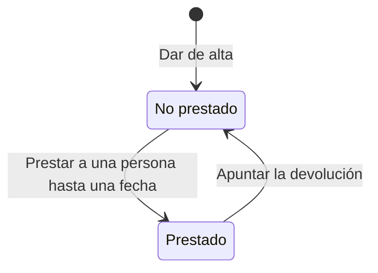

# Préstamo de equipos de la oficina

## Fuentes

- .diverger/inbox/peticion.md: petición del cliente con su anexo «API para el inventario de IT». Aporta el problema, los usuarios, el alcance, lo que queda fuera, el criterio de éxito, los riesgos y la API que debe exponerse tal cual.
- Respuestas del usuario (2 de noviembre de 2026): cierran las preguntas sobre nombres repetidos, la fecha de devolución, el acceso con Google y el mensaje del 401.

## Objetivo

Hoy los préstamos se apuntan en una hoja de cálculo que nadie mantiene al día: no se sabe qué equipos están prestados ni a quién, y cada pocos meses se pierde alguno o alguien se queda sin portátil porque se creía libre (peticion.md).

Una lista de los equipos de la oficina donde IT pueda apuntar a quién ha prestado cada uno y cuándo lo devuelve (peticion.md).

Métricas de éxito: durante el primer mes todos los préstamos se apuntan en la aplicación y no se pierde ningún equipo (peticion.md).

## Usuarios

- Equipo de IT: único usuario de la aplicación; entra con su cuenta de Google de la empresa, da de alta los equipos, apunta préstamos y devoluciones y consulta qué está prestado (peticion.md).
- Empleados: reciben los equipos prestados, pero no piden nada desde la aplicación (peticion.md).

## Alcance

- Dar de alta un equipo con su nombre, por ejemplo «Portátil 07» o «Proyector sala 2» (peticion.md).
- No permitir dos equipos con el mismo nombre (peticion.md, anexo).
- Comparar los nombres sin distinguir mayúsculas y quitando los espacios del principio y del final: «portátil 07 » repite «Portátil 07» (usuario).
- Rechazar una fecha de devolución que no sea real o no siga el formato AAAA-MM-DD con 400 {"error": "La fecha de devolución no es válida"}; una fecha pasada se acepta, porque IT puede apuntar préstamos con retraso (usuario).
- Apuntar el préstamo de un equipo con la persona y la fecha en que lo tiene que devolver (peticion.md).
- Apuntar la devolución cuando le devuelven el equipo a IT (peticion.md).
- Ver en todo momento qué equipos están prestados, a quién y hasta cuándo (peticion.md).

## Fuera de alcance

- Peticiones de los empleados desde la aplicación (peticion.md).
- Avisos de préstamos vencidos (peticion.md).
- Limitar el acceso solo a las cuentas de IT, en esta versión (usuario).

## Restricciones

- Solo la usa el equipo de IT, que entra con su cuenta de Google de la empresa (peticion.md).
- El inventario de IT se va a conectar a la aplicación, así que la API tiene que ser exactamente la del anexo (peticion.md, anexo).
- Todas las rutas necesitan haber iniciado sesión: sin un token válido responden 401 (peticion.md, anexo).
- Los errores son un objeto JSON con el mensaje exacto que indica el anexo (peticion.md, anexo).
- La fecha de devolución va como texto `AAAA-MM-DD` y se devuelve igual (peticion.md, anexo).
- Vale cualquier token de identidad de Google con el correo verificado y emitido para el cliente OAuth de la aplicación, como ya hace la plantilla (usuario).
- El inventario de IT entra con una cuenta de servicio de Google y su token de identidad (usuario).
- Sin un token válido, la respuesta es 401 con {"error": "Inicia sesión con Google."} (usuario).
- El minuto que preocupa al cliente es el tiempo de IT en la pantalla para apuntar un préstamo, no un requisito de rendimiento de la API (usuario).

## API fijada por el cliente

El inventario de IT se va a conectar a la aplicación, así que la API tiene que ser exactamente esta. Todas las rutas necesitan haber iniciado sesión: sin un token válido responden 401. Los errores son un objeto JSON `{"error": "<mensaje>"}` con el mensaje exacto que se indica.

| Operación | Petición | Respuesta correcta | Errores |
|---|---|---|---|
| Dar de alta un equipo | `POST /api/equipos` con `{"nombre": "Portátil 07"}` | 201 con `{"id": "…", "nombre": "Portátil 07", "prestado": false}` | 400 «Falta el nombre del equipo» si el nombre falta o está vacío. 409 «Ya hay un equipo con ese nombre» |
| Ver los equipos | `GET /api/equipos` | 200 con la lista de equipos, cada uno con `id`, `nombre` y `prestado`; si está prestado, también `persona` y `devolucion` | — |
| Prestar un equipo | `POST /api/equipos/{id}/prestamo` con `{"persona": "Ana Pérez", "devolucion": "2026-11-20"}` | 201 con el equipo: `id`, `nombre`, `prestado: true`, `persona` y `devolucion` | 400 «Faltan la persona o la fecha de devolución». 404 «No existe el equipo». 409 «El equipo ya está prestado» |
| Apuntar la devolución | `POST /api/equipos/{id}/devolucion` | 200 con el equipo y `prestado: false` | 404 «No existe el equipo». 409 «El equipo no está prestado» |

La fecha de devolución va como texto `AAAA-MM-DD` y se devuelve igual.

(peticion.md, «Anexo: API para el inventario de IT»)

## Riesgos

- Que IT deje de usar la aplicación si apuntar un préstamo cuesta más de un minuto (peticion.md).
- Que el inventario de IT deje de funcionar si la API cambia (peticion.md).

## Supuestos

- [SUPUESTO] La aplicación es web — se entra con cuenta de Google y hay una API HTTP, pero no se indica la plataforma.
- [SUPUESTO] Los equipos y préstamos se conservan entre sesiones — un inventario lo necesita, aunque no se dice.

## Preguntas abiertas

1. [alta] ¿IT trabaja desde una pantalla web además de la API, o solo se entrega la API?
2. [media] ¿Se pueden editar o dar de baja equipos (nombre erróneo, equipo retirado)? La API fijada no lo permite.
3. [media] ¿Se conserva el historial de préstamos o solo el estado actual? La API solo muestra el actual.
4. [media] ¿Cómo se mide «no se pierde ningún equipo» durante el primer mes y quién lo comprueba?
5. [media] ¿Se añaden los elementos habilitadores transversales de la plantilla (Sprint 0, rendimiento, pentesting, UAT y despliegue)?
6. [baja] ¿Cuántos equipos y personas de IT se esperan?

## Claridad

| Categoría | Claridad |
|---|---|
| Usuarios | 75 % |
| Problema | 75 % |
| Objetivo y métricas | 50 % |
| Alcance | 75 % |
| Fuera de alcance | 75 % |
| Restricciones | 75 % |
| Dependencias e integraciones | 75 % |
| Riesgos | 50 % |
| Global | 69 % |

## Diagramas

### Estados de un equipo

