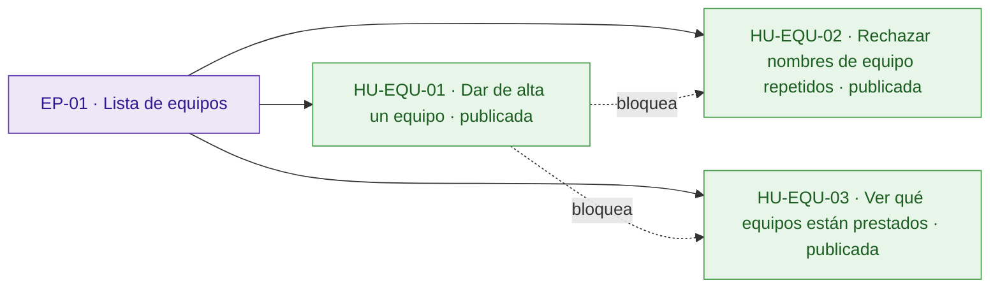
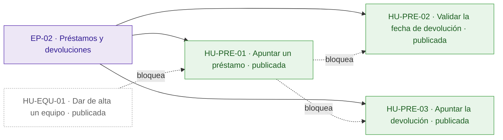
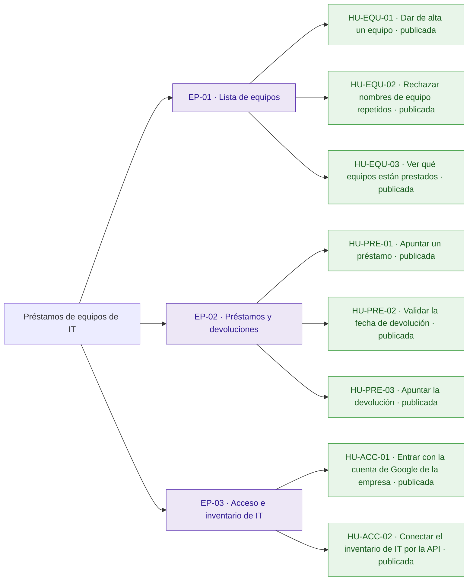
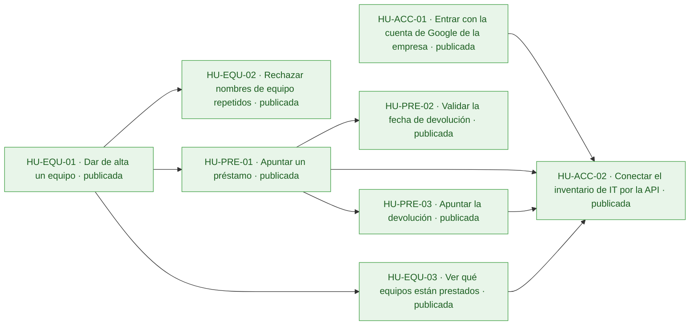
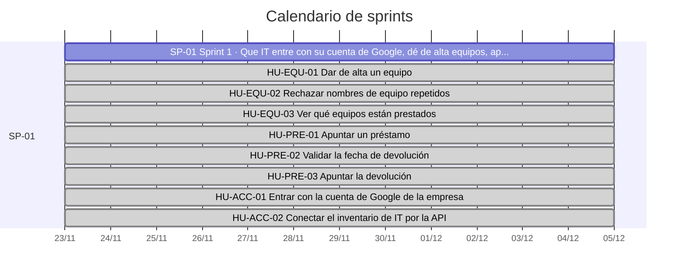

# Préstamos de equipos de IT

Hoy IT apunta los préstamos de equipos en una hoja de cálculo que nadie mantiene al día: no se sabe qué equipos están prestados ni a quién, y cada pocos meses se pierde alguno o alguien se queda sin portátil.

La aplicación da al equipo de IT una lista de los equipos de la oficina donde apunta cada préstamo, con la persona y la fecha de devolución, y cada devolución. Solo la usa IT, que entra con su cuenta de Google de la empresa, y el inventario de IT se conecta por la API fijada en el anexo de la petición. Quedan fuera las peticiones de los empleados y los avisos de préstamos vencidos.

## Visión y alcance

Tener una lista de los equipos de la oficina donde IT pueda apuntar a quién ha prestado cada uno y cuándo lo devuelve.

**Dentro del alcance**

- Dar de alta equipos con un nombre, por ejemplo «Portátil 07» o «Proyector sala 2» (peticion.md).
- Apuntar cada préstamo con la persona y la fecha en que tiene que devolverse (peticion.md).
- Apuntar la devolución cuando devuelven el equipo (peticion.md).
- Ver en todo momento qué equipos están prestados, a quién y hasta cuándo (peticion.md).
- No admitir dos equipos con el mismo nombre: dos nombres son el mismo si solo se diferencian en mayúsculas o en espacios al principio o al final (peticion.md, anexo).
- Validar la fecha de devolución: texto AAAA-MM-DD que sea una fecha que exista; una fecha pasada se acepta, porque IT a veces apunta los préstamos con retraso (peticion.md, anexo).
- Exponer la API del anexo para el inventario de IT: dar de alta un equipo, ver los equipos, prestar un equipo y apuntar la devolución, con los códigos y mensajes de error indicados (peticion.md, anexo).

**Fuera del alcance**

- Que los empleados pidan algo desde la aplicación (peticion.md).
- Avisos de préstamos vencidos (peticion.md).
- Limitar el acceso a las cuentas de IT, por ahora (peticion.md, anexo).

## Resumen en cifras

| Dato | Valor |
| --- | --- |
| Épicas | 3 |
| Historias | 8 |
| Historias por estado | borrador 0, aprobada 0, descartada 0, publicada 8 |
| Tareas | 25 |
| Sprints | 1 |
| Personas en el equipo | 1 |
| Modalidad de desarrollo | manual, sin IA |
| Horas estimadas | 30 h |
| Horas efectivas (según la modalidad de desarrollo) | 30 h |
| Historias sin estimar | 0 |
| Historias descartadas (fuera de las horas) | 0 |
| Supuestos | 20 |
| Preguntas abiertas | 5 |
| Requisitos | 9 |
| Requisitos sin historia | 0 |

## Índice

- [Visión y alcance](#visión-y-alcance)
- [Resumen en cifras](#resumen-en-cifras)
- [Épicas e historias](#épicas-e-historias)
  - [EP-01 · Lista de equipos](#ep-01--lista-de-equipos)
  - [EP-02 · Préstamos y devoluciones](#ep-02--préstamos-y-devoluciones)
  - [EP-03 · Acceso e inventario de IT](#ep-03--acceso-e-inventario-de-it)
- [Tareas](#tareas)
- [Sprints](#sprints)
- [Equipo](#equipo)
- [Dependencias](#dependencias)
- [Requisitos y trazabilidad](#requisitos-y-trazabilidad)
- [Preparación y definición de hecho](#preparación-y-definición-de-hecho)
- [Diagramas](#diagramas)
- [Supuestos](#supuestos)
- [Preguntas abiertas](#preguntas-abiertas)
- [Decisiones](#decisiones)

## Épicas e historias

### EP-01 · Lista de equipos

El equipo de IT da de alta los equipos de la oficina con su nombre y ve en todo momento cuáles están prestados, a quién y hasta cuándo. La lista no admite dos equipos con el mismo nombre. Apuntar préstamos y devoluciones queda en la épica EP-02 Préstamos y devoluciones.

#### Épica EP-01: Lista de equipos

#### HU-EQU-01 · Dar de alta un equipo

Como miembro del equipo de IT, quiero dar de alta un equipo de la oficina con su nombre, para tener en una sola lista todos los equipos que se pueden prestar.

**Contexto.** Cubre RQ.001 «Dar de alta equipos con un nombre» y la operación «Dar de alta un equipo» de RQ.007 (peticion.md y su anexo). Hoy los equipos están en una hoja de cálculo que nadie mantiene al día.

- **Prioridad:** Highest
- **Tamaño:** M
- **Horas:** 4 h estimadas · 4 h efectivas
- **Estado:** publicada
- **Sprint:** SP-01 Sprint 1
- **Responsable:** José Luis Calvo
- **Tipo:** historia
- **Puntos de historia:** 3
- **Preparación:** lista (pendiente: supuestos sin confirmar: DoR-04, DoR-05, DoR-06, DoR-07, DoR-09)
- **Requisitos:** RQ.001, RQ.007

**Criterios de aceptación**

*Escenarios positivos*

1. **Dado** un miembro del equipo de IT con sesión iniciada y una lista sin ningún equipo llamado «Portátil 07», **cuando** da de alta el equipo «Portátil 07», **entonces** «Portátil 07» aparece en la lista como no prestado.
2. **Dado** el inventario de IT con sesión iniciada y una lista sin ningún equipo llamado «Proyector sala 2», **cuando** envía \`POST /api/equipos\` con \`{"nombre": "Proyector sala 2"}\`, **entonces** recibe 201 con el \`id\` del equipo, \`nombre\` «Proyector sala 2» y \`prestado\` \`false\`.

*Escenarios negativos*

1. **Dado** un miembro del equipo de IT con sesión iniciada y una lista con 2 equipos, **cuando** da de alta un equipo con el nombre vacío, **entonces** ve «Falta el nombre del equipo» y la lista sigue con 2 equipos.
2. **Dado** el inventario de IT con sesión iniciada, **cuando** envía \`POST /api/equipos\` con \`{}\`, **entonces** recibe 400 con \`{"error": "Falta el nombre del equipo"}\` y no se guarda ningún equipo.

**Notas.** La pantalla de IT es un supuesto: la petición no dice si hace falta una interfaz web o basta con la API.

**Definición de hecho**

- Criterios de aceptación probados.
- La ruta, los códigos y los mensajes coinciden con el anexo de peticion.md.
- Textos revisados en español de España.

**Tareas**

- TA-001 · Modelo de datos del equipo: identificador, nombre y estado de préstamo · datos · José Luis Calvo
- TA-002 · Ruta POST /api/equipos con la validación del nombre · backend · José Luis Calvo
- TA-003 · Formulario de alta de equipo en la pantalla de IT · frontend · José Luis Calvo
- TA-004 · Pruebas del alta de equipos y del error 400 · QA · José Luis Calvo

#### HU-EQU-02 · Rechazar nombres de equipo repetidos

Como miembro del equipo de IT, quiero recibir un aviso al dar de alta un equipo con un nombre que ya existe, para no tener el mismo equipo dos veces en la lista.

**Contexto.** Cubre RQ.005 (peticion.md, anexo): dos nombres de equipo son el mismo si solo se diferencian en mayúsculas o en espacios al principio o al final, y el alta responde 409 «Ya hay un equipo con ese nombre».

- **Prioridad:** Highest
- **Tamaño:** S
- **Horas:** 2 h estimadas · 2 h efectivas
- **Estado:** publicada
- **Sprint:** SP-01 Sprint 1
- **Responsable:** José Luis Calvo
- **Tipo:** historia
- **Puntos de historia:** 2
- **Preparación:** parcialmente lista (pendiente: DoR-08: depende de HU-EQU-01, sin resolver ni planificada en un sprint anterior · supuestos sin confirmar: DoR-04, DoR-05, DoR-06, DoR-07, DoR-09)
- **Requisitos:** RQ.005, RQ.007
- **Depende de:**
  - HU-EQU-01 · Dar de alta un equipo: El aviso de nombre repetido exige poder dar de alta equipos.

**Criterios de aceptación**

*Escenarios positivos*

1. **Dado** un miembro del equipo de IT con sesión iniciada y una lista con el equipo «Portátil 07», **cuando** da de alta el equipo «Portátil 08», **entonces** «Portátil 08» aparece en la lista como no prestado, junto a «Portátil 07».

*Escenarios negativos*

1. **Dado** un miembro del equipo de IT con sesión iniciada y una lista con el equipo «Portátil 07», **cuando** da de alta el equipo « portátil 07 », en minúsculas y con un espacio al principio y otro al final, **entonces** ve «Ya hay un equipo con ese nombre» y la lista sigue con un solo «Portátil 07».
2. **Dado** el inventario de IT con sesión iniciada y una lista con el equipo «Portátil 07», **cuando** envía \`POST /api/equipos\` con \`{"nombre": "PORTÁTIL 07"}\`, **entonces** recibe 409 con \`{"error": "Ya hay un equipo con ese nombre"}\` y no se guarda ningún equipo.

**Definición de hecho**

- Criterios de aceptación probados.
- El código y el mensaje coinciden con el anexo de peticion.md.

**Tareas**

- TA-005 · Comparación de nombres sin distinguir mayúsculas ni espacios de los extremos y error 409 · backend · José Luis Calvo
- TA-006 · Aviso de nombre repetido en el formulario de alta · frontend · José Luis Calvo
- TA-007 · Pruebas de nombres repetidos con mayúsculas y espacios · QA · José Luis Calvo

#### HU-EQU-03 · Ver qué equipos están prestados

Como miembro del equipo de IT, quiero ver qué equipos están prestados, a quién y hasta cuándo, para saber si un equipo está libre antes de prestarlo y a quién reclamar los que faltan.

**Contexto.** Cubre RQ.004 «Ver en todo momento qué equipos están prestados, a quién y hasta cuándo» y la operación «Ver los equipos» de RQ.007 (peticion.md y su anexo). Hoy no se sabe qué equipos están prestados ni a quién.

- **Prioridad:** Highest
- **Tamaño:** M
- **Horas:** 4 h estimadas · 4 h efectivas
- **Estado:** publicada
- **Sprint:** SP-01 Sprint 1
- **Responsable:** José Luis Calvo
- **Tipo:** historia
- **Puntos de historia:** 3
- **Preparación:** parcialmente lista (pendiente: DoR-08: depende de HU-EQU-01, sin resolver ni planificada en un sprint anterior · supuestos sin confirmar: DoR-04, DoR-05, DoR-06, DoR-07, DoR-09)
- **Requisitos:** RQ.004, RQ.007
- **Depende de:**
  - HU-EQU-01 · Dar de alta un equipo: La lista necesita equipos dados de alta.

**Criterios de aceptación**

*Escenarios positivos*

1. **Dado** un miembro del equipo de IT con sesión iniciada, el equipo «Portátil 07» prestado a «Ana Pérez» con devolución «2026-11-20» y el equipo «Proyector sala 2» sin prestar, **cuando** abre la lista de equipos, **entonces** ve «Portátil 07» como prestado a «Ana Pérez» hasta «2026-11-20» y «Proyector sala 2» como no prestado.
2. **Dado** el inventario de IT con sesión iniciada, el equipo «Portátil 07» prestado a «Ana Pérez» con devolución «2026-11-20» y el equipo «Proyector sala 2» sin prestar, **cuando** envía \`GET /api/equipos\`, **entonces** recibe 200 con los 2 equipos: «Portátil 07» con \`id\`, \`nombre\`, \`prestado\` \`true\`, \`persona\` «Ana Pérez» y \`devolucion\` «2026-11-20», y «Proyector sala 2» con \`id\`, \`nombre\` y \`prestado\` \`false\`, sin \`persona\` ni \`devolucion\`.

*Escenarios negativos*

1. **Dado** una persona sin sesión iniciada, **cuando** abre la lista de equipos, **entonces** ve «Inicia sesión con Google.» y no ve ningún equipo ni ningún préstamo.

**Notas.** La pantalla de IT es un supuesto: la petición no dice si hace falta una interfaz web o basta con la API.

**Definición de hecho**

- Criterios de aceptación probados.
- La ruta, los campos y los códigos coinciden con el anexo de peticion.md.
- Textos revisados en español de España.

**Tareas**

- TA-008 · Ruta GET /api/equipos con la persona y la devolución de los equipos prestados · backend · José Luis Calvo
- TA-009 · Lista de equipos con su estado, la persona y la fecha de devolución · frontend · José Luis Calvo
- TA-010 · Pruebas de la lista con equipos prestados y sin prestar · QA · José Luis Calvo

### EP-02 · Préstamos y devoluciones

El equipo de IT apunta cada préstamo con la persona y la fecha de devolución, y apunta la devolución cuando le devuelven el equipo. La fecha de devolución tiene que existir, aunque ya haya pasado. Quedan fuera las peticiones de los empleados desde la aplicación y los avisos de préstamos vencidos.

#### Épica EP-02: Préstamos y devoluciones

#### HU-PRE-01 · Apuntar un préstamo

Como miembro del equipo de IT, quiero apuntar el préstamo de un equipo con la persona y la fecha en que tiene que devolverlo, para que no se pierda ningún equipo por no saber quién lo tiene.

**Contexto.** Cubre RQ.002 «Apuntar cada préstamo con la persona y la fecha en que tiene que devolverse» y la operación «Prestar un equipo» de RQ.007 (peticion.md y su anexo).

- **Prioridad:** Highest
- **Tamaño:** M
- **Horas:** 4 h estimadas · 4 h efectivas
- **Estado:** publicada
- **Sprint:** SP-01 Sprint 1
- **Responsable:** José Luis Calvo
- **Tipo:** historia
- **Puntos de historia:** 3
- **Preparación:** parcialmente lista (pendiente: DoR-08: depende de HU-EQU-01, sin resolver ni planificada en un sprint anterior · supuestos sin confirmar: DoR-04, DoR-05, DoR-06, DoR-07, DoR-09)
- **Requisitos:** RQ.002, RQ.007
- **Depende de:**
  - HU-EQU-01 · Dar de alta un equipo: Prestar exige un equipo dado de alta.

**Criterios de aceptación**

*Escenarios positivos*

1. **Dado** un miembro del equipo de IT con sesión iniciada y el equipo «Portátil 07» sin prestar, **cuando** apunta el préstamo de «Portátil 07» a «Ana Pérez» con devolución «2026-11-20», **entonces** «Portátil 07» pasa a figurar como prestado a «Ana Pérez» hasta «2026-11-20».
2. **Dado** el inventario de IT con sesión iniciada y el equipo «Portátil 07» sin prestar, **cuando** envía \`POST /api/equipos/{id}/prestamo\` con el \`id\` de «Portátil 07» y \`{"persona": "Ana Pérez", "devolucion": "2026-11-20"}\`, **entonces** recibe 201 con el equipo: \`id\`, \`nombre\` «Portátil 07», \`prestado\` \`true\`, \`persona\` «Ana Pérez» y \`devolucion\` «2026-11-20».

*Escenarios negativos*

1. **Dado** un miembro del equipo de IT con sesión iniciada y el equipo «Portátil 07» sin prestar, **cuando** apunta el préstamo de «Portátil 07» con devolución «2026-11-20» y sin persona, **entonces** ve «Faltan la persona o la fecha de devolución» y «Portátil 07» sigue como no prestado.
2. **Dado** un miembro del equipo de IT con sesión iniciada y el equipo «Portátil 07» prestado a «Ana Pérez» con devolución «2026-11-20», **cuando** apunta el préstamo de «Portátil 07» a «Luis Gómez» con devolución «2026-11-27», **entonces** ve «El equipo ya está prestado» y «Portátil 07» sigue prestado a «Ana Pérez» hasta «2026-11-20».
3. **Dado** el inventario de IT con sesión iniciada y ningún equipo con el \`id\` «no-existe», **cuando** envía \`POST /api/equipos/no-existe/prestamo\` con \`{"persona": "Ana Pérez", "devolucion": "2026-11-20"}\`, **entonces** recibe 404 con \`{"error": "No existe el equipo"}\`.

**Notas.** La petición señala como riesgo que IT deje de usar la aplicación si apuntar un préstamo cuesta más de un minuto. Sigue abierta la pregunta de qué incluye ese minuto.

**Definición de hecho**

- Criterios de aceptación probados.
- La ruta, los códigos y los mensajes coinciden con el anexo de peticion.md.
- Textos revisados en español de España.

**Tareas**

- TA-011 · Datos del préstamo en el equipo: persona y fecha de devolución · datos · José Luis Calvo
- TA-012 · Ruta POST /api/equipos/{id}/prestamo con los errores 400, 404 y 409 · backend · José Luis Calvo
- TA-013 · Formulario de préstamo con la persona y la fecha de devolución · frontend · José Luis Calvo
- TA-014 · Pruebas del préstamo y de sus errores · QA · José Luis Calvo

#### HU-PRE-02 · Validar la fecha de devolución

Como miembro del equipo de IT, quiero recibir un aviso al apuntar un préstamo con una fecha de devolución que no existe, para que la lista no muestre fechas de devolución imposibles.

**Contexto.** Cubre RQ.006 (peticion.md, anexo): la fecha de devolución va como texto AAAA-MM-DD y se devuelve igual, tiene que ser una fecha que exista («2026-02-30» no vale) y una fecha pasada se acepta, porque IT a veces apunta los préstamos con retraso.

- **Prioridad:** Highest
- **Tamaño:** S
- **Horas:** 2 h estimadas · 2 h efectivas
- **Estado:** publicada
- **Sprint:** SP-01 Sprint 1
- **Responsable:** José Luis Calvo
- **Tipo:** historia
- **Puntos de historia:** 2
- **Preparación:** parcialmente lista (pendiente: DoR-08: depende de HU-PRE-01, sin resolver ni planificada en un sprint anterior · supuestos sin confirmar: DoR-04, DoR-05, DoR-06, DoR-07, DoR-09)
- **Requisitos:** RQ.006, RQ.007
- **Depende de:**
  - HU-PRE-01 · Apuntar un préstamo: La validación de la fecha exige poder apuntar préstamos.

**Criterios de aceptación**

*Escenarios positivos*

1. **Dado** un miembro del equipo de IT con sesión iniciada el 19 de noviembre de 2026 y el equipo «Portátil 07» sin prestar, **cuando** apunta el préstamo de «Portátil 07» a «Ana Pérez» con devolución «2026-11-02», una fecha pasada, **entonces** «Portátil 07» pasa a figurar como prestado a «Ana Pérez» hasta «2026-11-02».

*Escenarios negativos*

1. **Dado** un miembro del equipo de IT con sesión iniciada y el equipo «Portátil 07» sin prestar, **cuando** apunta el préstamo de «Portátil 07» a «Ana Pérez» con devolución «2026-02-30», **entonces** ve «La fecha de devolución no es válida» y «Portátil 07» sigue como no prestado.
2. **Dado** el inventario de IT con sesión iniciada y el equipo «Portátil 07» sin prestar, **cuando** envía \`POST /api/equipos/{id}/prestamo\` con el \`id\` de «Portátil 07» y \`{"persona": "Ana Pérez", "devolucion": "2026-02-30"}\`, **entonces** recibe 400 con \`{"error": "La fecha de devolución no es válida"}\` y «Portátil 07» sigue como no prestado.

**Definición de hecho**

- Criterios de aceptación probados.
- El código y el mensaje coinciden con el anexo de peticion.md.

**Tareas**

- TA-015 · Validación de la fecha AAAA-MM-DD como fecha que existe, aceptando fechas pasadas · backend · José Luis Calvo
- TA-016 · Aviso de fecha no válida en el formulario de préstamo · frontend · José Luis Calvo
- TA-017 · Pruebas de fechas que no existen y de fechas pasadas · QA · José Luis Calvo

#### HU-PRE-03 · Apuntar la devolución

Como miembro del equipo de IT, quiero apuntar la devolución de un equipo prestado, para que el equipo vuelva a figurar como libre para el siguiente préstamo.

**Contexto.** Cubre RQ.003 «Apuntar la devolución cuando devuelven el equipo» y la operación «Apuntar la devolución» de RQ.007 (peticion.md y su anexo).

- **Prioridad:** Highest
- **Tamaño:** S
- **Horas:** 2 h estimadas · 2 h efectivas
- **Estado:** publicada
- **Sprint:** SP-01 Sprint 1
- **Responsable:** José Luis Calvo
- **Tipo:** historia
- **Puntos de historia:** 2
- **Preparación:** parcialmente lista (pendiente: DoR-08: depende de HU-PRE-01, sin resolver ni planificada en un sprint anterior · supuestos sin confirmar: DoR-04, DoR-05, DoR-06, DoR-07, DoR-09)
- **Requisitos:** RQ.003, RQ.007
- **Depende de:**
  - HU-PRE-01 · Apuntar un préstamo: Devolver exige un préstamo apuntado.

**Criterios de aceptación**

*Escenarios positivos*

1. **Dado** un miembro del equipo de IT con sesión iniciada y el equipo «Portátil 07» prestado a «Ana Pérez» con devolución «2026-11-20», **cuando** apunta la devolución de «Portátil 07», **entonces** «Portátil 07» pasa a figurar como no prestado, sin persona ni fecha de devolución.
2. **Dado** el inventario de IT con sesión iniciada y el equipo «Portátil 07» prestado a «Ana Pérez» con devolución «2026-11-20», **cuando** envía \`POST /api/equipos/{id}/devolucion\` con el \`id\` de «Portátil 07», **entonces** recibe 200 con el equipo «Portátil 07» y \`prestado\` \`false\`.

*Escenarios negativos*

1. **Dado** un miembro del equipo de IT con sesión iniciada y el equipo «Proyector sala 2» sin prestar, **cuando** apunta la devolución de «Proyector sala 2», **entonces** ve «El equipo no está prestado» y «Proyector sala 2» sigue como no prestado.
2. **Dado** el inventario de IT con sesión iniciada y ningún equipo con el \`id\` «no-existe», **cuando** envía \`POST /api/equipos/no-existe/devolucion\`, **entonces** recibe 404 con \`{"error": "No existe el equipo"}\`.

**Notas.** Sigue abierta la pregunta de si hay que conservar el historial de préstamos; la API del anexo no lo contempla.

**Definición de hecho**

- Criterios de aceptación probados.
- La ruta, los códigos y los mensajes coinciden con el anexo de peticion.md.
- Textos revisados en español de España.

**Tareas**

- TA-018 · Ruta POST /api/equipos/{id}/devolucion con los errores 404 y 409 · backend · José Luis Calvo
- TA-019 · Acción de devolución en la lista de equipos · frontend · José Luis Calvo
- TA-020 · Pruebas de la devolución y de sus errores · QA · José Luis Calvo

### EP-03 · Acceso e inventario de IT

El equipo de IT entra con su cuenta de Google de la empresa y el inventario de IT se conecta por la API del anexo con una cuenta de servicio. Sin sesión iniciada, ninguna ruta responde con datos. Por ahora queda fuera limitar el acceso a las cuentas de IT.

#### Épica EP-03: Acceso e inventario de IT

```mermaid
flowchart LR
    EP_03["EP-03 · Acceso e inventario de IT"]
    HU_ACC_01["HU-ACC-01 · Entrar con la cuenta de Google de la empresa · publicada"]
    EP_03 --> HU_ACC_01
    HU_ACC_02["HU-ACC-02 · Conectar el inventario de IT por la API · publicada"]
    EP_03 --> HU_ACC_02
    HU_PRE_01["HU-PRE-01 · Apuntar un préstamo · publicada"]
    HU_PRE_03["HU-PRE-03 · Apuntar la devolución · publicada"]
    HU_EQU_03["HU-EQU-03 · Ver qué equipos están prestados · publicada"]
    HU_ACC_01 -.->|bloquea| HU_ACC_02
    HU_PRE_01 -.->|bloquea| HU_ACC_02
    HU_PRE_03 -.->|bloquea| HU_ACC_02
    HU_EQU_03 -.->|bloquea| HU_ACC_02
    classDef epic fill:#ede7f6,stroke:#5e35b1,color:#311b92
    classDef published fill:#e8f5e9,stroke:#43a047,color:#1b5e20
    classDef external fill:#ffffff,stroke:#9e9e9e,color:#616161,stroke-dasharray:2 2
    class EP_03 epic
    class HU_ACC_01,HU_ACC_02 published
    class HU_PRE_01,HU_PRE_03,HU_EQU_03 external
```

#### HU-ACC-01 · Entrar con la cuenta de Google de la empresa

Como miembro del equipo de IT, quiero entrar en la aplicación con mi cuenta de Google de la empresa, para no tener que recordar otra contraseña para apuntar los préstamos.

**Contexto.** Cubre RQ.008 (peticion.md y su anexo): solo usa la aplicación el equipo de IT, que entra con su cuenta de Google de la empresa, y todas las rutas necesitan haber iniciado sesión con un token de identidad de Google con el correo verificado, emitido para el cliente OAuth de la aplicación.

- **Prioridad:** Highest
- **Tamaño:** L
- **Horas:** 8 h estimadas · 8 h efectivas
- **Estado:** publicada
- **Sprint:** SP-01 Sprint 1
- **Responsable:** José Luis Calvo
- **Tipo:** historia
- **Puntos de historia:** 5
- **Preparación:** parcialmente lista (pendiente: DoR-08: dependencias externas sin plan confirmado: Acceso con la cuenta de Google de la empresa · supuestos sin confirmar: DoR-04, DoR-05, DoR-06, DoR-07, DoR-09)
- **Requisitos:** RQ.008
- **Dependencias externas:** Acceso con la cuenta de Google de la empresa

**Criterios de aceptación**

*Escenarios positivos*

1. **Dado** un miembro del equipo de IT sin sesión iniciada, con la cuenta de Google de la empresa «it@empresa.example» y el correo verificado, **cuando** inicia sesión con esa cuenta de Google, **entonces** entra en la aplicación y ve la lista de equipos.

*Escenarios negativos*

1. **Dado** una persona sin sesión iniciada, **cuando** envía \`GET /api/equipos\` sin token, **entonces** recibe 401 con \`{"error": "Inicia sesión con Google."}\`.
2. **Dado** una persona con un token de identidad de Google emitido para otro cliente OAuth distinto del de la aplicación, **cuando** envía \`GET /api/equipos\` con ese token, **entonces** recibe 401 con \`{"error": "Inicia sesión con Google."}\`.
3. **Dado** una persona con un token de identidad de Google emitido para el cliente OAuth de la aplicación y con el correo sin verificar, y el equipo «Portátil 07» sin prestar, **cuando** envía \`POST /api/equipos/{id}/prestamo\` con el \`id\` de «Portátil 07», ese token y \`{"persona": "Ana Pérez", "devolucion": "2026-11-20"}\`, **entonces** recibe 401 con \`{"error": "Inicia sesión con Google."}\` y «Portátil 07» sigue como no prestado.

**Notas.** Por ahora no hace falta limitar el acceso a las cuentas de IT (peticion.md, anexo). Sigue abierta la pregunta de si debe restringirse más adelante. \[SUPUESTO\] El token se envía como Bearer en la cabecera Authorization.

**Definición de hecho**

- Criterios de aceptación probados.
- El código y el mensaje del 401 coinciden con el anexo de peticion.md.
- Textos revisados en español de España.

**Tareas**

- TA-021 · Comprobación del token de identidad de Google en todas las rutas y error 401 · backend · José Luis Calvo
- TA-022 · Inicio de sesión con Google en la pantalla de IT · frontend · José Luis Calvo
- TA-023 · Pruebas del acceso con y sin token válido · QA · José Luis Calvo

#### HU-ACC-02 · Conectar el inventario de IT por la API

Como inventario de IT, quiero usar la API del anexo con mi cuenta de servicio, para que el inventario de IT no deje de funcionar por un cambio de la API.

**Contexto.** Cubre RQ.007, RQ.008 y RQ.009 (peticion.md, anexo): el inventario de IT se va a conectar a la aplicación con una cuenta de servicio, así que la API tiene que ser exactamente la del anexo y los errores son un objeto JSON \`{"error": "\<mensaje\>"}\` con el mensaje exacto.

- **Prioridad:** Highest
- **Tamaño:** M
- **Horas:** 4 h estimadas · 4 h efectivas
- **Estado:** publicada
- **Sprint:** SP-01 Sprint 1
- **Responsable:** José Luis Calvo
- **Tipo:** historia
- **Puntos de historia:** 3
- **Preparación:** parcialmente lista (pendiente: DoR-08: dependencias externas sin plan confirmado: Inventario de IT; Acceso con la cuenta de Google de la empresa; depende de HU-ACC-01, HU-PRE-01, HU-PRE-03, HU-EQU-03, sin resolver ni planificada en un sprint anterior · supuestos sin confirmar: DoR-04, DoR-05, DoR-06, DoR-07, DoR-09)
- **Requisitos:** RQ.007, RQ.008, RQ.009
- **Dependencias externas:** Inventario de IT; Acceso con la cuenta de Google de la empresa
- **Depende de:**
  - HU-ACC-01 · Entrar con la cuenta de Google de la empresa: La cuenta de servicio pasa por la misma comprobación del token de Google.
  - HU-PRE-01 · Apuntar un préstamo: La comprobación de la API completa exige las rutas de alta y de préstamo.
  - HU-PRE-03 · Apuntar la devolución: La comprobación de la API completa exige la ruta de devolución.
  - HU-EQU-03 · Ver qué equipos están prestados: La comprobación exige la ruta que lista los equipos.

**Criterios de aceptación**

*Escenarios positivos*

1. **Dado** el inventario de IT con un token de identidad de Google de su cuenta de servicio, con el correo verificado y emitido para el cliente OAuth de la aplicación, y una lista con el equipo «Portátil 07», **cuando** envía \`GET /api/equipos\` con ese token, **entonces** recibe 200 con la lista de equipos, en la que está «Portátil 07».

*Escenarios negativos*

1. **Dado** el inventario de IT con un token de identidad de Google de su cuenta de servicio, emitido para el cliente OAuth de la aplicación y con el correo sin verificar, **cuando** envía \`GET /api/equipos\` con ese token, **entonces** recibe 401 con \`{"error": "Inicia sesión con Google."}\` y ningún equipo.
2. **Dado** el inventario de IT con un token válido de su cuenta de servicio y ningún equipo con el \`id\` «no-existe», **cuando** envía \`POST /api/equipos/no-existe/devolucion\` con ese token, **entonces** recibe 404 con un objeto JSON cuyo único campo es \`error\`, con el valor «No existe el equipo».

**Notas.** La petición señala como riesgo que el inventario deje de funcionar si la API cambia. Sigue abierta la pregunta de si la API puede cambiar en el futuro con versiones.

**Definición de hecho**

- Criterios de aceptación probados.
- Las cuatro operaciones del anexo de peticion.md se comprueban con un token de cuenta de servicio: rutas, códigos, campos y mensajes exactos.

**Tareas**

- TA-024 · Aceptación de tokens de cuenta de servicio y formato JSON de todos los errores · backend · José Luis Calvo
- TA-025 · Pruebas de las cuatro operaciones del anexo con un token de cuenta de servicio · QA · José Luis Calvo

## Tareas

| ID | Título | Historia | Disciplina | Descripción | Responsable | Horas estimadas | Horas efectivas |
| --- | --- | --- | --- | --- | --- | --- | --- |
| TA-001 | Modelo de datos del equipo: identificador, nombre y estado de préstamo | HU-EQU-01 · Dar de alta un equipo | datos |   | José Luis Calvo |   |   |
| TA-002 | Ruta POST /api/equipos con la validación del nombre | HU-EQU-01 · Dar de alta un equipo | backend |   | José Luis Calvo |   |   |
| TA-003 | Formulario de alta de equipo en la pantalla de IT | HU-EQU-01 · Dar de alta un equipo | frontend |   | José Luis Calvo |   |   |
| TA-004 | Pruebas del alta de equipos y del error 400 | HU-EQU-01 · Dar de alta un equipo | QA |   | José Luis Calvo |   |   |
| TA-005 | Comparación de nombres sin distinguir mayúsculas ni espacios de los extremos y error 409 | HU-EQU-02 · Rechazar nombres de equipo repetidos | backend |   | José Luis Calvo |   |   |
| TA-006 | Aviso de nombre repetido en el formulario de alta | HU-EQU-02 · Rechazar nombres de equipo repetidos | frontend |   | José Luis Calvo |   |   |
| TA-007 | Pruebas de nombres repetidos con mayúsculas y espacios | HU-EQU-02 · Rechazar nombres de equipo repetidos | QA |   | José Luis Calvo |   |   |
| TA-008 | Ruta GET /api/equipos con la persona y la devolución de los equipos prestados | HU-EQU-03 · Ver qué equipos están prestados | backend |   | José Luis Calvo |   |   |
| TA-009 | Lista de equipos con su estado, la persona y la fecha de devolución | HU-EQU-03 · Ver qué equipos están prestados | frontend |   | José Luis Calvo |   |   |
| TA-010 | Pruebas de la lista con equipos prestados y sin prestar | HU-EQU-03 · Ver qué equipos están prestados | QA |   | José Luis Calvo |   |   |
| TA-011 | Datos del préstamo en el equipo: persona y fecha de devolución | HU-PRE-01 · Apuntar un préstamo | datos |   | José Luis Calvo |   |   |
| TA-012 | Ruta POST /api/equipos/{id}/prestamo con los errores 400, 404 y 409 | HU-PRE-01 · Apuntar un préstamo | backend |   | José Luis Calvo |   |   |
| TA-013 | Formulario de préstamo con la persona y la fecha de devolución | HU-PRE-01 · Apuntar un préstamo | frontend |   | José Luis Calvo |   |   |
| TA-014 | Pruebas del préstamo y de sus errores | HU-PRE-01 · Apuntar un préstamo | QA |   | José Luis Calvo |   |   |
| TA-015 | Validación de la fecha AAAA-MM-DD como fecha que existe, aceptando fechas pasadas | HU-PRE-02 · Validar la fecha de devolución | backend |   | José Luis Calvo |   |   |
| TA-016 | Aviso de fecha no válida en el formulario de préstamo | HU-PRE-02 · Validar la fecha de devolución | frontend |   | José Luis Calvo |   |   |
| TA-017 | Pruebas de fechas que no existen y de fechas pasadas | HU-PRE-02 · Validar la fecha de devolución | QA |   | José Luis Calvo |   |   |
| TA-018 | Ruta POST /api/equipos/{id}/devolucion con los errores 404 y 409 | HU-PRE-03 · Apuntar la devolución | backend |   | José Luis Calvo |   |   |
| TA-019 | Acción de devolución en la lista de equipos | HU-PRE-03 · Apuntar la devolución | frontend |   | José Luis Calvo |   |   |
| TA-020 | Pruebas de la devolución y de sus errores | HU-PRE-03 · Apuntar la devolución | QA |   | José Luis Calvo |   |   |
| TA-021 | Comprobación del token de identidad de Google en todas las rutas y error 401 | HU-ACC-01 · Entrar con la cuenta de Google de la empresa | backend |   | José Luis Calvo |   |   |
| TA-022 | Inicio de sesión con Google en la pantalla de IT | HU-ACC-01 · Entrar con la cuenta de Google de la empresa | frontend |   | José Luis Calvo |   |   |
| TA-023 | Pruebas del acceso con y sin token válido | HU-ACC-01 · Entrar con la cuenta de Google de la empresa | QA |   | José Luis Calvo |   |   |
| TA-024 | Aceptación de tokens de cuenta de servicio y formato JSON de todos los errores | HU-ACC-02 · Conectar el inventario de IT por la API | backend |   | José Luis Calvo |   |   |
| TA-025 | Pruebas de las cuatro operaciones del anexo con un token de cuenta de servicio | HU-ACC-02 · Conectar el inventario de IT por la API | QA |   | José Luis Calvo |   |   |

## Sprints

| Sprint | Fechas | Objetivo | Historias | Capacidad (h) | Carga (h efectivas) |
| --- | --- | --- | --- | --- | --- |
| SP-01 Sprint 1 | del 23/11/2026 al 04/12/2026 | Que IT entre con su cuenta de Google, dé de alta equipos, apunte préstamos y devoluciones y vea qué está prestado, con la API del anexo lista para el inventario. | 8 | 56 h | 30 h · 54 % |

Historias sin sprint: 0.

## Equipo

| Nombre | Rol | Dedicación | Usa un agente de IA |
| --- | --- | --- | --- |
| José Luis Calvo | Desarrollo | 100 % | sí |

*Por privacidad, este documento no incluye correos electrónicos ni usuarios de GitHub o Trello.*

## Dependencias

| Historia | Bloqueada por | Motivo |
| --- | --- | --- |
| HU-EQU-02 · Rechazar nombres de equipo repetidos | HU-EQU-01 · Dar de alta un equipo | El aviso de nombre repetido exige poder dar de alta equipos. |
| HU-EQU-03 · Ver qué equipos están prestados | HU-EQU-01 · Dar de alta un equipo | La lista necesita equipos dados de alta. |
| HU-PRE-01 · Apuntar un préstamo | HU-EQU-01 · Dar de alta un equipo | Prestar exige un equipo dado de alta. |
| HU-PRE-02 · Validar la fecha de devolución | HU-PRE-01 · Apuntar un préstamo | La validación de la fecha exige poder apuntar préstamos. |
| HU-PRE-03 · Apuntar la devolución | HU-PRE-01 · Apuntar un préstamo | Devolver exige un préstamo apuntado. |
| HU-ACC-02 · Conectar el inventario de IT por la API | HU-ACC-01 · Entrar con la cuenta de Google de la empresa | La cuenta de servicio pasa por la misma comprobación del token de Google. |
| HU-ACC-02 · Conectar el inventario de IT por la API | HU-PRE-01 · Apuntar un préstamo | La comprobación de la API completa exige las rutas de alta y de préstamo. |
| HU-ACC-02 · Conectar el inventario de IT por la API | HU-PRE-03 · Apuntar la devolución | La comprobación de la API completa exige la ruta de devolución. |
| HU-ACC-02 · Conectar el inventario de IT por la API | HU-EQU-03 · Ver qué equipos están prestados | La comprobación exige la ruta que lista los equipos. |

## Requisitos y trazabilidad

| Requisito | Título | Tipo | Origen | Historias | Cobertura |
| --- | --- | --- | --- | --- | --- |
| RQ.001 | Dar de alta equipos con un nombre, por ejemplo «Portátil 07» o «Proyector sala 2» | Funcional | peticion.md | HU-EQU-01 | cubierto |
| RQ.002 | Apuntar cada préstamo con la persona y la fecha en que tiene que devolverse | Funcional | peticion.md | HU-PRE-01 | cubierto |
| RQ.003 | Apuntar la devolución cuando devuelven el equipo | Funcional | peticion.md | HU-PRE-03 | cubierto |
| RQ.004 | Ver en todo momento qué equipos están prestados, a quién y hasta cuándo | Funcional | peticion.md | HU-EQU-03 | cubierto |
| RQ.005 | No admitir dos equipos con el mismo nombre: dos nombres son el mismo si solo se diferencian en mayúsculas o en espacios al principio o al final | Funcional | peticion.md | HU-EQU-02 | cubierto |
| RQ.006 | Validar la fecha de devolución: texto AAAA-MM-DD que sea una fecha que exista; una fecha pasada se acepta | Funcional | peticion.md | HU-PRE-02 | cubierto |
| RQ.007 | Exponer la API del anexo para el inventario de IT: dar de alta un equipo, ver los equipos, prestar un equipo y apuntar la devolución, con los códigos y mensajes de error indicados | Funcional | peticion.md | HU-EQU-01, HU-EQU-02, HU-EQU-03, HU-PRE-01, HU-PRE-02, HU-PRE-03, HU-ACC-02 | cubierto |
| RQ.008 | Todas las rutas necesitan haber iniciado sesión con un token de identidad de Google válido; sin él responden 401 con «Inicia sesión con Google.» | No funcional: seguridad | peticion.md | HU-ACC-01, HU-ACC-02 | cubierto |
| RQ.009 | Los errores son un objeto JSON {"error": "\<mensaje\>"} con el mensaje exacto que se indica | No funcional: compatibilidad | peticion.md | HU-ACC-02 | cubierto |

Requisitos sin ninguna historia: 0 de 9.

## Preparación y definición de hecho

**Definición de preparado (DoR)**

- Historia con título, descripción y valor de negocio claros.
- Trazabilidad a uno o varios RQ registrada.
- Criterios de aceptación verificables definidos.
- Reglas funcionales necesarias cerradas.
- Diseño/prototipo o referencia UI disponible cuando aplique.
- Fuentes/campos de datos identificados cuando aplique.
- Datos de prueba suficientes o estrategia de mock definida.
- Dependencias externas resueltas o plan temporal explícito.
- Permisos/roles definidos si afectan a la historia.
- La historia puede completarse razonablemente dentro de un sprint.
- No hay decisiones de negocio abiertas que impidan implementar o probar.

**Definición de hecho del proyecto (DoD)**

- Todos los criterios de aceptación implementados.
- Código revisado y mergeado conforme al flujo acordado.
- Tests unitarios y de integración asociados en verde.
- Pruebas funcionales ejecutadas correctamente.
- Comportamiento validado con los datos disponibles.
- Permisos/RLS verificados cuando corresponda.
- Rendimiento contrastado cuando el RQ lo requiera.
- Sin defectos críticos o bloqueantes asociados.
- Desplegada en el entorno previsto para el sprint.
- Trazabilidad HU → RQ → prueba/evidencia actualizada.

**Historias que no están listas del todo**

| ID | Historia | Preparación | Pendiente |
| --- | --- | --- | --- |
| HU-EQU-02 | Rechazar nombres de equipo repetidos | parcialmente lista | DoR-08: depende de HU-EQU-01, sin resolver ni planificada en un sprint anterior · supuestos sin confirmar: DoR-04, DoR-05, DoR-06, DoR-07, DoR-09 |
| HU-EQU-03 | Ver qué equipos están prestados | parcialmente lista | DoR-08: depende de HU-EQU-01, sin resolver ni planificada en un sprint anterior · supuestos sin confirmar: DoR-04, DoR-05, DoR-06, DoR-07, DoR-09 |
| HU-PRE-01 | Apuntar un préstamo | parcialmente lista | DoR-08: depende de HU-EQU-01, sin resolver ni planificada en un sprint anterior · supuestos sin confirmar: DoR-04, DoR-05, DoR-06, DoR-07, DoR-09 |
| HU-PRE-02 | Validar la fecha de devolución | parcialmente lista | DoR-08: depende de HU-PRE-01, sin resolver ni planificada en un sprint anterior · supuestos sin confirmar: DoR-04, DoR-05, DoR-06, DoR-07, DoR-09 |
| HU-PRE-03 | Apuntar la devolución | parcialmente lista | DoR-08: depende de HU-PRE-01, sin resolver ni planificada en un sprint anterior · supuestos sin confirmar: DoR-04, DoR-05, DoR-06, DoR-07, DoR-09 |
| HU-ACC-01 | Entrar con la cuenta de Google de la empresa | parcialmente lista | DoR-08: dependencias externas sin plan confirmado: Acceso con la cuenta de Google de la empresa · supuestos sin confirmar: DoR-04, DoR-05, DoR-06, DoR-07, DoR-09 |
| HU-ACC-02 | Conectar el inventario de IT por la API | parcialmente lista | DoR-08: dependencias externas sin plan confirmado: Inventario de IT; Acceso con la cuenta de Google de la empresa; depende de HU-ACC-01, HU-PRE-01, HU-PRE-03, HU-EQU-03, sin resolver ni planificada en un sprint anterior · supuestos sin confirmar: DoR-04, DoR-05, DoR-06, DoR-07, DoR-09 |

## Diagramas

### Mapa de la iniciativa

### Dependencias entre historias

### Calendario de sprints

## Supuestos

- \[SUPUESTO\] La aplicación es web y tiene una interfaz para IT además de la API — la petición dice que IT «entra con su cuenta de Google» y «ve en todo momento» los préstamos, pero no dice que haya pantalla.
- \[SUPUESTO\] El token de Google se envía como Bearer en la cabecera Authorization — el anexo no indica la cabecera.
- \[SUPUESTO\] El estado «prestado» se calcula a partir del préstamo abierto y la devolución lo cierra — se deduce del comportamiento de la API.
- \[SUPUESTO\] «Todos los préstamos» del criterio de éxito son los que gestiona IT con la aplicación — la petición no lo define de otro modo.
- \[SUPUESTO\] La dedicación «100» del equipo es un porcentaje de la jornada — equipo.csv no indica la unidad.
- \[SUPUESTO\] equipo.csv describe al equipo que construye el producto, no a sus usuarios — sus columnas hablan de rol, dedicación y uso de agente de IA.
- \[SUPUESTO\] La pantalla de IT muestra los mismos mensajes de error que fija el anexo para la API — la petición solo da los mensajes de la API.
- \[SUPUESTO\] ¿Hace falta una interfaz web para IT o basta con la API?: hace falta la interfaz web, además de la API (web/sesion.ts: la plantilla del proyecto ya trae el frontend con el botón de inicio de sesión de Google, que manda el token en cada petición a /api)
- \[SUPUESTO\] ¿Debe restringirse el acceso a las cuentas de IT (por dominio o por lista) cuando termine el «por ahora»?: en esta entrega no se restringe (intent.md: «Por ahora no hace falta limitar el acceso a las cuentas de IT»)
- \[SUPUESTO\] ¿«Más de un minuto» incluye iniciar sesión y localizar el equipo, o solo rellenar el préstamo?: solo rellenar el préstamo de un equipo ya localizado, y ningún criterio lo mide (supuesto razonable: la petición lo nombra como riesgo, no como requisito)
- \[SUPUESTO\] ¿Hay que editar, renombrar o dar de baja equipos, y conservar el historial de préstamos?: no en esta entrega (intent.md: la API fijada en el anexo solo tiene alta, lista, préstamo y devolución)
- \[SUPUESTO\] ¿Hay límite de longitud en el nombre del equipo y en la persona?: no se fija ningún límite propio (supuesto razonable: el anexo solo exige que el nombre no esté vacío y que no falten la persona ni la fecha)
- \[SUPUESTO\] ¿Puede cambiar la API en el futuro (con versiones) sin romper el inventario?: en esta entrega la API es la del anexo, sin versiones (intent.md: «La API tiene que ser exactamente la del anexo»)
- \[SUPUESTO\] ¿Las reglas de nombre repetido (409) y de fecha válida (400) son imprescindibles para la primera entrega?: sí (intent.md: los dos errores están en la API fijada por el cliente, que tiene que ser exactamente la del anexo)
- \[SUPUESTO\] ¿Una fecha de devolución con un formato distinto de AAAA-MM-DD, como «20/11/2026», debe responder 400 «La fecha de devolución no es válida»?: sí (supuesto razonable: el anexo dice que la fecha va como texto AAAA-MM-DD, así que otro texto no es una fecha real en ese formato)
- \[SUPUESTO\] Sprints de 10 días laborables: el equipo no ha dado la duración.
- \[SUPUESTO\] El primer sprint empieza el lunes 23 de noviembre de 2026: el equipo no ha dado la fecha de inicio.
- \[SUPUESTO\] Jornada de 8 horas al día: el equipo no ha dado la suya.
- \[SUPUESTO\] Factor de foco 0,7: el equipo no ha dado el suyo.
- \[SUPUESTO\] Modalidad de desarrollo: solo trabajo manual; el equipo no ha dicho si usará IA.

## Preguntas abiertas

- \[media\] ¿Cómo se mide «no se pierde ningún equipo» y quién lo comprueba al cabo del primer mes?
- \[media\] ¿Cuántos equipos y préstamos se esperan, y hay que importar los datos de la hoja de cálculo actual?
- \[media\] ¿Hay fecha límite, presupuesto o restricciones de plataforma o tecnología?
- \[baja\] ¿Hay otras personas (producto, diseño, pruebas) que deban figurar en el equipo?
- \[media\] ¿Se añaden los enablers transversales de la plantilla (Sprint 0, rendimiento, pentesting, UAT y despliegue)?

## Decisiones

- **2026-11-19 12:43** · Se crea la iniciativa «Préstamos de equipos de IT» a partir de .diverger/inbox/peticion.md y .diverger/inbox/equipo.csv, con el título deducido de la petición y el alcance guardado sin aprobación explícita (modo yolo). *(supuesto)*
- **2026-11-19 12:43** · Se usa la plantilla DIVERGER de convenciones: IDs por área, Story y Enabler, Datos/Backend/Frontend/QA, puntos y horas, prioridad Jira, RQ.001, DoR y DoD de la plantilla, Sprint 0 propuesto. *(supuesto)*
- **2026-11-19 12:43** · La aplicación es web y tiene una interfaz para IT además de la API: la petición dice que IT «entra con su cuenta de Google» y «ve en todo momento» los préstamos, pero no dice que haya pantalla. *(supuesto)*
- **2026-11-19 12:43** · El token de Google se envía como Bearer en la cabecera Authorization: el anexo no indica la cabecera. *(supuesto)*
- **2026-11-19 12:43** · El estado «prestado» se calcula a partir del préstamo abierto y la devolución lo cierra: se deduce del comportamiento de la API. *(supuesto)*
- **2026-11-19 12:43** · «Todos los préstamos» del criterio de éxito son los que gestiona IT con la aplicación: la petición no lo define de otro modo. *(supuesto)*
- **2026-11-19 12:43** · La dedicación «100» de equipo.csv es un porcentaje de la jornada y el fichero describe al equipo que construye el producto, no a sus usuarios. *(supuesto)*
- **2026-11-19 12:47** · Se escribe el backlog con 3 épicas, 8 historias en borrador y 25 tareas, a partir de intent.md y sin aprobación explícita (modo yolo). Tras la auditoría, las 8 historias quedan como imprescindibles porque todas forman parte de la API fijada en el anexo. *(supuesto)*
- **2026-11-19 12:47** · Los tamaños y los puntos de historia son la propuesta de Diverger para que el equipo los ajuste. *(supuesto)*
- **2026-11-19 12:47** · La pantalla de IT muestra los mismos mensajes de error que fija el anexo para la API: la petición solo da los mensajes de la API. *(supuesto)*
- **2026-11-19 12:47** · \[SUPUESTO\] DoR DoR-04 «Reglas funcionales necesarias cerradas.»: se supone cumplido — HU-EQU-01, HU-EQU-02, HU-EQU-03, HU-PRE-01, HU-PRE-02, HU-PRE-03, HU-ACC-01, HU-ACC-02 *(supuesto)*
- **2026-11-19 12:47** · \[SUPUESTO\] DoR DoR-05 «Diseño/prototipo o referencia UI disponible cuando aplique.»: se supone cumplido — HU-EQU-01, HU-EQU-02, HU-EQU-03, HU-PRE-01, HU-PRE-02, HU-PRE-03, HU-ACC-01, HU-ACC-02 *(supuesto)*
- **2026-11-19 12:47** · \[SUPUESTO\] DoR DoR-06 «Fuentes/campos de datos identificados cuando aplique.»: se supone cumplido — HU-EQU-01, HU-EQU-02, HU-EQU-03, HU-PRE-01, HU-PRE-02, HU-PRE-03, HU-ACC-01, HU-ACC-02 *(supuesto)*
- **2026-11-19 12:47** · \[SUPUESTO\] DoR DoR-07 «Datos de prueba suficientes o estrategia de mock definida.»: se supone cumplido — HU-EQU-01, HU-EQU-02, HU-EQU-03, HU-PRE-01, HU-PRE-02, HU-PRE-03, HU-ACC-01, HU-ACC-02 *(supuesto)*
- **2026-11-19 12:47** · \[SUPUESTO\] DoR DoR-09 «Permisos/roles definidos si afectan a la historia.»: se supone cumplido — HU-EQU-01, HU-EQU-02, HU-EQU-03, HU-PRE-01, HU-PRE-02, HU-PRE-03, HU-ACC-01, HU-ACC-02 *(supuesto)*
- **2026-11-19 12:51** · \[SUPUESTO\] ¿Hace falta una interfaz web para IT o basta con la API?: hace falta la interfaz web, además de la API (web/sesion.ts: la plantilla del proyecto ya trae el frontend con el botón de inicio de sesión de Google, que manda el token en cada petición a /api) *(supuesto)*
- **2026-11-19 12:51** · \[SUPUESTO\] ¿Debe restringirse el acceso a las cuentas de IT (por dominio o por lista) cuando termine el «por ahora»?: en esta entrega no se restringe (intent.md: «Por ahora no hace falta limitar el acceso a las cuentas de IT») *(supuesto)*
- **2026-11-19 12:51** · \[SUPUESTO\] ¿«Más de un minuto» incluye iniciar sesión y localizar el equipo, o solo rellenar el préstamo?: solo rellenar el préstamo de un equipo ya localizado, y ningún criterio lo mide (supuesto razonable: la petición lo nombra como riesgo, no como requisito) *(supuesto)*
- **2026-11-19 12:51** · \[SUPUESTO\] ¿Hay que editar, renombrar o dar de baja equipos, y conservar el historial de préstamos?: no en esta entrega (intent.md: la API fijada en el anexo solo tiene alta, lista, préstamo y devolución) *(supuesto)*
- **2026-11-19 12:51** · \[SUPUESTO\] ¿Hay límite de longitud en el nombre del equipo y en la persona?: no se fija ningún límite propio (supuesto razonable: el anexo solo exige que el nombre no esté vacío y que no falten la persona ni la fecha) *(supuesto)*
- **2026-11-19 12:51** · \[SUPUESTO\] ¿Puede cambiar la API en el futuro (con versiones) sin romper el inventario?: en esta entrega la API es la del anexo, sin versiones (intent.md: «La API tiene que ser exactamente la del anexo») *(supuesto)*
- **2026-11-19 12:51** · \[SUPUESTO\] ¿Las reglas de nombre repetido (409) y de fecha válida (400) son imprescindibles para la primera entrega?: sí (intent.md: los dos errores están en la API fijada por el cliente, que tiene que ser exactamente la del anexo) *(supuesto)*
- **2026-11-19 12:51** · \[SUPUESTO\] ¿Una fecha de devolución con un formato distinto de AAAA-MM-DD, como «20/11/2026», debe responder 400 «La fecha de devolución no es válida»?: sí (supuesto razonable: el anexo dice que la fecha va como texto AAAA-MM-DD, así que otro texto no es una fecha real en ese formato) *(supuesto)*
- **2026-11-19 12:52** · \[SUPUESTO\] HU-EQU-01, HU-EQU-02, HU-EQU-03, HU-PRE-01, HU-PRE-02, HU-PRE-03, HU-ACC-01 y HU-ACC-02 aprobadas sin revisión del usuario: son válidas, no tienen problemas de calidad y sus preguntas abiertas quedaron resueltas como supuestos tras la confirmación de los requisitos. *(supuesto)*
- **2026-11-19 12:52** · \[SUPUESTO\] HU-EQU-02 entra en un sprint sin estar lista: Supuesto razonable: HU-EQU-01, de la que depende, está aprobada y se planifica antes en el orden de trabajo. *(supuesto)*
- **2026-11-19 12:52** · \[SUPUESTO\] HU-EQU-03 entra en un sprint sin estar lista: Supuesto razonable: HU-EQU-01, de la que depende, está aprobada y se planifica antes en el orden de trabajo. *(supuesto)*
- **2026-11-19 12:52** · \[SUPUESTO\] HU-PRE-01 entra en un sprint sin estar lista: Supuesto razonable: HU-EQU-01, de la que depende, está aprobada y se planifica antes en el orden de trabajo. *(supuesto)*
- **2026-11-19 12:52** · \[SUPUESTO\] HU-PRE-02 entra en un sprint sin estar lista: Supuesto razonable: HU-PRE-01, de la que depende, está aprobada y se planifica antes en el orden de trabajo. *(supuesto)*
- **2026-11-19 12:52** · \[SUPUESTO\] HU-PRE-03 entra en un sprint sin estar lista: Supuesto razonable: HU-PRE-01, de la que depende, está aprobada y se planifica antes en el orden de trabajo. *(supuesto)*
- **2026-11-19 12:52** · \[SUPUESTO\] HU-ACC-01 entra en un sprint sin estar lista: Resuelto en el repositorio: lib/auth.ts: el servidor ya verifica el token de identidad de Google con el cliente OAuth de la aplicación; infra/variables.tf: la variable google\_client\_id lleva el ID de ese cliente. *(supuesto)*
- **2026-11-19 12:52** · \[SUPUESTO\] HU-ACC-02 entra en un sprint sin estar lista: Supuesto razonable: la API está fijada en el anexo, así que se puede construir y probar con un token de cuenta de servicio sin esperar al inventario de IT; sus historias bloqueadoras están aprobadas y se planifican antes. *(supuesto)*
- **2026-11-19 12:53** · Equipo cargado desde .diverger/inbox/equipo.csv: una persona (P-01) con rol de Desarrollo, a jornada completa y con agente de IA. *(supuesto)*
- **2026-11-19 12:53** · \[SUPUESTO\] Sprints de 10 días laborables: el equipo no ha dado la duración. *(supuesto)*
- **2026-11-19 12:53** · \[SUPUESTO\] El primer sprint empieza el lunes 23 de noviembre de 2026: el equipo no ha dado la fecha de inicio. *(supuesto)*
- **2026-11-19 12:53** · \[SUPUESTO\] Jornada de 8 horas al día: el equipo no ha dado la suya. *(supuesto)*
- **2026-11-19 12:53** · \[SUPUESTO\] Factor de foco 0,7: el equipo no ha dado el suyo. *(supuesto)*
- **2026-11-19 12:53** · \[SUPUESTO\] Modalidad de desarrollo: solo trabajo manual; el equipo no ha dicho si usará IA. *(supuesto)*
- **2026-11-19 12:53** · Plan guardado: un sprint, SP-01 Sprint 1, del 23 de noviembre al 4 de diciembre de 2026, con las 8 historias aprobadas (30 horas sobre 56 horas de capacidad), todas asignadas a P-01. No se añaden dependencias nuevas: las tres propuestas son de confianza media. *(supuesto)*

---

*Documento generado por Diverger, de DIVERGER, a partir de backlog.json. Se reescribe en cada exportación: los cambios se hacen en el backlog, no aquí.*
