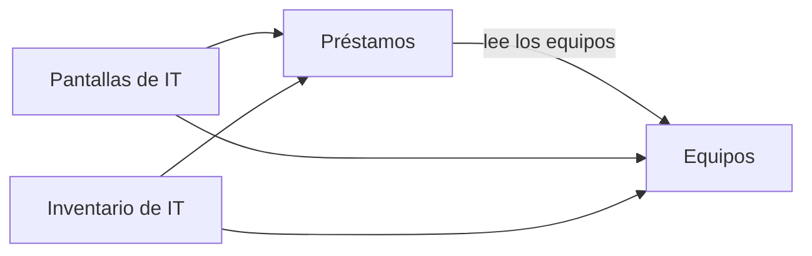

# Arquitectura de «Préstamos de equipos de IT»

## Resumen

La aplicación da al equipo de IT una lista de los equipos de la oficina donde apunta a quién ha prestado cada uno y cuándo lo devuelve. IT la usa desde sus pantallas y el inventario de IT se conecta por la misma API, que el cliente fijó en un anexo.

Se divide en dos contextos delimitados:

- **equipos:** da de alta los equipos y garantiza que su nombre no se repite.
- **prestamos:** apunta préstamos y devoluciones y sirve la lista de equipos con su estado. Depende de «equipos».

## Mapa de contextos

No hay eventos entre contextos.

## Despliegue

El golden path de la constitución, sin salirse del stack: un servicio de Cloud Run con Node.js y TypeScript, un módulo por contexto (`src/equipos` y `src/prestamos`), las pantallas en React (`web/equipos` y `web/prestamos`), inicio de sesión con Google y Firestore.

## Piezas transversales

- **Inicio de sesión.** Todas las rutas de `/api` piden un token de identidad de Google, con el correo verificado y emitido para el cliente OAuth de la aplicación, de una persona o de una cuenta de servicio. Lo comprueba el servidor de la plantilla antes de llegar a los contextos; sin un token válido responde 401 con `{"error": "Inicia sesión con Google."}`. Por ahora no se limita el acceso a las cuentas de IT.
- **Persistencia.** Cada contexto guarda y lee sus datos solo por el puerto de persistencia del golden path y escribe solo en sus colecciones, con su id delante. No hay transacciones que crucen contextos.
- **Llamadas entre contextos.** «prestamos» usa «equipos» en proceso, por su `index.ts`.
- **Contratos primero.** El contrato de cada contexto se escribe y se aprueba antes que el código, y los tipos de datos se generan de él.
- Un cambio de contrato es una tarea propia y en serie. Cambiar un contrato que otro contexto o una tarea ya usa no se hace dentro de otra tarea, y dos cambios de contrato no van a la vez. Si el cambio es incompatible, lleva además su ADR, como dice la constitución.

## Decisiones

Los contratos siguen la API fijada por el cliente en `intent.md`, en lugar de dos convenciones del formato: las rutas no llevan el prefijo `/api/<id>/` y los errores son `{"error": "<mensaje>"}` en `application/json`, no RFC 9457.

- [ADR 0001](../docs/adr/0001-api-fijada-por-el-cliente.md): los contratos siguen la API fijada por el cliente.
- [ADR 0002](../docs/adr/0002-nombre-de-equipo-unico.md): un nombre de equipo no se repite, con un documento por nombre normalizado dentro de una transacción.
- [ADR 0003](../docs/adr/0003-un-prestamo-activo-por-equipo.md): un equipo tiene como mucho un préstamo activo, con un documento por equipo dentro de una transacción.
- [ADR 0004](../docs/adr/0004-lista-de-equipos-en-prestamos.md): la lista de equipos con su préstamo la sirve «prestamos».

No hay decisiones pendientes.

## Supuestos

- [SUPUESTO] El `id` de un equipo es un texto opaco que genera el servidor: el anexo solo lo enseña como «…».
- [SUPUESTO] El nombre de un equipo se guarda sin los espacios del principio y del final, con sus mayúsculas: el anexo solo dice cómo se comparan dos nombres.
- [SUPUESTO] Un nombre con solo espacios cuenta como vacío, y una persona o una fecha vacías cuentan como si faltaran.
- [SUPUESTO] Prestar comprueba en este orden: que estén la persona y la fecha (400), que la fecha sea válida (400), que el equipo exista (404) y que no esté prestado (409). Es el orden en que el anexo enumera los errores.
- [SUPUESTO] Una fecha de devolución con un formato distinto de `AAAA-MM-DD` responde 400 con «La fecha de devolución no es válida»: el anexo solo dice «si no es una fecha real».
- [SUPUESTO] La lista de equipos se devuelve ordenada por nombre: el anexo no fija el orden.
- [SUPUESTO] Las respuestas de préstamo y de devolución llevan los mismos campos que la lista para ese equipo: tras la devolución, `id`, `nombre` y `prestado: false`, sin `persona` ni `devolucion`.
- [SUPUESTO] Las pantallas enseñan a la persona los mismos mensajes que la API devuelve en `error`.
- [SUPUESTO] No hay pantallas solo para IT: cualquier persona con la sesión iniciada las ve, porque por ahora no se limita el acceso a las cuentas de IT.
- [SUPUESTO] La devolución borra el préstamo activo y no se guarda el historial de préstamos, que queda fuera de esta entrega.
- [SUPUESTO] El servidor de la plantilla responde 503 con «Inicio de sesión sin configurar.» cuando la aplicación no tiene cliente OAuth: es un estado de despliegue, fuera de la API del anexo. Punto a comprobar con el cliente.
