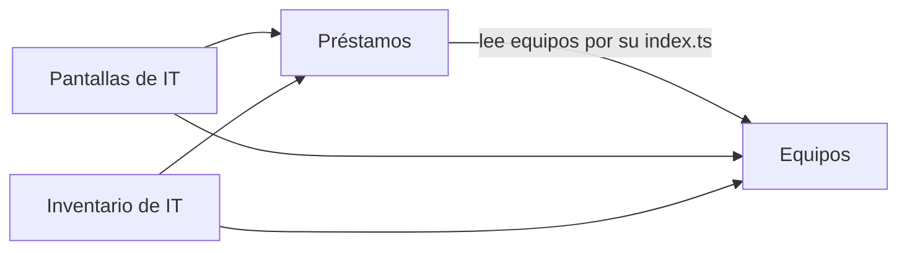

# Arquitectura: Préstamo de equipos de la oficina

## Resumen

La aplicación permite a IT dar de alta los equipos de la oficina, apuntar a quién presta cada uno y hasta cuándo, apuntar la devolución y ver qué está prestado. El inventario de IT usa la misma API con una cuenta de servicio de Google. Se divide en dos contextos: **equipos**, que guarda los equipos y sus nombres, y **prestamos**, que apunta los préstamos activos y sirve la lista de equipos con su préstamo.

## Mapa de contextos

## Despliegue

El golden path de la constitución: un servicio de Cloud Run con un módulo por contexto (`src/equipos`, `src/prestamos`), el frontend React con las pantallas en `web/equipos` y `web/prestamos`, inicio de sesión con Google y Firestore a través del puerto de persistencia `lib/datos.ts`.

## Piezas transversales

- **Inicio de sesión.** El servidor de la plantilla verifica en cada petición a `/api` el token de identidad de Google, con el correo verificado y emitido para el cliente OAuth de la aplicación, de una persona o de una cuenta de servicio. Sin un token válido responde 401 `{"error": "Inicia sesión con Google."}`. No se limita el acceso a un dominio ni a las cuentas de IT.
- **Persistencia.** Cada contexto escribe solo en sus colecciones (`equipos_*`, `prestamos_*`) y las reglas de concurrencia se garantizan con transacciones del puerto de persistencia, nunca entre contextos.
- **Contratos primero.** Cada contrato se escribe y se aprueba antes que el código, y los tipos se generan del contrato.
- Un cambio de contrato es una tarea propia y en serie. Cambiar un contrato que usa otro contexto, una tarea o el inventario de IT nunca se hace dentro de otra tarea, y dos cambios de contrato no van a la vez. Un cambio incompatible lleva además su ADR, como dice la constitución.

## Decisiones

- [ADR 0001](../docs/adr/0001-nombre-de-equipo-unico.md): dos equipos no pueden tener el mismo nombre; documento por nombre normalizado en una transacción.
- [ADR 0002](../docs/adr/0002-un-prestamo-activo-por-equipo.md): un equipo tiene como mucho un préstamo activo; documento de préstamo activo por equipo en una transacción.
- [ADR 0003](../docs/adr/0003-api-fijada-por-el-cliente.md): los contratos siguen la API fijada por el cliente en `intent.md` en lugar de las convenciones del formato: sin el prefijo `/api/<contexto>/` (todas las rutas van bajo `/api/equipos`) y con errores `{"error": "<mensaje>"}` en `application/json` en lugar de RFC 9457.
- [ADR 0004](../docs/adr/0004-lista-de-equipos-en-prestamos.md): `GET /api/equipos` es del contexto prestamos, que depende de equipos, para no crear un ciclo.

No quedan decisiones pendientes.

## Supuestos

- [SUPUESTO] La aplicación tiene pantallas web para IT además de la API, según los supuestos del backlog; el inventario de IT solo usa la API.
- [SUPUESTO] Un nombre formado solo por espacios cuenta como vacío y recibe 400 «Falta el nombre del equipo».
- [SUPUESTO] El nombre normalizado quita los espacios del principio y del final y pasa a minúsculas; los espacios del medio se mantienen.
- [SUPUESTO] El `id` de un equipo lo genera la aplicación y es un texto opaco.
- [SUPUESTO] La lista `GET /api/equipos` no tiene un orden fijado por el cliente; se devuelve por nombre.
- [SUPUESTO] Un cuerpo de alta sin el campo `nombre` o con un valor que no es texto se trata como nombre que falta (400 «Falta el nombre del equipo»), y un préstamo con `persona` o `devolucion` que no son texto, o una `persona` vacía, como datos que faltan (400 «Faltan la persona o la fecha de devolución»).
- [SUPUESTO] Una fecha con otro formato, como «20/11/2026», recibe 400 «La fecha de devolución no es válida».
- [SUPUESTO] No se guarda historial de préstamos: la devolución borra el préstamo activo.
