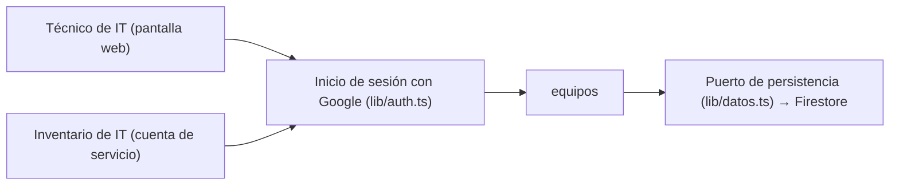

# Arquitectura: préstamo de equipos de la oficina

## Resumen

La aplicación lleva la lista de los equipos de la oficina y sus préstamos: IT da de alta los equipos, apunta a quién presta cada uno y hasta cuándo, apunta la devolución y ve qué está prestado. El inventario de IT usa la misma API, que fijó el cliente. Todo el dominio cabe en un solo contexto, `equipos`; el inicio de sesión con Google es una pieza transversal del golden path.

## Mapa de contextos

## Despliegue

Un servicio de Cloud Run del golden path (Node.js con TypeScript y React), con el módulo `src/equipos`, inicio de sesión con Google y Firestore. El identificador del cliente OAuth llega como `GOOGLE_CLIENT_ID` desde `infra/cloud_run.tf`. Despliega solo el pipeline al integrar en main.

## Piezas transversales

- **Inicio de sesión:** `lib/auth.ts` verifica en cada llamada el token de identidad de Google (correo verificado y emitido para el cliente OAuth de la aplicación) y responde 401 `{"error": "Inicia sesión con Google."}` sin él. Vale también el token de la cuenta de servicio del inventario de IT.
- **Persistencia:** el contexto guarda y lee solo a través de `lib/datos.ts`.
- **Contratos primero:** el contrato `spec/contextos/equipos/api.openapi.json` se aprueba antes que el código, y los tipos se generan de él.

## Decisiones

Ningún ADR todavía en `docs/adr/`. Necesitarán uno:

- Los contratos siguen la API fijada por el cliente en `intent.md` en lugar de las convenciones del formato: las rutas son las del cliente (`/api/equipos`, `/api/equipos/{id}/prestamo`, `/api/equipos/{id}/devolucion`) y no `/api/<id>/<recurso>`, y los errores son `{"error": "<mensaje>"}` en `application/json` en lugar de RFC 9457 (`application/problem+json`).
- Un solo contexto para todo el dominio, con el acceso como pieza transversal y no como contexto propio.
- Nombre único normalizado con Firestore (transacción o documento índice).
- Préstamo sin dobles préstamos a la vez (transacción sobre el equipo).

## Supuestos

- [SUPUESTO] La aplicación es web: la pantalla de IT (inicio de sesión, alta, préstamo, devolución y lista) usa la misma API del contrato.
- [SUPUESTO] El 400 «La fecha de devolución no es válida» comparte el código 400 de «Faltan la persona o la fecha de devolución»; el anexo del cliente solo nombra el segundo, y el primero viene de una decisión del usuario. Conviene comprobarlo con el cliente.
- [SUPUESTO] El 401 `{"error": "Inicia sesión con Google."}` aplica a las cuatro rutas, aunque el anexo no da su mensaje; lo fijó el usuario.
- [SUPUESTO] Los campos `persona` y `devolucion` no aparecen en un equipo no prestado.
- [SUPUESTO] El `id` del equipo es un texto opaco generado por la aplicación.
