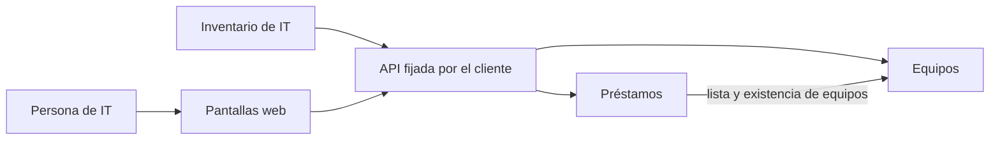

# Arquitectura

## Resumen

La aplicación da al equipo de IT una lista de los equipos de la oficina donde apunta a quién presta cada uno y cuándo lo devuelve. El inventario de IT se conecta a ella por una API que el cliente ha fijado. Se divide en dos contextos delimitados:

- **Equipos:** da de alta los equipos, con un nombre que no se repite.
- **Préstamos:** apunta los préstamos y las devoluciones y enseña la lista de equipos con su préstamo. Depende de «equipos».

## Mapa de contextos

No hay eventos entre contextos.

## Despliegue

El stack de la constitución, sin salirse del golden path: un servicio de Cloud Run con Node.js y TypeScript, React para las pantallas, inicio de sesión con Google y Firestore. Cada contexto es un módulo, `src/equipos` y `src/prestamos`, con sus pantallas en `web/equipos` y `web/prestamos`.

## Piezas transversales

- **Inicio de sesión:** el de la plantilla (`lib/auth.ts`). Cada petición a `/api` lleva un token de identidad de Google, con el correo verificado y emitido para el cliente OAuth de la aplicación, de una persona o de una cuenta de servicio. Sin un token válido, toda ruta responde 401 con `{"error": "Inicia sesión con Google."}`.
- **Persistencia:** solo a través del puerto de persistencia (`lib/datos.ts`), que el servidor pasa a cada contexto. Cada contexto escribe solo en sus colecciones, con su id delante, y no hay transacciones que crucen contextos.
- **Llamadas entre contextos:** en proceso, por el `index.ts` del otro contexto.
- **Contratos primero:** el contrato se escribe y se aprueba antes que el código, y los tipos se generan de él. Un cambio de contrato es una tarea propia y en serie. Si el cambio es incompatible, lleva además su ADR.

## Decisiones

- [ADR 0001](../docs/adr/0001-nombre-de-equipo-unico.md): el nombre de un equipo no se repite, con un documento por nombre normalizado dentro de una transacción.
- [ADR 0002](../docs/adr/0002-un-prestamo-activo-por-equipo.md): un equipo tiene como mucho un préstamo activo, con un documento por equipo dentro de una transacción.
- [ADR 0003](../docs/adr/0003-api-fijada-por-el-cliente.md): los contratos siguen la API fijada por el cliente de `intent.md` en lugar de dos convenciones del formato: el prefijo de ruta `/api/<id>/` y el formato de error RFC 9457. Las rutas son las del cliente y los errores son `{"error": "<mensaje>"}` en `application/json`.
- [ADR 0004](../docs/adr/0004-la-lista-de-equipos-la-sirve-prestamos.md): la lista de equipos con su préstamo (`GET /api/equipos`) la sirve el contexto «prestamos».

No hay decisiones pendientes.

## Supuestos

- [SUPUESTO] El nombre normalizado se obtiene quitando los espacios del principio y del final y pasando a minúsculas; el anexo solo dice que no cuentan las mayúsculas ni esos espacios.
- [SUPUESTO] Un nombre de equipo de solo espacios cuenta como vacío y responde 400 «Falta el nombre del equipo».
- [SUPUESTO] El nombre del equipo se guarda y se devuelve tal como se escribió.
- [SUPUESTO] Una persona vacía o de solo espacios cuenta como que falta y responde 400 «Faltan la persona o la fecha de devolución».
- [SUPUESTO] Una fecha de devolución con otro formato que AAAA-MM-DD responde 400 «La fecha de devolución no es válida», igual que una fecha que no existe.
- [SUPUESTO] Al prestar, se comprueba en este orden: los datos de la petición (400), que el equipo existe (404) y que no está prestado (409). La API del cliente no fija el orden.
- [SUPUESTO] La lista de equipos se devuelve ordenada por nombre; la API del cliente no fija el orden.
- [SUPUESTO] La respuesta de la devolución trae `id`, `nombre` y `prestado: false`, sin `persona` ni `devolucion`; el anexo dice «el equipo y `prestado: false`».
- [SUPUESTO] No se guarda el historial de préstamos: nadie lo pide.
- [SUPUESTO] No se limita el acceso por cuenta ni por dominio: entra cualquier cuenta de Google con un token válido para el cliente OAuth de la aplicación, como dice el anexo «por ahora».
- [SUPUESTO] El contexto «equipos» ofrece a «prestamos» dos lecturas en proceso (listar los equipos y obtener uno por su id) que no son rutas de la API.
- [SUPUESTO] Los identificadores del glosario van en español, como los esquemas de los contratos, de los que se generan los tipos.
- [SUPUESTO] El contexto `ejemplo` que trae la plantilla en `spec/contextos/ejemplo/` no forma parte de esta especificación.
