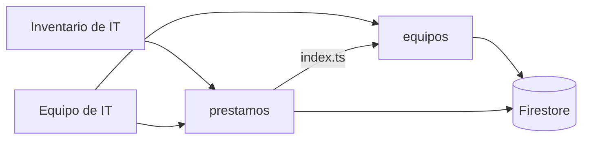

# Arquitectura: préstamo de equipos de la oficina

## Resumen

La aplicación permite al equipo de IT dar de alta los equipos de la oficina, apuntar a quién se presta cada uno y hasta cuándo, apuntar la devolución y ver en todo momento qué equipos están prestados. Otro sistema, el inventario de IT, usa la misma API con una cuenta de servicio de Google.

Se divide en dos contextos:

- **Equipos** (`equipos`): es dueño del inventario y de que un nombre no se repita.
- **Préstamos** (`prestamos`): es dueño de a quién se presta cada equipo y de cuándo vuelve. Depende de `equipos`.

## Mapa de contextos

## Despliegue

Sigue el golden path de la constitución: un solo servicio en Cloud Run con un módulo por contexto (`src/equipos` y `src/prestamos`), inicio de sesión con Google y Firestore, a través del puerto de persistencia de `lib/datos.ts`. Cada contexto escribe solo en sus colecciones: `equipos_equipos` y `equipos_nombres` en `equipos`, y `prestamos_activos` en `prestamos`.

## Piezas transversales

- **Inicio de sesión.** El servidor de la plantilla comprueba el token de identidad de Google de toda petición a `/api`, con el correo verificado y emitido para el cliente OAuth de la aplicación, y responde 401 con «Inicia sesión con Google.» si no es válido. Los contratos lo declaran con el esquema `google`.
- **Persistencia.** Los contextos usan el puerto de persistencia; no hay transacciones que crucen contextos.
- **Contratos primero.** El contrato de cada contexto se escribe y se aprueba antes que el código.
- Un cambio de contrato es una tarea propia y en serie. Cambiar un contrato que otro contexto, una tarea o el inventario de IT ya usan nunca se hace dentro de otra tarea, y dos cambios de contrato nunca se ejecutan a la vez.

## Decisiones

Los contratos siguen la API fijada por el cliente en `intent.md` en lugar de las convenciones del formato. Se sustituyen dos: el prefijo de las rutas (`/api/<id>/`) y el formato de los errores (RFC 9457, que pasa a `{"error": "<mensaje>"}`). Lo decide el [ADR 0003](../docs/adr/0003-api-fijada-por-el-cliente.md).

| ADR | Decisión | Contexto |
|---|---|---|
| [0001](../docs/adr/0001-nombre-de-equipo-unico.md) | Un nombre de equipo no se repite: documento de clave en la misma transacción | equipos |
| [0002](../docs/adr/0002-un-prestamo-activo-por-equipo.md) | Un equipo tiene como mucho un préstamo activo: un documento por equipo | prestamos |
| [0003](../docs/adr/0003-api-fijada-por-el-cliente.md) | Los contratos copian la API fijada por el cliente | equipos, prestamos |

No hay decisiones pendientes.

## Supuestos

- [SUPUESTO] La lista de equipos con su estado (`GET /api/equipos`) es del contexto de préstamos, no del de equipos: necesita el estado de préstamo, y si fuera de `equipos` este dependería de `prestamos` y los dos contextos formarían un ciclo.
- [SUPUESTO] `prestamos` lee los equipos a través del `index.ts` de `equipos`, con una función para obtener un equipo y otra para listarlos. No son rutas de la API: el cliente no las ha pedido y no se añaden a su API.
- [SUPUESTO] Solo se guarda el préstamo activo: al devolver, se borra y no hay historial. La petición no pide historial y la pregunta sigue abierta.
- [SUPUESTO] El identificador del equipo lo genera el servidor y es opaco. El anexo solo dice `"id": "…"`.
- [SUPUESTO] El nombre se guarda sin espacios al principio ni al final y con las mayúsculas con que se escribió; la comparación es sin mayúsculas.
- [SUPUESTO] La persona del préstamo es un texto libre no vacío, sin espacios al principio ni al final.
- [SUPUESTO] Si una petición de préstamo tiene un error de datos y además el equipo no existe, gana el 400 sobre el 404, y el 404 sobre el 409. El anexo lista los errores sin decir el orden.
- [SUPUESTO] Una fecha de devolución con un formato distinto de AAAA-MM-DD recibe el mismo 400 «La fecha de devolución no es válida» que una fecha que no existe.
- [SUPUESTO] Un token con el correo sin verificar o emitido para otro cliente OAuth recibe el mismo 401 «Inicia sesión con Google.».
- [SUPUESTO] La aplicación tiene también pantallas para IT, además de la API. El cliente solo fija la API; si hacen falta las pantallas sigue como pregunta abierta, y las que se describen aquí son las que cubren las historias de una persona.
- [SUPUESTO] Por ahora todas las pantallas las ve cualquier persona con la sesión iniciada, porque el anexo dice que no se limita el acceso a las cuentas de IT.
- [SUPUESTO] El contexto `ejemplo` de la plantilla no forma parte de la aplicación: no está en el manifiesto. Su carpeta `spec/contextos/ejemplo/` se puede borrar.
