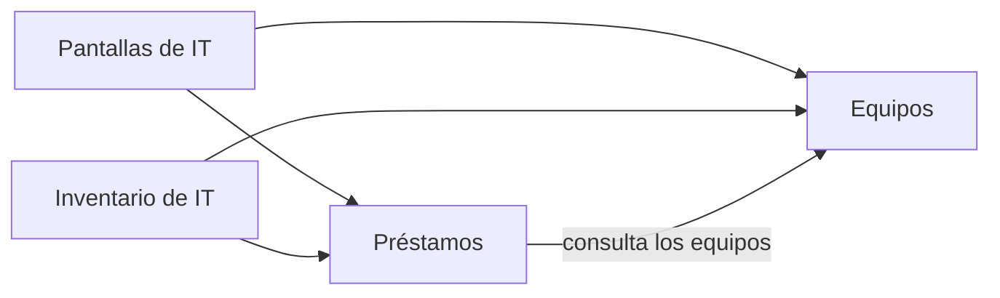

# Arquitectura

## Resumen

La aplicación da al equipo de IT una lista de los equipos de la oficina donde apunta a quién ha prestado cada uno y cuándo lo devuelve. El inventario de IT usa la misma API con una cuenta de servicio. Se divide en dos contextos:

- **Equipos**: da de alta los equipos y garantiza que no hay dos con el mismo nombre.
- **Préstamos**: apunta préstamos y devoluciones y sirve la lista de equipos con su préstamo. Depende de «equipos».

## Mapa de contextos

No hay eventos entre contextos.

## Despliegue

El golden path de la constitución: un servicio de Cloud Run con Node.js y TypeScript, un módulo por contexto (`src/equipos`, `src/prestamos`), las pantallas en React (`web/equipos`, `web/prestamos`), inicio de sesión con Google y Firestore.

## Piezas transversales

- **Inicio de sesión.** El servidor de la plantilla comprueba en cada ruta de `/api` el token de identidad de Google, con el correo verificado y emitido para el cliente OAuth de la aplicación, de una persona o de una cuenta de servicio. Sin un token válido responde 401 con `{"error": "Inicia sesión con Google."}` antes de llegar al contexto. Los contextos no repiten esa comprobación ni limitan el acceso a las cuentas de IT.
- **Persistencia.** Cada contexto guarda y lee sus datos solo por el puerto de persistencia (`lib/datos.ts`), en colecciones con su id delante. No hay transacciones que crucen contextos; «préstamos» consulta los equipos por el `index.ts` de «equipos».
- **Contratos primero.** El contrato de cada contexto se escribe y se aprueba antes que el código, y los tipos se generan de él.
- Un cambio de contrato es una tarea propia y en serie. Si además es incompatible, lleva su ADR, como pide la constitución.

## Decisiones

- [ADR 0001](../docs/adr/0001-api-fijada-por-el-cliente.md): los contratos siguen la API fijada por el cliente en `intent.md` en lugar de las convenciones del formato. Sustituye dos: el prefijo de ruta `/api/<id>/` (las rutas son `/api/equipos`, `/api/equipos/{id}/prestamo` y `/api/equipos/{id}/devolucion`) y el formato de error RFC 9457 (los errores son `{"error": "<mensaje>"}` en `application/json`).
- [ADR 0002](../docs/adr/0002-nombre-de-equipo-unico.md): no hay dos equipos con el mismo nombre, con un documento por nombre normalizado en una transacción.
- [ADR 0003](../docs/adr/0003-un-prestamo-activo-por-equipo.md): un equipo tiene como mucho un préstamo activo, con un documento por equipo en una transacción.
- [ADR 0004](../docs/adr/0004-la-lista-de-equipos-esta-en-prestamos.md): la lista de equipos (`GET /api/equipos`) la sirve «préstamos».

No hay decisiones pendientes.

## Supuestos

- [SUPUESTO] Las historias del acceso con Google no tienen datos propios: se apoyan en el inicio de sesión de la plantilla. La de las personas va en «equipos» y la del inventario de IT, en «préstamos», que sirve la lista que el inventario consulta.
- [SUPUESTO] El `id` de un equipo lo genera la aplicación como un texto opaco; la API del cliente solo dice que es un texto.
- [SUPUESTO] En el alta, un nombre que solo tiene espacios cuenta como vacío, y el nombre se guarda y se devuelve como se recibió; la API del cliente solo dice «si el nombre falta o está vacío».
- [SUPUESTO] Al prestar, una persona o una fecha vacías cuentan como si faltaran, y un texto que no tiene la forma `AAAA-MM-DD` es una fecha no válida.
- [SUPUESTO] Si la petición de préstamo tiene varios fallos, se comprueban en este orden: 404 si el equipo no existe, 400 si faltan datos, 400 si la fecha no es válida y 409 si ya está prestado. La API del cliente no fija el orden.
- [SUPUESTO] La lista de equipos no tiene un orden fijado por el cliente; se devuelve por nombre.
- [SUPUESTO] La pantalla de alta enseña el equipo recién creado con la respuesta del alta; la lista completa está en la pantalla de «préstamos», porque «equipos» no depende de «préstamos».
- [SUPUESTO] Las pantallas las ve cualquier persona con la sesión iniciada: el cliente dice que por ahora no hace falta limitar el acceso a las cuentas de IT.
- [SUPUESTO] El contexto de ejemplo de la plantilla (`spec/contextos/ejemplo/`) no forma parte de esta especificación y no se ha tocado.
