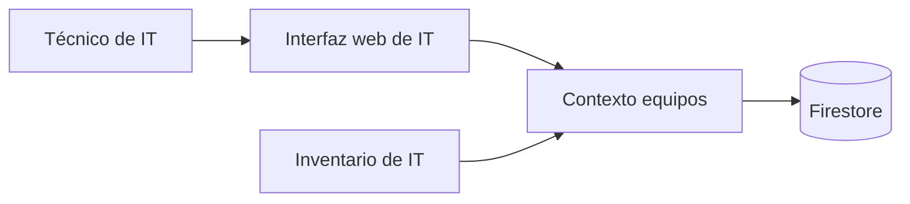

# Arquitectura de Préstamo de equipos de IT

## Resumen

La aplicación da a IT una lista de los equipos de la oficina donde dar de alta cada uno, apuntar su préstamo con la persona y la fecha de devolución, apuntar la devolución y ver en todo momento qué está prestado, a quién y hasta cuándo. El inventario de IT se conecta a la misma API con una cuenta de servicio de Google. El backlog es pequeño y su dominio es uno solo, así que hay un único bounded context, `equipos`, dueño de los equipos y de su préstamo en curso.

## Mapa de contextos

## Despliegue

Golden path de la constitución: un servicio de Cloud Run con Node.js y TypeScript, el frontend en React servido por el mismo servicio, inicio de sesión con Google y Firestore. El contexto vive en `src/equipos` y se registra en `app/contextos.ts`.

## Piezas transversales

- **Inicio de sesión:** el servidor del golden path (`app/server.ts` y `lib/auth.ts`) verifica en cada petición a `/api` el token de identidad de Google (audiencia del cliente OAuth de la aplicación y correo verificado) y responde 401 con `{"error": "Inicia sesión con Google."}` sin él. Vale para personas y cuentas de servicio; no se limita a las cuentas de IT.
- **Persistencia:** el contexto usa solo el puerto `lib/datos.ts`, con sus colecciones `equipos_equipos` y `equipos_nombres`, y sus transacciones para las reglas de unicidad y de préstamo.
- **Contratos primero:** el contrato `spec/contextos/equipos/api.openapi.json` se aprueba antes que el código, y los tipos se generan de él.

## Decisiones

Esta versión del arquitecto no escribe ADR. Necesitarán uno de la aplicación:

- **API fijada por el cliente.** El contrato de `equipos` sigue la API fijada por el cliente de `intent.md` en lugar de las convenciones del formato: los caminos son `/api/equipos`, `/api/equipos/{id}/prestamo` y `/api/equipos/{id}/devolucion` (sin el prefijo `/api/<id>/` sobre un recurso propio) y los errores son `{"error": "<mensaje>"}` en `application/json`, no RFC 9457.
- **Un solo contexto** para equipos y préstamos: el préstamo en curso es parte del equipo, porque la API solo expone el estado actual.
- **Unicidad del nombre** con la colección `equipos_nombres` dentro de una transacción (concurrencia).
- **Préstamo y devolución en una transacción** sobre el documento del equipo, para no prestar dos veces el mismo equipo (concurrencia).

## Supuestos

- [SUPUESTO] El préstamo en curso se guarda dentro del documento del equipo y no hay historial de préstamos — el backlog no pide historial y la API solo expone el estado actual.
- [SUPUESTO] El id de un equipo lo genera la aplicación como texto opaco — la API solo dice `"id": "…"`.
- [SUPUESTO] La lista de equipos se devuelve sin un orden fijado — la API no dice ninguno.
- [SUPUESTO] Un nombre formado solo por espacios cuenta como vacío y da 400 «Falta el nombre del equipo» — supuesto del backlog.
- [SUPUESTO] Una fecha de devolución en otro formato, como «20/11/2026», da 400 «La fecha de devolución no es válida» — supuesto del backlog.
- [SUPUESTO] Una persona vacía («») cuenta como persona que falta y da 400 «Faltan la persona o la fecha de devolución» — la API dice «Faltan la persona o la fecha de devolución» sin distinguir vacío de ausente.
- [SUPUESTO] Los esquemas de las peticiones no marcan campos obligatorios, para que los mensajes de error sean los del cliente y no los de la validación del servidor.
- [SUPUESTO] El contexto de ejemplo de la plantilla (`spec/contextos/ejemplo/` y `src/ejemplo`) no forma parte de la aplicación; se retira en el plan técnico.
